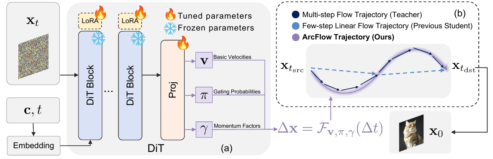
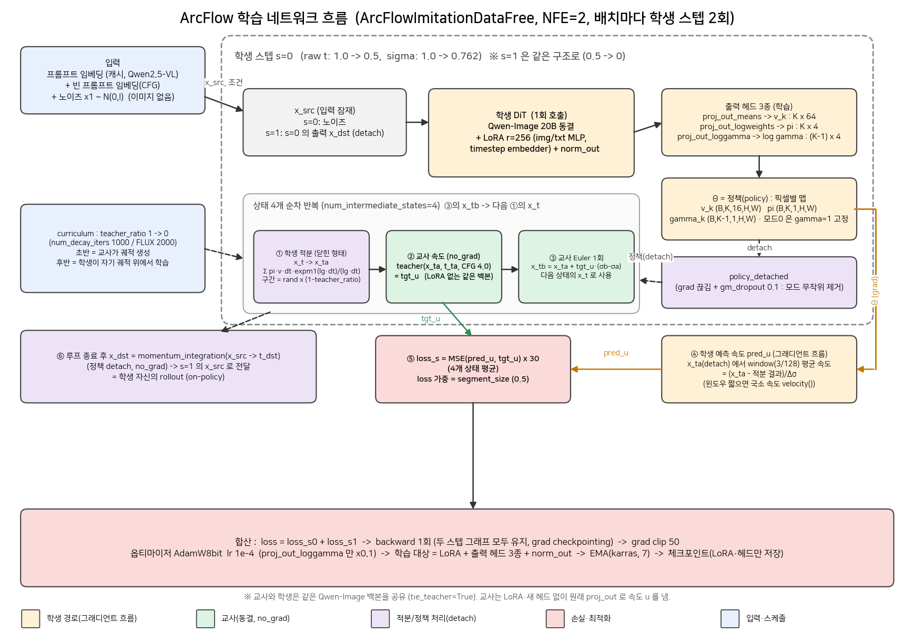
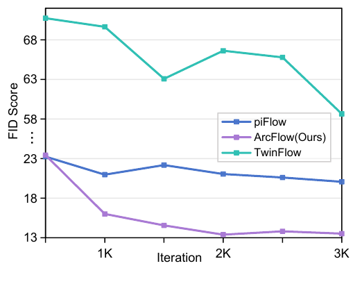

# ArcFlow — 지수 모멘텀 혼합으로 2-step 증류 (Qwen-Image-20B / FLUX.1-dev)

## 1️⃣ 메타 정보

*왜 이 장을 두나: 논문·코드·사용 모델의 출처를 한곳에 모아, 나중에 같은 자료를 바로 다시 찾기 위해서.*

| 항목 | 내용 |
|---|---|
| 제목 | ArcFlow: Unleashing 2-Step Text-to-Image Generation via High-Precision Non-Linear Flow Distillation |
| 저자 | Zihan Yang\*, Shuyuan Tu\*, Licheng Zhang, Qi Dai(MSRA), Yu-Gang Jiang, Zuxuan Wu (Fudan Univ.) |
| 공개일 | 2026-02-09 (arXiv v1) |
| 분야 | few-step distillation(소수 스텝 증류), text-to-image, flow matching |
| 링크 | [arXiv abs](https://arxiv.org/abs/2602.09014) / [PDF](https://arxiv.org/pdf/2602.09014) |
| 코드 | [pnotp/ArcFlow](https://github.com/pnotp/ArcFlow) (Apache-2.0, 최종 커밋 2026-05-20), 체크포인트 [ymyy307/ArcFlow](https://huggingface.co/ymyy307/ArcFlow) |
| 선생(teacher) | Qwen-Image-20B, FLUX.1-dev |
| 비교 대상 | Qwen-Image-Lightning(VSD류), TwinFlow(self-adversarial), pi-Flow(GMFlow 정책), SenseFlow(DMD) |
| 학습 데이터 | pi-Flow 공개 프롬프트 230만 (Lakonik/t2i-prompts-3m), 이미지 없는 data-free |
| 학습 자원 | 논문: 96×H100, batch 384 / 코드 README: GPU당 약 70GB |
| 코드 리뷰 기준 | 정적 분석만 수행 (GPU·가중치 없어 실행 검증은 못 함) |

---

## 2️⃣ 주요 용어 사전 (Glossary)

*왜 이 장을 두나: 본문에 증류 계열 용어가 많이 나오므로, 본문 위에서 한 번에 풀어 두면 뒤에서 막히지 않는다.*

### 기본 개념
| 용어 | 풀이 |
|---|---|
| flow matching(흐름 매칭) | 노이즈에서 이미지로 가는 길을 따라 "지금 어느 방향으로 얼마나 가야 하나"(velocity, 속도)를 학습하는 생성 방식 |
| velocity(속도) / velocity field(속도장) | 잠재(latent) 위의 각 점·시각에서의 이동 방향과 크기. 이 논문에서는 노이즈−데이터 방향 |
| NFE | 네트워크를 몇 번 불렀는지 (Number of Function Evaluations). 2-NFE = 모델 2번 호출로 이미지 완성 |
| PF-ODE | probability flow ODE. 속도장을 적분하면 노이즈→이미지 궤적이 되는 결정론적 미분방정식 |
| trajectory(궤적) | 노이즈에서 이미지로 가는 한 줄의 길. 접선(tangent)=그 점의 속도 |
| distillation(증류) | 50스텝 선생의 능력을 2스텝 학생에게 옮기는 학습 |
| teacher / student | 증류의 원본(느리고 정확) / 결과물(빠르고 가벼움) |
| CFG | classifier-free guidance. 프롬프트를 더 잘 따르게 하는 추론 기법. 선생은 두 번 계산해야 해서 Qwen-Image는 50×2=100 NFE |
| LoRA | 큰 가중치는 얼리고 작은 보조 행렬만 학습하는 어댑터(adapter) 방식 |
| shift(timestep shift) | 시간축을 노이즈 쪽으로 휘게 하는 변환. 이 논문 학습/추론은 shift=3.2 고정 |

### ArcFlow 고유 개념
| 용어 | 풀이 |
|---|---|
| momentum factor γ(모멘텀 계수) | 한 스텝 안에서 속도가 시간에 따라 늘어나는지(γ>1) 줄어드는지(γ<1)를 정하는 수. γ=1이면 일정(직선) |
| mixture of K modes(K개 모드 혼합) | 속도를 "기본 속도 v_k × γ_k 곡선"을 K개 섞어 표현. 기본 K=16 |
| gating probability π(게이트 확률) | K개 모드를 얼마씩 섞을지 정하는 가중치 (softmax) |
| analytic transition operator(닫힌 형태 이동량) | 지수함수 합을 적분한 정답식. 수치 적분 없이 한 번에 스텝 끝점 계산 |
| linear shortcut(직선 지름길) | 한 스텝을 직선 한 번으로 건너뛰는 기존 증류의 가정 |
| geometric mismatch(기하 불일치) | 선생 궤적은 굽어 있는데 학생은 직선으로 근사해서 생기는 어긋남 (논문의 문제 설정) |
| mixed trajectory integration(혼합 궤적 적분) | 학습 초반엔 선생이 궤적을 만들고 점차 학생이 넘겨받는 curriculum(교과과정) |
| data-free | 실제 이미지 없이 프롬프트만으로 학습 (학생이 직접 rollout해서 만든 잠재 사용) |
| on-policy | 학생 자신이 만든 상태 위에서 선생의 정답을 받는 학습 방식 |

### 평가 지표
| 용어 | 풀이 |
|---|---|
| FID / pFID (vs teacher) | 50스텝 선생 출력과의 분포 거리 / 패치 단위 버전. **선생을 얼마나 닮았나**의 지표이지 절대 품질 지표가 아님 |
| GenEval / DPG-Bench / OneIG | 프롬프트 정합(alignment) 벤치마크. OneIG는 Alignment·Text·Diversity·Style·Reasoning 5축 |
| Align5000 | 논문이 직접 만든 5000 프롬프트 세트 (HPSv2 3200 + COCO 1800) |

---

## 3️⃣ 논문 요약 (TL;DR)

**한 줄**: 2스텝 학생의 스텝 내부 속도를 "K개 지수 곡선의 가중합"으로 두고 적분을 닫힌 식으로 풀어, LoRA(약 4.5%)만 학습해 선생에 가까운 품질과 다양성을 2 NFE로 얻는다.

**핵심 문제**: 기존 증류는 한 스텝을 직선으로 건너뛴다(linear shortcut). 선생 궤적은 접선이 계속 바뀌므로 학생은 선생 가중치를 덮어써야 하고, 그래서 전체 파라미터 학습이나 GAN류 손실이 필요하다고 논문은 주장한다.

**해결책**: 네트워크 1회 호출로 토큰(픽셀)마다 (v_k, γ_k, π_k) K세트를 예측 → 스텝 안의 속도 = 합(π_k · v_k · γ_k^시간) → 적분은 닫힌 형태 → 학습은 선생 속도와의 MSE만 사용.

**검증**: Qwen-Image 2-NFE에서 GenEval 0.85, DPG 88.46, OneIG-Diversity 0.182(Lightning 0.098), Align5000 FID 12.40으로 최저. FLUX도 선생 수준 (자세한 수치 → 6장).

**이 문서의 평가 (요지)**: 구현 완성도와 공개 범위는 좋으나, "비선형 궤적이 원인"이라는 인과 주장은 입증이 약하다. 코드는 pi-Flow 포크이며 논문 서술과 어긋나는 구현이 여러 곳이다 (→ 7장).

---

## 4️⃣ 핵심 기여 (Contributions)

1. **지수 모멘텀 혼합 정책**: 스텝 내부 속도를 γ^시간 곡선 K개의 혼합으로 파라미터화. 닫힌 형태 적분으로 수치 적분 오차가 없다고 주장.
2. **Theorem 1**: K≥N이면 N개 시각의 속도를 정확히 맞추는 파라미터가 존재 (Chebyshev system 증명).
3. **혼합 궤적 적분 + 순간 속도 매칭 증류**: 선생이 만든 궤적에서 학생이 점차 넘겨받는 curriculum + MSE 한 가지 손실.
4. **효율 주장**: 학습 가능 파라미터 5% 미만(LoRA), 2 NFE, 판별기·fake-score 네트워크 불필요, 다양성 보존.

> 기여 평가: 1·4는 실용적 가치가 있으나 "최초의 비선형 증류" 표현은 과장 (pi-Flow도 스텝 내 비선형 정책). 2는 보간 사실에 가깝다 (→ Q1).

---

## 5️⃣ 주요 알고리즘 설명

*왜 이 장을 두나: 논문에 쓰인 식과 실제 코드가 달라서, "논문 식 → 코드 위치 → 실제 값"을 한 표로 묶어 두지 않으면 재현 시 혼동되기 때문.*

### 5.1 속도 모델 (Eq. 2)

*왜 이렇게 쓰나: 한 번의 호출로 스텝 전체의 속도 변화를 예측하려면, 시간에 대한 함수를 몇 개의 파라미터로 압축해야 하기 때문.*

스텝 안에서 시각 t의 속도는 (식을 말로 풀면):
**속도(t) = 모든 모드 k에 대해 [ π_k × v_k × γ_k의 (시간 경과)제곱 ] 의 합**

- γ_k>1이면 스텝이 진행될수록(t가 0에 가까울수록) 속도가 커지고, γ_k<1이면 작아진다. γ=1이면 일정.
- 비유: "출발 속도 하나에 가속·감속 곡선 16종을 섞어 한 스텝의 속도 변화를 그린다."

### 5.2 닫힌 형태 이동량 (Eq. 4, 5)

*왜 필요한가: 곡선 속도를 직접 적분하려면 서브스텝이 필요한데, 지수함수는 적분이 정확히 풀려서 한 번에 끝점을 구할 수 있다.*

모드 k의 이동량 = v_k × C(γ_k), C = (γ^(1−t_e) − γ^(1−t_s)) / ln γ (γ=1이면 t_s−t_e). 최종 x_te = x_ts − Σ π_k v_k C_k. γ→1에서 연속(극한 증명 부록 E.1).

### 5.3 학습 (Alg.1, 코드 `piid_segment_momentum`)

*왜 이렇게 학습하나: 선생의 정답 궤적 자체는 얻을 수 없으니(속도만 예측), 학생이 만든 경로 위의 여러 점에서 선생 속도를 받아 "ODE를 만족하게" 맞춘다(collocation).*

1. 시작점에서 학생 1회 호출 → Θ=(v, γ, π) 획득
2. 스텝 안 상태 4개를 뽑아 (선생이 일부, 학생이 나머지) 혼합 적분으로 잠재 생성, detach
3. 그 점에서 선생 속도(교사 호출)와 학생 속도(Θ에서 공식 계산)의 MSE

### 5.3-b 학습 네트워크 전체 흐름 (코드 기준 `ArcFlowImitationDataFree`)

*왜 그리나: 5.3의 세 줄 요약만으로는 "어느 호출에 그래디언트가 흐르고 어느 호출이 detach인지", "2번째 스텝 입력이 어디서 오는지"가 안 보여서, 한 장에 흐름을 모아 둔다.*

읽는 순서:
1. 프롬프트 임베딩(캐시)과 노이즈만 입력 (이미지 없음). 학생 DiT를 1회 호출해 정책 Θ(픽셀별 v_k, π, γ)를 얻는다.
2. 상태 4개를 순차로 만든다: ① 학생이 닫힌 식으로 x_ta까지 적분(정책은 detach, 모드 드롭아웃 0.1) → ② 교사가 x_ta에서 속도 tgt_u 계산(CFG 4.0, no_grad) → ③ 교사 Euler 1회로 x_tb를 만들어 다음 상태의 시작점으로.
3. 그래디언트는 ④ 하나의 경로로만 흐른다: Θ에서 x_ta의 짧은 윈도우 평균 속도 pred_u를 공식으로 계산 → ⑤ MSE(pred_u, tgt_u). 즉 **학생 네트워크는 스텝당 1회만 돌고**, 상태 4개의 손실은 같은 Θ를 재사용한다.
4. 루프 후 정책으로 x_dst까지 적분(detach)해 s=1의 입력으로 넘긴다 (on-policy rollout).
5. 두 스텝 손실을 합쳐 backward 1회, AdamW8bit으로 LoRA·헤드 3종·norm_out만 갱신, EMA 유지.

비용 감각: 학생 forward/backward 2회 + 교사 forward 8회(상태 4개×스텝 2개, Qwen은 CFG로 각각 2배 → 최대 16회 평가).

### 5.4 논문 ↔ 코드 대조표 ⭐

*왜 정리하나: 이 표가 재현 시 가장 먼저 확인해야 할 체크리스트.*

| 항목 | 논문 | 코드 (`lakonlab/…`) |
|---|---|---|
| γ, π 단위 | 스칼라 γ_k ∈ R+ | **픽셀(토큰)별 맵** (B,K−1,1,H,W). 16 채널 공유, v_k만 픽셀×채널 |
| 속도 앵커/시간축 | γ^(1−t), t∈[0,1] (식 2) | exp(logγ × (σ_src−σ)) → **shift된 sigma**, 앵커는 스텝 시작점 (식 1에 가까움) |
| 모드 수 | K=16, (N_v,N_γ)=(K,K) | 모드 0은 **γ=1 영구 고정** → γ는 15개 (실제 (K,K−1)) |
| γ 초기 범위 | 표6 [0.5,4.0] / 부록 C.2 [0.4,5.0] | `init_weights` [0.2,4.0] (**세 곳이 모두 다름**) |
| 옵티마이저 | AdamW | **AdamW8bit** (γ 헤드 lr×0.1은 일치) |
| 총 스텝 | Qwen 7500 / FLUX 8000 | total_iters 15000 / 10000 (멀티스텝 iteration 2배 카운팅으로 **추정**, 러너 미확인) |
| 손실 | 순간 속도 매칭 (식 7) | `window_substeps=3`: 짧은 구간(raw 약 0.023) **평균 속도** vs 선생 국소 속도. pi-Flow 계승, 논문 미기재 |
| 혼합 적분 | 식 6: 서브구간마다 교사→학생 1회 handoff | 상태 4개에 대해 학생 적분 → 교사 1회 Euler 교차 반복. curriculum 끝(teacher_ratio=0)엔 점 샘플링만 |
| 선생 구간 | 상수 속도(Euler) | 일치 |
| 추가 기법 | 없음 | `gm_dropout=0.1`(궤적 생성 정책 모드 드롭), 손실 스케일 30, norm_out도 학습 |
| 학습 방식 | 알고리즘 1 "Initialize x_src" | `ArcFlowImitationDataFree`: 2번째 스텝 입력 = **학생 1스텝 출력(detach)**, 완전 on-policy |
| CFG | 미기재 | Qwen true-CFG **4.0**, FLUX distilled guidance **3.5** |
| shift | 미기재 | 3.2 고정 |

### 5.5 초기화 설계 (코드에서만 드러남)

*왜 중요한가: "빠른 수렴"의 실체가 비선형성보다 이 초기화일 가능성이 높기 때문.*

- 사전학습 출력 헤드(proj_out)를 K번 복제 → 모든 모드가 선생 속도로 시작 (편향에만 0.05 노이즈)
- LoRA는 B=0, 게이트 균등(logweights 0), γ 헤드 가중치 0 + 편향에 로그 간격 γ 값
- 스텝 시작점에서는 모든 감쇠 인자가 1 → **초기 학생이 시작 순간에 선생 속도와 정확히 일치**
- log γ 예측(양수 보장) + γ 헤드 학습률 0.1배로 지수 폭주 방지
- 학습 파라미터: rank-256 LoRA(img/txt MLP, timestep embedder, 59블록 txt_mlp) + 출력 헤드 ≈ 0.94B ≈ 20B의 4.7% (Fig.1의 "1.8G"는 바이트)

### 5.6 비선형성이 실제로 발현되는 크기

*왜 계산하나: "곡선 궤적"이 스텝별로 실제 얼마나 굽는지 보려면 sigma 구간을 따져야 한다.*

shift=3.2에서 raw t=0.5 ↔ sigma≈0.762.

| 스텝 | sigma 구간 (폭) | γ∈[0.2,4] 때 속도 배율 범위 |
|---|---|---|
| 1 | [0.762, 1] (0.238) | 약 0.68 ~ 1.39 |
| 2 | [0, 0.762] (0.762) | 약 0.29 ~ 2.88 |

→ 비선형성은 사실상 2번째 스텝에서 주로 발현.

---

## 6️⃣ 실험 요약

*왜 이 장을 두나: 논문의 주장이 어떤 숫자로 뒷받침되는지, 어디까지가 우위이고 어디서 지는지 한눈에 보기 위해서.*

### 6.1 메인 결과 (2 NFE, 1024²)

| 모델 | GenEval | DPG | OneIG Align | Text | Diversity | Style | Reasoning |
|---|---|---|---|---|---|---|---|
| Qwen-Image 선생 (50×2) | 0.87† | 88.32† | 0.880† | 0.888† | 0.194† | 0.427† | 0.306† |
| Lightning | 0.85 | 88.42 | 0.875 | **0.879** | 0.098 | 0.415 | **0.292** |
| pi-Flow | 0.83 | 86.45 | 0.837 | 0.634 | 0.176 | 0.382 | 0.259 |
| TwinFlow | 0.82 | 87.01 | 0.862 | 0.825 | 0.130 | 0.364 | 0.267 |
| **ArcFlow-Qwen** | 0.85 | 88.46 | 0.877 | 0.853 | **0.182** | 0.421 | 0.289 |
| FLUX 선생 (50) | 0.66 | 84.16 | 0.790† | 0.556† | 0.238† | 0.307† | 0.257† |
| **ArcFlow-FLUX** | 0.65 | 84.29 | 0.798 | 0.368 | 0.210 | 0.350 | 0.224 |

(† 타 논문 인용값. 선생은 직접 평가가 아님.) 정합 점수는 Lightning과 동급이고, **우위는 Diversity(+85.7%)와 선생 유사도**에 한정. Text 렌더링은 Lightning에, Reasoning도 근소하게 짐. FLUX Text는 선생 0.556 대비 0.368로 크게 하락.

### 6.2 선생 유사도 (Align5000, vs 50스텝 선생)

| 모델 | FID | pFID | CLIP |
|---|---|---|---|
| ArcFlow-Qwen | **12.40** | **3.78** | 0.325 |
| TwinFlow | 16.77 | 4.34 | 0.320 |
| Lightning | 16.86 | 11.32 | 0.320 |
| pi-Flow(Qwen) | 20.07 | 12.42 | 0.323 |
| ArcFlow-FLUX | **16.83** | 11.20 | 0.315 |
| SenseFlow(FLUX) | 27.55 | **9.25** | 0.311 |
| pi-Flow(FLUX) | 32.62 | 37.84 | 0.314 |

FLUX의 pFID는 SenseFlow가 낮음 → 본문 "두 백본 모두 FID·pFID 최저"는 틀린 서술.

### 6.3 Ablation (1500 스텝 학습, Align5000 FID)

| 실험 | 설정 → FID |
|---|---|
| 모멘텀 γ | 항상 1 → 17.06 / 고정 → 14.77 / 학습 → 14.56 |
| (N_v,N_γ), K=16 | (K,1) 15.08 / (1,K) 14.97 / (K,K) 14.56 |
| 모드 수 K (풀학습) | 8 → 12.54, 16 → 12.40, 32 → 12.39 (pFID 4.17/3.78/3.69) |
| 혼합 적분 (3K iter, 배치 16) | Qwen 14.04→13.52, FLUX 19.17→18.21 |

단일 시드, 차이 대부분 0.2~1.0.

### 6.4 추론 시간 (2 NFE, 1024²)

Qwen: Lightning 1.718s / TwinFlow 1.372s / pi-Flow 1.440s / ArcFlow 1.411s. FLUX: SenseFlow 1.432s / pi-Flow 1.470s / ArcFlow 1.466s. **선생 시간 없음 → "40× 가속"은 표로 검증 불가** (NFE 비로는 100/2=50×).

### 6.5 수렴 비교 (Fig.2)

배치 16, 3K iteration까지의 Align5000 FID. 조건: 베이스라인은 "공식 코드대로" 학습, ArcFlow는 선생 근처 초기화라 출발이 유리.

### 6.6 한계 (논문 부록 G)

1-NFE로 돌리면 흐려져 실패. 원인을 "γ 예측이 민감해서"라 하나 검증 실험 없음. 스케일 검증은 future work.

---

## 7️⃣ 💬 Q&A

### Q1. 논문 상세 리뷰: 어디가 강하고 어디가 약한가?

*왜 이 질문: 논문의 인과 주장("비선형 궤적이 좋다")이 증거로 뒷받침되는지 가르기 위해서.*

**강점**
- 별도의 fake-score 네트워크·판별기가 없고 선생과 베이스를 공유 → 메모리/구현이 가벼움
- 닫힌 형태 적분과 안정화(log γ, 작은 lr, 기하 초기화)가 정확
- 다양성 보존: Diversity 0.182 (선생 0.194)로 DMD/VSD류보다 우수

**급소 ①: "최초의 비선형 궤적" 과장**
pi-Flow도 한 번 호출로 스텝 내 비선형 정책을 만들고 같은 imitation 방식으로 학습한다. 차이는 정책 파라미터화(가우시안 혼합 대 지수 혼합)와 닫힌 적분. 또 "linear shortcut"은 Lightning(VSD/DMD류)에는 맞지 않는 묘사 (분포를 맞출 뿐 궤적을 맞추지 않음).

**급소 ②: 2-step 추론에서는 곡선 모양이 쓰이지 않는다**
추론은 스텝 끝점만 쓴다. "이산화 오차 제거"는 선형 학생에겐 애초에 해당 없음. 비선형성이 하는 실제 일은 (a) 학습 중 여러 시점 속도 감독, (b) K개 벡터의 출력 용량 (γ≡1이면 K개를 섞어도 실효 벡터 1개로 붕괴), (c) 5.5의 초기화. 이 셋이 분리되어 있지 않다.

**급소 ③: ablation이 약하다**
γ 고정(14.77) vs 학습(14.56)은 차 0.2, (K,1)/(1,K)/(K,K)는 ≤0.5, K=8/16/32는 거의 동일 → 혼합 개수가 본질이 아님. K=1~2 실험 없음, 시드 1개. 의미 있는 격차는 γ≡1(17.06) 대 γ 도입(~14.6) 하나뿐인데, γ≡1은 "속도 하나로 중간 속도들만 맞추는" 약한 선형 기준선이다. 평균속도·x0 직접 회귀 등 강한 선형 기준선과의 비교가 없다.

**급소 ④: Theorem 1은 장식에 가깝다**
증명은 맞지만 "K개 점을 K개 지수로 보간할 수 있다"는 보간 사실. 고정된 y에서 서로 다른 t의 속도를 다루는데, 실제 학습은 x가 변하는 경로를 따라간다. 또 w_k=π_k·v_k로만 쓰이므로 v_k가 자유이면 π는 완전히 중복(게이트 확률 해석은 실질 제약 없음).

**급소 ⑤: FID의 의미**
FID/pFID는 "선생 출력 대비" 5000장 기준이고 ArcFlow가 직접 최적화하는 목표와 일치한다. 분포를 다르게 맞추는 DMD류에는 불리한 척도이며, HPS·ImageReward·Aesthetic·사용자 연구가 없다. 또 부록 B는 "낮은 FID가 블러"라 쓰는데 "높은 FID"의 오기, pFID의 patch 64 / stride 128 정의도 이상하다.

**급소 ⑥: 비교 공정성**
선생 수치는 타 논문 인용(†), 학생은 직접 평가. Lightning은 원래 4/8스텝 LoRA로 알고 있어(확인 필요) 2스텝 평가가 설계점 밖일 수 있고 체크포인트도 불명. 수렴 비교(Fig.2)는 배치 16으로 3K iteration만 보고, 베이스라인 학습 조건이 ArcFlow에 유리할 수 있다. GPU-시간 비교 없음.

**급소 ⑦: "40× 가속" 근거 없음** (6.4 참조).

**급소 ⑧: 알고리즘 명세 공백** → 코드로 일부 해소됨 (5.4 표: 시작 잠재변수, CFG, shift, γ 단위). 남은 불일치: γ 초기 범위 3종, "한 모드 γ=1 고정"의 의미, 식 6 적분 구간 표기 오류, 선생 구간이 Euler 1회라 "충분히 작다"는 가정이 20B 선생에겐 느슨.

**총평**: 증류 레시피로는 매력적이나 "곡선 궤적이 원인"이라는 인과는 현재 증거로 입증되지 않았다.

### Q2. 공개 코드는 어떤가? (논문과의 관계, 버그)

*왜 이 질문: 코드가 공개되어 재현 가능해 보이지만, 논문 서술과의 차이를 모르면 결과를 못 맞추기 때문.*

**코드의 정체: pi-Flow 포크**
- 폴더 `lakonlab`, 헤더 "Copyright (c) 2025 Hansheng Chen", `piid_segment_momentum`, 정책 docstring의 "Gaussian components", 파이프라인의 "GMFlow/DX" 문구가 모두 pi-Flow 흔적.
- ArcFlow 고유 코드는 (a) 정책 `velocity`, (b) `momentum_integration`, (c) γ 헤드와 초기화로 좁혀진다. 학습 루프·데이터·imitation 구조·샘플러 골격은 pi-Flow 그대로.

**논문 서술과 코드의 차이** → 5.4 표 참조.

**버그·위험**

| 항목 | 내용 | 영향 |
|---|---|---|
| `temperature_` 미정의 | `forward_test`가 `policy.temperature_()`를 부르는데 `ArcFlowPolicy`에 정의 없음 (`temperature()`도 동일) | 학습 중 검증을 켜면 AttributeError. 현재 workflow가 train만이라 잠복 |
| 파이프라인 `temperature` 인자 | 시그니처·docstring에만 있고 본문에서 미사용 | 조절해도 무효 |
| 기본값 불일치 | 파이프라인 기본 timestep_ratio=0.5, steps=4, 학습은 1.0, 2 | README가 1.0 유지 경고 |
| `set_detect_anomaly(True)` 하드코딩 | `base_diffusion.train_fwd_bwd` | 학습이 크게 느려짐 → "빠른 학습" 서술과 충돌, 재현 시 GPU 시간 부풀 수 있음 |
| 죽은 설정 | `reggamma=False` 소비처 없음, 디버그 주석 다량 | 정리 덜 됨 |
| 메모리 | 두 스텝 그래프를 합산 backward, GPU당 ~70GB, 추론 Qwen ~57GB | 일반 GPU 재현 곤란 |

**코드가 새로 알려준 것**
1. 학생 스텝당 교사 호출 4회(Qwen은 CFG로 2배), 학생 스텝 2개 → 배치당 교사 평가 최대 16회. "학습이 가볍다"기보다 "학습 파라미터가 적다"가 정확하며 GPU-시간은 비공개.
2. README는 nfe를 2 이상으로 바꿔 쓸 수 있다고 하고 예제 기본값은 nfe=4. 2스텝 학습 체크포인트의 4스텝 일반화는 논문에 보고되지 않음.
3. 학습·설정·체크포인트가 모두 공개되어 재현 가능성은 높지만, AdamW8bit·iteration 카운팅·γ 초기값 차이 때문에 논문 수치를 정확히 맞추려면 설정을 직접 대조해야 한다.

### Q3. 직접 검증한다면 무엇을 해야 하나?

*왜 이 질문: 위 비판들을 실험으로 가르는 최소 설계를 남겨 두기 위해서.*

1. γ≡1이되 **같은 초기화**(교사 헤드 복제·LoRA B=0)와 같은 학습 설정을 쓴 기준선, 그리고 평균속도·x0 직접 회귀 선형 기준선과의 비교
2. K=1, 2와 γ 고정/학습을 시드 3개 이상으로 반복
3. 4스텝 설정, Lightning 4/8스텝 체크포인트와 공정 비교
4. HPS·ImageReward·사용자 선호로 품질을 선생 유사도와 분리
5. 선생 실측 추론 시간으로 가속 배수 확인
6. `gm_dropout`, `window_substeps`, 교차 handoff 각각의 ablation (논문에 없는 구현 요소)

### Q4. PVD, DMD2와 비교하면?

*왜 이 질문: 같은 "few-step 증류"라도 무엇을 바꾸는지(곡선 모양 / 시간축 분할 / 분포 매칭)가 달라서, 축별로 나란히 놓아야 ArcFlow의 위치가 보이기 때문.*

| 축 | ArcFlow | PVD | DMD2 |
|---|---|---|---|
| 한 줄 | 스텝 내부 속도를 지수 곡선 혼합으로 두고 선생 속도에 맞추는 2스텝 증류 | 시간축을 [0,0.4]/[0.4,1]로 쪼개 반 깊이 전문가 둘을 순차 실행하는 1스텝 증류 | DMD에서 회귀 손실(L_reg)을 빼고 TTUR·GAN·multi-step 등 6요소로 보강한 분포 매칭 증류 |
| 증류 계열 | 궤적(trajectory) 모방: 선생 ODE를 학생 경로 위에서 맞춤 | 평균 속도(average velocity) 학습 + T2I에선 적대 손실 | 분포(distribution) 매칭: 선생 score와 critic score의 차이 |
| 목표 스텝 | 2 NFE (1 NFE는 실패) | 1스텝 (전문가 2회 호출) | 1스텝(기본), 4스텝(SDXL 표준) |
| 손실 | 선생 속도와의 MSE 한 가지 | 평균 속도 L2(stop-gradient) + 구간별 판별자(T2I) | 분포 매칭 그래디언트 + GAN(실제 이미지 판별) |
| 보조 네트워크 | 없음 (선생과 백본 공유) | 구간별 판별자(T2I만) | fake-score critic + GAN 판별 헤드 → 학생·선생·critic 3벌 |
| 학습 데이터 | 프롬프트만 (이미지 없음, 학생 rollout) | ImageNet, Unsplash 등 (부록 D 미확인) | 프롬프트 + 실제 이미지(GAN), backward simulation으로 입력 보정 |
| 학습 파라미터 | LoRA+헤드 약 4.7% (교사 크기 그대로) | 교사 블록을 절반으로 추린 반 깊이 전문가 2개 (+LoRA) | 전체 또는 LoRA (SDXL LoRA 호환) |
| 추론 비용 | 교사 크기 네트워크 2회 | 반 깊이 2회 ≈ 교사 1회분 FLOPs, 활성 파라미터·VRAM 약 50%↓ | 교사 크기 1회(또는 4회) |
| 선생 대비 상한 | 선생 ODE 모방이라 선생이 천장 | GenEval만 대등, ImageReward·DPG·QI-Bench는 하락 | 실이미지 GAN으로 선생 추월 가능 (ImageNet FID 1.28) |
| 다양성 | 보존 (OneIG Diversity 0.182, 선생 0.194) | 낮은 편 | 모드 붕괴 위험 있음 (critic·GAN 균형에 의존) |
| 대표 수치 | Qwen 2NFE GenEval 0.85 (선생 0.87), 선생 대비 FID 12.40 | ImageNet 256² 1스텝 FID 1.48 | ImageNet 1.28(선생 추월), SDXL 4스텝 |
| 학습 불안정 요인 | 거의 없음. 단 교사 호출이 많아 비쌈 | 구간 경계(t=0.4) 선택, 적대 손실 | 매우 큼: TTUR 5:1, critic 표류, GAN |
| 공개 | 코드+체크포인트 | 코드+체크포인트 7종 | 코드+SDXL 체크포인트 |

**세 방법의 차이를 한 문장씩**
- **ArcFlow**: "스텝 한 번의 곡선 모양"을 바꿔서 선생과 가깝게 만듭니다. 선생을 안 넘는 대신 안전하고 다양합니다.
- **PVD**: "스텝 하나가 모든 걸 하지 말고 둘로 나누자"입니다. 품질보다 추론 계산량·메모리를 절반으로 줄이는 쪽이 강점입니다.
- **DMD2**: 궤적이 아니라 분포를 맞춥니다. 선생을 넘을 수 있지만 보조 네트워크가 많고 학습이 가장 까다롭습니다.

**주의할 점**
- 위 수치는 각 논문이 서로 다른 벤치마크와 선생에서 낸 값이라 **직접 비교할 수 없습니다**. FID 1.48(PVD)과 1.28(DMD2)도 설정이 다릅니다.
- PVD의 부록 D/I/J는 [[PAPER_PVD.md]]에서도 미확인이고, DMD2 수치는 기존 정리(PAPER_DMD2.md) 기준입니다. 이번에 원문을 다시 열어 검증하지는 않았습니다.
- ArcFlow와 PVD는 둘 다 속도 기반이지만 접근이 다릅니다. ArcFlow는 스텝 내부 곡선을, PVD는 시간축 분할과 전문가 분리를 바꿉니다. 둘은 결합할 수 있는 직교 축으로 보입니다 (예: PVD의 각 전문가를 ArcFlow 정책으로). 실험 근거는 없는 추정입니다.

---

## 8️⃣ 한 줄 요약 (전체)

ArcFlow는 pi-Flow 계열 on-policy imitation 위에 "교사 속도에서 정확히 출발하는 지수 혼합 정책 + LoRA"를 얹은 잘 만든 2-step 증류 엔지니어링이다. 정합 점수는 기존 SOTA와 동급이고 우위는 다양성·선생 유사도에 있으며, "비선형 궤적이 핵심 원인"이라는 주장은 입증이 약하고 논문 서술과 코드의 어긋남도 많다.

---

## 9️⃣ 관련 메모리 링크

- [[paper_dmd2]] — DMD2: 분포 매칭 증류 (ArcFlow가 비교·대비하는 계열, Q4 참조)
- [[paper_pvd]] — PVD: 반 깊이 전문가 2개 1스텝 증류 (Q4 비교)
- [[paper_diffusionopd]] / [[paper_danceopd]] — on-policy 교사 증류 계열
- [[paper_pid]] — DMD2 기반 4-step 증류 사례
- [[paper_z_image]] — Decoupled DMD 기반 증류
- [[paper_qwen_image]] — ArcFlow의 20B 교사
