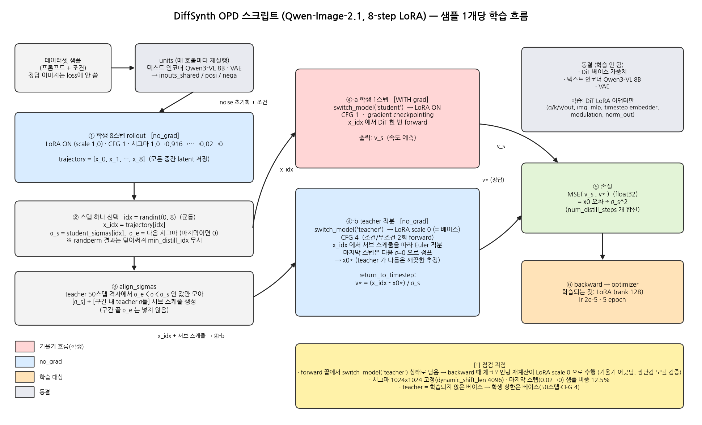
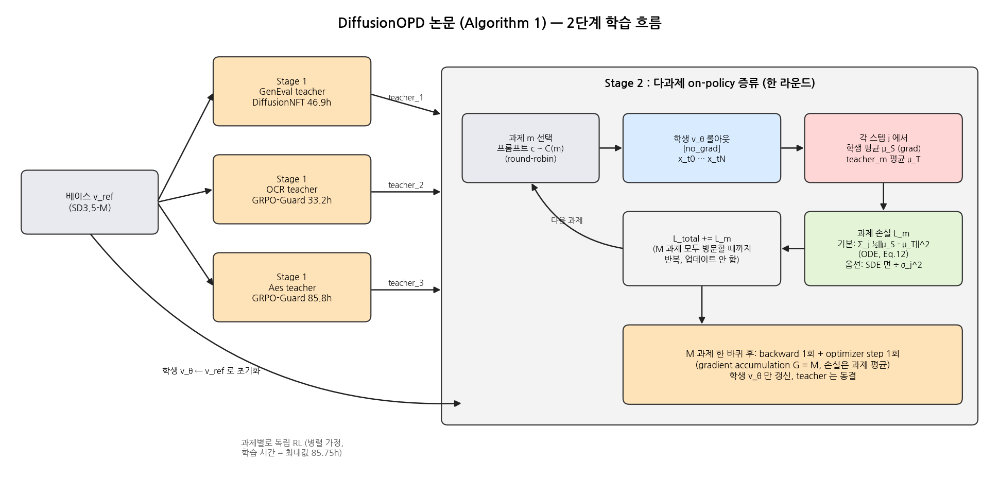

# DiffusionOPD: A Unified Perspective of On-Policy Distillation in Diffusion Models

## 0. 메타 정보

| 항목 | 내용 |
|---|---|
| 제목 | DiffusionOPD: A Unified Perspective of On-Policy Distillation in Diffusion Models |
| 저자 | Quanhao Li*, Junqiu Yu*, Kaixun Jiang, Yujie Wei (Fudan) / Zhen Xing, Pandeng Li, Ruihang Chu, Shiwei Zhang, Yu Liu (Alibaba) / Zuxuan Wu† (Fudan) |
| 게재 | arXiv 2605.15055 (v1 2026-05-14, v2 2026-09-11), SIGGRAPH Asia 2026 Conference Papers (12쪽) |
| 분야 | cs.LG / cs.CV — 확산 모델 다과제 RL, on-policy distillation |
| 링크 | https://arxiv.org/abs/2605.15055 · https://arxiv.org/pdf/2605.15055 |
| 코드(논문) | 본문에서 코드 링크 못 찾음 |
| 코드(분석 대상) | DiffSynth-Studio `examples/qwen_image_21/model_training/special/opd/` (train_Qwen-Image-2.1-8steps_lora.sh, train_opd_lora.py, compute_sigmas.py) + `diffsynth/diffusion/flow_match.py` |
| 베이스/데이터 | SD3.5-Medium 512², LoRA(α=64, r=32), DiffusionNFT 설정 계승. 보상: GenEval, OCR, PickScore, ClipScore, HPSv2.1, Aesthetic, ImageReward, UnifiedReward. 학습 Pick-a-Pic / 평가 DrawBench |
| 검증 범위 | PDF 전문(본문 1~10쪽, 부록 없음) + 스크립트 원문 + train_opd_lora.py + flow_match.py를 직접 읽음. 체크포인트 기울기 검증은 장난감 모델로만 수행 |

---

## 1. 주요 용어 사전 (Glossary)

*이 절을 두는 이유: 논문이 RL·증류·SDE/ODE 용어를 섞어 쓰므로, 본문 전에 낱말 뜻을 맞춰 두면 이후 비판을 따라가기 쉽다.*

### 학습 패러다임
| 용어 | 쉬운 풀이 |
|---|---|
| OPD (On-Policy Distillation, 온폴리시 증류) | 학생이 **자기가** 만든 궤적 위에서, 선생이 각 단계마다 "여기선 이쪽"이라고 알려주는 증류. LLM에서는 토큰 단위 KL로 함 |
| 다과제 RL | 하나의 모델이 여러 보상(GenEval·OCR·미적 품질)을 동시에 만족하도록 학습 |
| 공동 최적화 (joint) | 모든 과제를 한 번에 학습. 과제끼리 간섭, 쉬운 과제가 지배 |
| 캐스케이드 (cascade) | 과제를 순서대로 학습. 번거롭고 앞 과제를 잊음(catastrophic forgetting) |
| teacher / student | 과제별 RL로 학습된 전문가 모델 / 이들을 합치는 하나의 통합 모델 |
| round-robin | 과제를 돌아가며 한 번씩 방문하고, 손실을 모아 한 번에 업데이트 |

### 확산 / 수식
| 용어 | 쉬운 풀이 |
|---|---|
| flow matching, velocity(속도) | 노이즈에서 이미지로 가는 직선 경로의 방향 벡터를 예측하는 방식 |
| SDE / ODE 샘플러 | 단계마다 노이즈를 주입하는(확률적) / 주입하지 않는(결정론적) 샘플링 |
| 노이즈 수준 a | SDE 샘플러의 전역 노이즈 크기. a=0이면 ODE |
| 전이 평균 (transition mean) | 한 스텝 뒤 상태의 기댓값. 두 모델의 이것을 맞추는 것이 이 논문의 손실 |
| 닫힌형 KL | 두 가우시안의 공분산이 같으면 KL이 평균 차이의 제곱합으로 정리됨 |
| score-function 항 | PPO식 기울기에 붙는 추가 항(노이즈에 비례). 기대값 0이지만 분산을 키운다는 것이 논문 주장 |
| surrogate(대리 손실) | 진짜 기울기에서 일부 항을 빼고 쓰는 근사 목적함수 |
| σ(시그마) | 노이즈 비율. 1.0 = 순수 노이즈, 0 = 깨끗한 이미지 |
| x0 추정 | 현재 상태에서 한 번에 깨끗한 이미지로 갔을 때의 예측 |

### 스크립트 용어
| 용어 | 쉬운 풀이 |
|---|---|
| CFG | classifier-free guidance. 조건/무조건 예측을 섞는 강도. teacher 4 → 학생 1 |
| 스텝 증류 | 50스텝 teacher를 8스텝 학생으로 압축 |
| LoRA 스케일 토글 | 어댑터 스케일 1.0 = 학생, 0.0 = LoRA 꺼진 베이스 = teacher |
| gradient checkpointing | 메모리를 아끼려 backward 때 forward를 다시 계산하는 기법 |
| return_to_timestep | (시작 latent, teacher 최종 결과)에서 시작 σ 기준 속도를 되돌려 계산하는 함수 |

---

## 2. 논문 요약 (TL;DR)

- **한 줄**: 과제별 teacher를 따로 RL로 만든 뒤, 학생이 자기 롤아웃 위에서 각 teacher에게 "전이 평균"을 맞추도록 증류해 다과제 모델을 만든다.
- **문제**: 공동 최적화는 간섭·불균형, 캐스케이드는 번거로움과 망각.
- **해결**: 탐험(과제별 RL)과 통합(다과제 증류)을 분리.
- **검증**: SD3.5-M·512²에서 Multi-Task GRPO-Guard / NFT / Cascade NFT보다 평균 점수 높음 (Table 1: 0.929). 단 아래 비판 참조.
- **이 문서의 평가**: 아이디어는 합리적이나 headline 이론(닫힌형 KL)은 기본 설정에서 쓰이지 않고, 효율 주장은 teacher 병렬 가정에 의존하며, 표 불일치와 부록 부재가 있다.

## 3. 핵심 기여 (논문 주장)

1. 도메인별 teacher가 통합 학생을 학생 자신의 롤아웃 위에서 감독하는 다과제 OPD 패러다임.
2. SDE·ODE를 한 틀로 묶는 닫힌형 스텝별 KL 목적함수(분산이 PPO식보다 낮다는 주장).
3. 다과제 비교 실험 + 증류 목적함수·손실 형태·노이즈 수준 ablation.

---

## 4. 주요 알고리즘 설명

### 4.1 논문의 방법

*이 절을 두는 이유: 이후의 비판(4.3)과 스크립트 분석(5장)이 모두 "논문의 정확한 손실이 무엇인가"에 기대기 때문이다.*

**Stage 1 — teacher 훈련**: 과제마다 기존 RL로 따로 학습.
- GenEval: DiffusionNFT (수렴 빠르고 천장 높음)
- OCR, Aesthetic(PickScore:ClipScore:HPSv2.1 = 1:1:1): GRPO-Guard (NFT는 OCR에서 보상 해킹, 저자 예비 실험)

**Stage 2 — 다과제 OPD** (Algorithm 1)
1. 학생을 베이스(v_ref)에서 초기화.
2. 매 라운드: 과제 m마다 프롬프트 샘플 → 현재 학생으로 롤아웃(no_grad) → teacher로 손실 계산 → 손실 누적.
3. 모든 과제를 한 바퀴 돈 뒤 backward 한 번, 옵티마이저 스텝 한 번 (gradient accumulation G = M).

**수식 흐름**
- 디노이징을 이산 마르코프 체인으로 보고 Flow-GRPO식 Euler–Maruyama 이산화 (Eq.5). 노이즈 계수 σ_t = sqrt(a·t/(1−t)).
- 한 스텝 전이는 가우시안: 학생 평균 μ_S(Eq.7), teacher 평균 μ_T(Eq.9). 공분산 σ̄²·I가 같음.
- 같은 공분산이므로 KL = ‖μ_S − μ_T‖² / (2σ̄²) (Eq.10, 14). 목적함수는 이를 롤아웃 전체 스텝에 대해 합산 (Eq.11).
- **ODE(노이즈 0)**: 공분산이 0이라 KL이 정의되지 않으므로 평균끼리 단순 L2 (Eq.12). **Algorithm 1에서 이것이 기본값.**
- 기울기(Eq.15): 롤아웃 분포를 통한 미분을 뺀 **stopped-trajectory surrogate**라고 논문이 직접 인정.

**PPO식과의 비교 (3.3절)**: −KL을 스텝별 advantage로 쓰면, ρ=1 조건에서 기울기 = 경로미분 항 + Δ_j·∇log π 항. 둘째 항은 기대값이 0이라 기대 기울기는 같고(Eq.21), 가우시안 노이즈에 비례하는 추가 분산이 붙는다는 것이 "닫힌형이 낫다"는 논거.

### 4.2 DiffSynth 스크립트의 실제 알고리즘

*이 절을 두는 이유: 사용자가 보라고 한 스크립트가 논문 방법과 무엇이 같고 다른지 분리해 두어야 비판이 정확해진다.*

**논문 vs 스크립트**

| 항목 | 논문 | 스크립트 |
|---|---|---|
| teacher | 과제별 RL로 학습된 모델 | **같은 가중치에서 LoRA 스케일 0 = 학습 안 된 베이스** |
| 목적 | 다과제 능력 통합 | 50스텝·CFG 4 → 8스텝·CFG 1 (스텝+CFG 증류) |
| 데이터 | 과제별 프롬프트 | 프롬프트와 조건만, 정답 이미지는 loss에 안 쓰임 |
| 학습 스텝 | 롤아웃 전 스텝 손실 합산 | 기본 **1스텝**(opd_num_distill_steps=1) |
| 모델 | SD3.5-M | Qwen-Image-2.1 |

논문 2.2절은 "스텝 축소 증류에는 쓰지 않는다"고 명시한다. 스크립트는 정확히 그 용도로 쓴 변형이다.

> **정정/보충 (2026-10-26)**: DiffSynth 문서(Training/Distillation)는 이 OPD 코드를 DiffusionOPD(2605.15055)와 DanceOPD(2606.27377) 두 논문을 인용하는 범용 구현으로 소개하고, `--opd_num_distill_steps`(DiffusionOPD 스타일)와 `--opd_min_distill_idx`(DanceOPD 스타일, 저노이즈 구간만 샘플링)로 변형을 구분한다. 즉 "독자 구현"이 아니라 두 논문의 아이디어를 옵션으로 담으려 한 구현이다. 단 5.2(2)의 덮어쓰기 때문에 두 옵션 모두 현재 무효이며, 같은 줄이 Flux2·Moss-Image용 스크립트에도 있다. DanceOPD 쪽 정리와 4자 비교표는 [[PAPER_DanceOPD.md]] 참조.

**설정 (.sh)**: max_pixels 1048576, dataset_repeat 40, 5 에폭, lr 2e-5, LoRA rank 128 (to_q/k/v/out, img_mlp.proj/out/gate_layer, timestep_embedder linear_1/2, modulation.1, norm_out.linear), teacher 50스텝·CFG 4, 학생 8스텝·CFG 1.
학생 시그마: 1.0, 0.916, 0.820, 0.709, 0.580, 0.427, 0.244, 0.02 (뒤에 0 추가).
시그마는 compute_sigmas.py(dynamic_shift_len 4096) 출력을 **복사해 하드코딩**한다.

**학습 한 번의 흐름**
1. 학생이 8스텝 rollout (no_grad), 중간 latent 전부 저장.
2. 스텝 idx를 균등 무작위로 하나 선택.
3. 학생이 trajectory[idx]에서 한 번 예측 (grad 있음, return_first_output).
4. teacher(LoRA 끔, CFG 4)가 같은 latent에서 aligned 서브 스케줄을 따라 적분.
5. teacher 결과를 return_to_timestep으로 시작 σ 기준 속도로 환산해 MSE (float32).

**한 샘플 비용**: DiT forward 약 20회(학생 롤아웃 8 + 학생 1 + teacher 서브스텝 평균 약 6 × CFG 2). 텍스트 인코더(8B VLM)도 units 재실행으로 3회.

### 4.3 전체 학습 네트워크 flow (그림)

*이 절을 두는 이유: 4.1(논문)과 4.2(스크립트)의 글 설명을 한 장씩 그림으로 묶어, 어떤 네트워크가 동결/학습되고 기울기가 어디로 흐르는지 한눈에 보기 위해서다.*

**(a) DiffSynth 스크립트 — 샘플 1개당 학습 흐름**

읽는 법
- 빨강 = 기울기가 흐르는 곳(학생 1스텝, ④-a), 파랑 = no_grad(학생 rollout ①, teacher 적분 ④-b), 주황 = 학습 대상(LoRA만), 회색 = 동결(DiT 베이스·텍스트 인코더·VAE).
- 네트워크는 **DiT 하나**뿐이다. 학생과 teacher의 차이는 LoRA 스케일(1.0 / 0.0)과 CFG(1 / 4)뿐이다.
- v*(정답)에는 기울기가 없고, 학생의 v_s로만 기울기가 흘러 LoRA를 갱신한다(⑥).
- 노란 상자는 5.2의 점검 지점(스케일 상태 잔존, 시그마 고정, 베이스 teacher 상한) 요약.

**(b) 논문 Algorithm 1 — 2단계 학습 흐름**

읽는 법
- Stage 1: 베이스(v_ref)에서 과제별 teacher 3개를 독립 RL로 학습(시간은 병렬 가정으로 최대값 85.75h, 5.1(1) 참조).
- Stage 2: 학생을 v_ref로 초기화한 뒤, 과제를 돌아가며 롤아웃 → 스텝별 평균 L2 → 손실 누적. M개 과제를 한 바퀴 돈 뒤에야 backward 1회 + optimizer 1회.
- 스크립트와의 차이는 4.2 표 참조(teacher가 과제별 RL 모델 vs LoRA 끈 베이스, 전 스텝 합산 vs 1스텝).

---

## 5. 비판적 평가

### 5.1 논문 (원문 기준)

*이 절을 두는 이유: 논문이 내세우는 주장 중 어디까지가 표·수식으로 받쳐지는지 가려내기 위해서다.*

#### (1) 효율 주장은 "teacher 병렬" 가정에 의존
- Table 1의 DiffusionOPD 시간 85.75+11.26은 각주상 "teacher 학습 시간 **최대값** + OPD 시간".
- teacher 3개 합은 46.92 + 33.17 + 85.75 = **165.84시간**. 여기에 11.26을 더하면 약 177시간으로 multi-task 베이스라인(128~149시간)보다 많다.
- 같은 GPU 총량 기준 비교는 없고, Cascade NFT 148.49시간은 대략치(∗).

#### (2) 표·본문 불일치

| 항목 | 내용 |
|---|---|
| Fig.1 vs Table 1 평균 | Fig.1: DiffusionOPD 0.914 / Cascade 0.903 / GRPO-Guard 0.884 / Multi-NFT 0.861. Table 1: 0.929 / 0.851 / 0.763 / 0.715. 같은 방법인데 간격이 다르고 (Cascade 차이 0.011 → 0.078) 설명 없음 |
| 평균 정규화 | min-max, 최저점 "SD3.5-M w/o CFG"가 0.000 — 약한 기준점이 스케일을 키움 |
| "OCR SOTA" 주장 | Multi-Task NFT OCR 0.96 > DiffusionOPD 0.94 |
| teacher 대비 | GenEval 0.96 = teacher와 동일, Aesthetic 6.15 < teacher 6.22 |

→ 정확한 결론은 "teacher 수준을 거의 잃지 않고 하나로 합쳤다". teacher를 넘어선다는 증거는 없다.

#### (3) 기본 설정은 KL이 아니라 단순 L2
- Algorithm 1: "Eq.(12) by default" = 노이즈 0 ODE의 평균 L2.
- Eq.(11)·(14)의 KL(1/(2σ̄²) 가중)은 σ→0에서 정의되지 않아 기본 설정에서 쓰이지 않는다.
- "ODE가 SDE(a=0.7)보다 최대 5배 효율"은 "노이즈를 빼니 좋아졌다"는 경험적 발견이지 KL 이론의 승리가 아니다.

#### (4) 이론 범위
- Eq.(15)는 surrogate (롤아웃 분포 미분 빠짐). "PPO와 기대값 동일 + 분산 낮음"은 이 surrogate 안에서만 성립하고, 증명은 "추가 항의 기대값 0" 한 줄.
- 분산이 낮다는 실증은 Fig.6 한 설정(a=0.7)뿐, 분산 측정·다중 시드 없음. PPO 쪽은 baseline 없이 −KL을 그대로 advantage로 쓴 단순형이라 약한 비교 대상일 수 있음.

#### (5) 실험의 빈칸
- 모델 1종(SD3.5-M), 512², LoRA(r=32), 과제 3계열.
- 부록 없음 → 학습률·배치·롤아웃 수·스텝 수·프롬프트 수 전부 미기재. 코드 링크 없음. 재현 곤란.
- DMD·TDM·SFT 비교는 곡선(Fig.5)만, 표 없음. DMD의 fake score 학습 비용을 어떻게 맞췄는지 설명 없음.
- 다양성·사람 평가·보상 해킹 지표 없음. teacher 알고리즘 선택(NFT vs GRPO-Guard)은 저자 예비 실험 기반, 근거 데이터 없음.
- 학생은 teacher가 아닌 **원본 모델**에서 초기화.

### 5.2 스크립트 (코드 확인)

*이 절을 두는 이유: 실제로 돌릴 때 학습 결과를 바꿀 수 있는 지점을 우선순위 높은 것부터 정리한다.*

#### (1) 목표값의 정체 — "x0 점프형"
- align_sigmas는 [학생 시작 σ] + [그 구간 안의 teacher σ들]만 만들고 **구간 끝 σ는 넣지 않는다**.
- flow_match.py의 step은 마지막 스텝에서 다음 σ를 0으로 취급 → teacher 궤적 마지막 값은 "서브 스텝을 따라가다 마지막에 σ=0까지 한 번에 점프한 깨끗한 이미지 추정".
- return_to_timestep = (시작 latent − 그 추정) / 시작 σ. 즉 학생이 시작 σ에서 한 번에 깨끗한 이미지로 갈 때의 속도.
- 결국 손실은 "학생의 x0 추정 = teacher가 서브 스텝으로 다듬은 x0 추정" (consistency 스타일).
- 논문 Eq.(12)와의 차이: (a) 목표가 한 스텝 전이 평균이 아니라 다듬은 x0, (b) 속도 공간이라 논문 식의 스텝 길이 제곱(Δσ²) 가중이 빠짐.
- 함의: 학생은 Euler 한 스텝으로 가는데 목표는 teacher가 구간 끝에 실제 도달한 상태가 아니다. 곡률이 큰 구간에서 8스텝 Euler 이산화 오차가 보정되지 않을 수 있다. "teacher를 구간 끝 σ까지만 적분해 비교"하는 대안과의 ablation 필요.
- (정정) 초기 리뷰에서 "teacher 격자와 학생 경계 불일치"라 한 것은 오판. 의도된 설계.

#### (2) 스텝 선택 버그 (확정)
91~94행: `randperm`으로 뽑은 distill_idx를 같은 루프 안에서 `randint`가 덮어씀.
- `min_distill_idx` 옵션(고노이즈 스텝 제외) 무시.
- `num_distill_steps ≥ 2`면 같은 스텝 중복 학습 가능.

#### (3) gradient checkpointing과 어댑터 스케일 불일치 (새 발견, 장난감 모델 검증)
- forward 끝에서 `switch_model("teacher")`를 부르므로 backward 시점의 LoRA 스케일은 0.
- 스크립트는 `--use_gradient_checkpointing` 사용. DiffSynth 체크포인트는 `use_reentrant=False`라 backward 때 forward를 **현재 스케일 0으로 재계산**.
- 검증 (peft 0.17.1, torch 2.2.2, 장난감 2층 모델, `code_diffusionopd_ckpt_scale_check.py`):

| 설정 | LoRA 기울기 합 |
|---|---|
| 체크포인트 없음 (스케일 0 전환 여부 무관) | 0.7121 |
| 체크포인트 + 스케일 1 유지 | 0.7121 |
| 체크포인트 + backward 직전 스케일 0 | **0.7384** |

- 기울기가 0이 되지는 않고 **값이 어긋남**(저장 활성값이 LoRA를 뺀 베이스 상태로 재계산되기 때문). 초기엔 LoRA 차이가 작아 오차가 작고 학습이 진행될수록 커질 수 있음. 실제 Qwen 모델에서의 영향 크기는 **미측정**.
- 수정: forward return 직전에 `switch_model("student")` 한 줄.

#### (4) 손실 가중
- 속도 MSE = x0 오차 ÷ (시작 σ)².
- 마지막 학생 스텝(0.02 → 0)은 teacher 서브 스텝이 없고 CFG 차이만 남아 정보가 거의 없는데 샘플의 12.5%를 차지.
- 가장 변화가 큰 스텝(0.427→0.244, 0.244→0.02)도 같은 확률. 균등 샘플링이 최선인지 미검증.

#### (5) 해상도 고정
시그마가 dynamic_shift_len 4096(1024² 가정)으로 하드코딩. max_pixels는 상한일 뿐이라 작은 이미지도 같은 시그마로 학습되고, 다른 해상도 추론에서는 스케줄이 어긋남.

#### (6) 기타
- 시그마 인자를 비우면 `float("")`로 터짐. `num_distill_steps=0`이면 loss가 정수 0이라 backward 실패.
- 어댑터가 여러 개면 "default"만 토글되어 teacher 오염.
- 전체 파인튜닝은 PEFT 층이 없어 teacher = 학생이 되는데 경고 없음 (별도 train_opd_full.py).
- fetch_trajectory가 units(8B VLM 텍스트 인코더 포함)를 호출마다 재실행 (코드 주석은 "negligible").
- LoRA 대상에 텍스트 스트림 모듈이 보이지 않음 (모델 구조 확인 필요).
- lr 2e-5, repeat 40 × 5 에폭은 예제 데이터용 값으로 보임.

---

## 6. 실험 요약

*이 절을 두는 이유: 5.1의 비판이 어떤 숫자에 근거하는지 표로 남겨 둔다.*

### Table 1 (SD3.5-M 512², 40스텝 ODE 평가)

| 모델 | 시간(h) | GenEval | OCR | Pick | Clip | HPSv2.1 | Aes | ImgRwd | UniRwd | 평균 |
|---|---|---|---|---|---|---|---|---|---|---|
| SD3.5-M + CFG | — | 0.63 | 0.59 | 22.34 | 0.285 | 0.279 | 5.36 | 0.85 | 3.03 | 0.484 |
| GenEval Teacher | 46.92 | 0.96 | 0.40 | 22.04 | 0.274 | 0.248 | 5.24 | 0.59 | 2.97 | 0.473 |
| OCR Teacher | 33.17 | 0.65 | 0.93 | 22.27 | 0.290 | 0.272 | 5.26 | 0.90 | 3.09 | 0.550 |
| Aes Teacher | 85.75 | 0.49 | 0.59 | 24.02 | 0.295 | 0.346 | 6.22 | 1.498 | 3.48 | 0.698 |
| Multi-Task GRPO-Guard | 129.86 | 0.89 | 0.94 | 23.12 | 0.296 | 0.307 | 5.61 | 1.31 | 3.33 | 0.763 |
| Multi-Task NFT | 128.42 | 0.95 | 0.96 | 22.59 | 0.288 | 0.282 | 5.41 | 1.08 | 3.23 | 0.715 |
| Cascade NFT | 148.49∗ | 0.94 | 0.91 | 23.80 | 0.293 | 0.331 | 6.01 | 1.49 | 3.49 | 0.851 |
| **DiffusionOPD** | 85.75+11.26† | 0.96 | 0.94 | 23.99 | 0.297 | 0.342 | 6.15 | 1.50 | 3.50 | 0.929 |

† teacher 학습 시간의 최대값 + OPD 시간 (병렬 가정). 평균 = min-max 정규화 평균.

### Ablation (곡선만, 표 없음)
- 증류 방법(Fig.5): DiffusionOPD가 DMD·TDM·SFT보다 빠르고 높음.
- 손실 형태(Fig.6): 닫힌형 KL > PPO식 (a=0.7).
- 노이즈 수준(Fig.6): 낮을수록 좋고 ODE가 SDE(0.7) 대비 최대 5배 효율.

---

## 7. 💬 Q&A

### Q1. 논문 안 읽었어? (리뷰 정정 이력)
*이 절을 두는 이유: 어떤 판단이 어떤 근거로 바뀌었는지 남겨 이후 같은 실수를 막는다.*

- 첫 리뷰는 PDF가 용량 제한으로 열리지 않아 요약기 출력 기반이었다. 이후 PDF를 직접 받아 전문을 읽고 정정했다.
- 정정 1: teacher 격자 ↔ 학생 경계 불일치 지적은 오판 → 5.2(1)의 x0 점프 설계.
- 정정 2: "teacher 학습이 총시간의 88%"는 부정확 → 5.1(1)의 최대값 + 병렬 가정이 핵심.
- 확인 3: "ODE에서 KL 불성립"은 논문이 스스로 인정하며, 그 L2가 기본값(5.1(3)).
- 새 발견: 표·Fig 불일치(5.1(2)), 체크포인트 스케일 문제(5.2(3)).

### Q2. 종합하면 어떻게 평가하나?
- **논문**: 아이디어(과제별 teacher + 학생 on-policy 롤아웃 + 평균 매칭)는 단순하고 합리적. 그러나 headline 이론인 닫힌형 KL은 기본 설정에서 쓰이지 않고, 효율 주장은 teacher 병렬 가정에 의존하며, 평균 점수는 Fig.1과 Table 1이 서로 안 맞고, OCR SOTA 주장은 표와 충돌하며, 부록이 없어 재현이 어렵다.
- **스크립트**: 논문을 스텝·CFG 증류에 전용한 변형. 한 스텝만 역전파하고 teacher를 LoRA 토글로 공유해 메모리 효율은 좋다. 다만 5.2(3)의 스케일 문제는 한 줄로 고칠 수 있는 실제 결함이고, 5.2(1)의 x0 점프 목표와 5.2(5)의 해상도 고정은 사용 전에 점검할 지점.

### Q3. 스크립트를 쓰기 전에 무엇부터 확인/수정해야 하나?
우선순위순:
1. forward 끝에 `switch_model("student")` 추가 (5.2(3)).
2. 스텝 선택 덮어쓰기 제거 (5.2(2)).
3. 시그마 하드코딩 → 해상도 고정 여부 점검 (5.2(5)).
4. 목표값을 "구간 끝까지 적분" 방식과 비교하는 ablation (5.2(1)).
5. 마지막 스텝 샘플링 비중 조정 검토 (5.2(4)).

### Q4. DMD2 알고리즘과의 차이는? (표)
*이 절을 두는 이유: 같은 "증류"라도 DMD2(분포 매칭)와 OPD(점별 회귀)는 무엇을 맞추는지가 달라, 어떤 상황에 무엇을 쓸지 판단하려면 구조 차이를 한눈에 봐야 한다.*

※ DMD2 쪽은 기존 지식(메모리 [[paper_dmd2]] 포함) 기준이며 이번에 원문을 다시 열어 확인하지 않았다. DiffusionOPD·스크립트 쪽은 직접 읽은 내용.

| 항목 | DMD2 | DiffusionOPD (논문) | DiffSynth 스크립트 |
|---|---|---|---|
| 목적 | 다스텝 확산 모델을 1~4스텝 생성기로 압축 | 과제별 RL teacher들을 하나의 학생으로 통합 | 50스텝·CFG 4를 8스텝·CFG 1로 압축 |
| 무엇을 맞추나 | **분포**(학생 출력 분포가 teacher 분포와 같아지게) | **한 스텝 전이 평균**(점별 회귀) | **x0 추정**을 속도로 환산한 점별 회귀 |
| teacher | 고정된 사전학습 확산 모델(CFG 포함) | 과제별 RL 전문가 여러 개 | LoRA를 끈 베이스(학습 안 됨) |
| 손실 | 학생 샘플의 (가짜 score − 진짜 score) 방향 기울기(분포 매칭 KL의 기울기) + GAN 손실 | 전이 평균의 제곱거리(기본은 ODE L2) | 속도 공간 MSE 한 개 |
| 보조 네트워크 | **fake score 네트워크**(학생 분포를 따라가며 같이 학습) + 판별기 | 없음 | 없음 |
| 실제 데이터 사용 | 있음(GAN 손실이 실제 이미지를 봄) | 없음 | 없음(프롬프트만) |
| 회귀 손실(L_reg) | **제거**(DMD1은 있었음) | 해당 없음(회귀가 곧 본체) | 회귀가 곧 본체 |
| 학습 안정화 | TTUR(critic 5회 : generator 1회), GAN | 없음. 라운드로빈 손실 누적 | 없음 |
| 다스텝 처리 | 학생 자신의 다스텝 출력을 입력으로 쓰는 backward simulation으로 학습·추론 불일치 해소 | 롤아웃 전 스텝 손실 합산 | 롤아웃 후 **스텝 하나**만 무작위 선택해 학습 |
| on-policy 성격 | 있음(학생 샘플로 평가) | 있음(학생 롤아웃 위) | 있음(학생 롤아웃 위) |
| teacher 호출 | 학생 샘플에 노이즈를 입혀 score를 한 번 평가 | 학생 상태에서 teacher 한 스텝 | 학생 상태에서 teacher 서브스텝 약 6회 × CFG 2배 |
| 생성기 gradient 경로 | fake/real score 차이를 생성기 출력으로 역전파 | 평균 차이를 학생 예측으로 역전파 | 속도 MSE를 학생 한 스텝으로 역전파 |
| 모드 거동 | 분포 매칭이라 **mode-seeking**(다양성 감소 위험) | 점별 회귀라 teacher 궤적을 따라감 | 같음(결정론적 teacher 궤적 회귀) |
| 품질 천장 | GAN 덕에 teacher를 **넘을 수 있음**(ImageNet FID, SDXL 4스텝) | 평균 매칭이라 teacher 수준이 상한 | 베이스 teacher 수준이 상한 |
| 학습 비용 | 학생 + fake score + 판별기를 함께 학습(메모리·구현 부담 큼) | 단일 모델 | 단일 모델(LoRA 토글로 teacher 공유) |
| 하이퍼파라미터 민감도 | critic:generator 비율, GAN 가중, 가이던스 스케일 등 | 부록 없음(미기재) | lr, 시그마 하드코딩 |

**핵심 차이**
1. **회귀냐 분포 매칭이냐**: DMD2는 fake score 네트워크를 따로 두어 샘플 분포를 맞춘다. DiffusionOPD와 스크립트는 같은 상태에서 teacher가 가리키는 점을 학생이 직접 따라 하는 회귀다. 보조 네트워크가 없어 단순·안정적이지만 결과가 teacher 궤적에 묶인다.
2. **GAN과 실제 데이터**: DMD2의 품질 향상은 상당 부분 실제 이미지를 보는 GAN 손실에서 온다. 두 OPD 쪽은 실제 이미지를 전혀 안 보므로 "teacher보다 좋아지는" 경로가 구조적으로 없다.
3. **학습-추론 불일치**: DMD2는 backward simulation, OPD는 학생 롤아웃 위 감독으로 같은 문제(exposure bias)를 푼다. 사상은 가깝다.
4. **비용 구조**: DMD2는 학습 네트워크가 3개. 스크립트는 학생 1개 + LoRA 토글로 teacher 공유지만, teacher를 서브스텝으로 여러 번 돌려 샘플당 forward가 약 20회.
5. **다양성 위험**: 스크립트는 teacher 궤적을 점별로 따라가므로 DMD류 mode collapse 위험은 낮을 것으로 **예상**(제 추론, Qwen-Image-2.1에서 측정된 근거 없음). 반대로 8스텝에서 디테일이 흐려지는 회귀형 증류의 일반적 약점이 나타날 수 있으나 이것도 미검증.

**한 줄**: DMD2는 보조 score 네트워크와 GAN으로 **분포를** 맞추는 방식, DiffusionOPD와 스크립트는 보조 네트워크 없이 학생 롤아웃 위에서 teacher 목표를 **점별로 회귀**하는 방식. OPD가 훨씬 가볍고 단순한 대신 teacher를 넘어서는 경로는 없다.

### Q5. DPO를 이용한 Turbo 공개 모델이 있나?
*이 절을 두는 이유: few-step 모델에 선호 정렬을 어떻게 얹는지, 공개 가중치로 확인되는 선례가 있는지 가려 두면 OPD 계열과의 위치를 판단하기 쉽다.*

검색 스니펫 기반이라 모델 카드로 직접 확인한 것은 아니다. 결론: **"DPO로 학습한 공식 Turbo 공개 모델"은 확인하지 못했다.**

| 모델 | DPO와의 관계 | 비고 |
|---|---|---|
| [Z-Image-Turbo](https://www.emergentmind.com/topics/z-image-turbo) | 증류에 RL 보상 최적화를 결합했지만 DPO가 아니라 DMDR 방식 | 가장 근접한 공개 Turbo. 메모리 [[paper_z_image]]에 "Decoupled DMD + DMDR + 2-stage RLHF" |
| [thibaud/sdxl_dpo_turbo](https://huggingface.co/thibaud/sdxl_dpo_turbo/commits/refs%2Fpr%2F4/text_encoder_2/config.json) | SDXL-Turbo와 SDXL-DPO 가중치를 **병합**한 커뮤니티 모델 | 학습이 아니라 merge. 라이선스 "other" |
| [Qwen-Image-2.1-viggle-turbo](https://huggingface.co/Viggle/Qwen-Image-2.1-viggle-turbo) | 6스텝·CFG 없는 증류 LoRA. DPO 언급 없음 | 본 문서 스크립트와 같은 계열의 Turbo |
| [Diffusion-DPO류 학술 실험](https://arxiv.org/pdf/2411.11727) | SD-Turbo 위 few-step 보상 미세조정(D3PO 비교 포함) | 논문 실험, 공개 Turbo 모델 아님 |

참고: DPO를 쓰는 공개 모델 중 Turbo가 아닌 것은 LongCat-Image(DPO·GRPO·MPO 3단 RLHF, [[paper_longcat_image]]).
→ 증류 후 정렬은 대체로 DMD 계열 보상 최적화나 GRPO이고, DPO를 증류된 few-step 모델에 직접 적용한 공식 가중치는 찾지 못했다.

### Q6. FLUX 계열 few-step 공개 모델은? (DPO 아니어도)
*이 절을 두는 이유: 본 문서의 OPD 스크립트와 비교할 FLUX 쪽 증류 선례를 한곳에 모아 둔다.*

검색 결과와 기존 지식을 섞었고, 출처 없는 항목은 "미확인"으로 표시했다.

| 모델 | 방식 | 스텝 | 비고 |
|---|---|---|---|
| FLUX.1 schnell | 적대적 증류(FLUX.1 pro에서) | 4 | BFL 공식. [pi-Flow 논문](https://arxiv.org/pdf/2510.14974)은 선호 정렬이 dev보다 크게 약하다고 보고 |
| FLUX.1 Turbo (Alpha) | 적대적 학습 | 8 | [MeanFlow 논문](https://arxiv.org/pdf/2605.17834) 기준 HPSv2.1 31.49 |
| Hyper-FLUX | 일관성 증류 + RL, LoRA | 8 | 같은 표에서 8스텝 중 HPSv2.1 최고(31.78) |
| [SenseFlow](https://github.com/XingtongGe/SenseFlow) | DMD 계열 분포 매칭 + VFM 판별기 | 소수 스텝 | ICLR 2026. 가중치가 HF에 공개돼 FLUX.1-dev의 transformer 폴더에 교체 가능 |
| [π-Flow](https://github.com/lakonik/piflow) | 정책 기반 모방 증류 | 4 | DMD류보다 다양성이 높고 teacher급 품질 유지. ComfyUI 지원 |
| [fal/FLUX.2-dev-Turbo](https://huggingface.co/fal/FLUX.2-dev-Turbo) | LoRA | 8 | FLUX [dev] 비상업 라이선스 |
| FLUX.2 klein | 4스텝 모델 | 4 | 학습 방식 미확인 |
| [TwinFlow](https://arxiv.org/html/2610.08070), [ArcFlow](https://arxiv.org/pdf/2602.09014) | 최신 증류 방법 | 1~2 | FLUX용 공개 가중치 여부 미확인 |

- 정렬 방식은 대부분 적대적 학습이나 DMD 분포 매칭. RL이 들어간 확인 사례는 Hyper-FLUX.
- 위 점수는 서로 다른 논문의 지표·스텝 수·프로토콜이라 직접 비교 불가. TwinFlow 표는 SenseFlow와 π-Flow 행이 중복돼 신뢰도가 낮다고 검색 결과에도 적혀 있다.
- DMD류는 대규모 flow 모델에서 수렴·다양성 문제가 보고되며, SenseFlow는 판별기로 보완하고 π-Flow는 다양성을 장점으로 내세운다.
- **본 문서 스크립트와 가장 가까운 것은 π-Flow**(둘 다 점별 감독으로 teacher 궤적을 따라가는 imitation 계열). 이 가까움은 추정.
- 관련해 [D-OPSD](https://arxiv.org/pdf/2605.05204)는 step-distilled 모델을 on-policy self-distillation으로 계속 튜닝하는 논문으로 DiffusionOPD와 문제의식이 겹친다(아직 읽지 않음).

---

## 8. 한 줄 요약 (전체)

DiffusionOPD는 "과제별 teacher를 따로 만들고 학생의 자기 롤아웃 위에서 전이 평균을 맞춘다"는 실용적 아이디어지만, 기본 설정은 KL이 아닌 단순 L2이고 효율 수치는 teacher 병렬 가정에 기대며, DiffSynth 스크립트는 이를 스텝·CFG 증류로 전용하면서 x0 점프형 목표와 체크포인트 스케일 불일치라는 점검 지점을 안고 있다.

## 9. 관련 메모리 링크

- [[paper_dmd]], [[paper_dmd2]] — 분포 매칭 증류(논문이 비교한 DMD 계열)
- [[paper_qwen_image_2_1]] — 스크립트의 대상 모델(Qwen-Image-2.1)
- [[paper_qwen_image_2_rl]] — OPD(작업별 교사)를 쓴 Qwen-Image-2.0-RL
- [[paper_z_image]] — Decoupled DMD·RLHF 증류 비교
