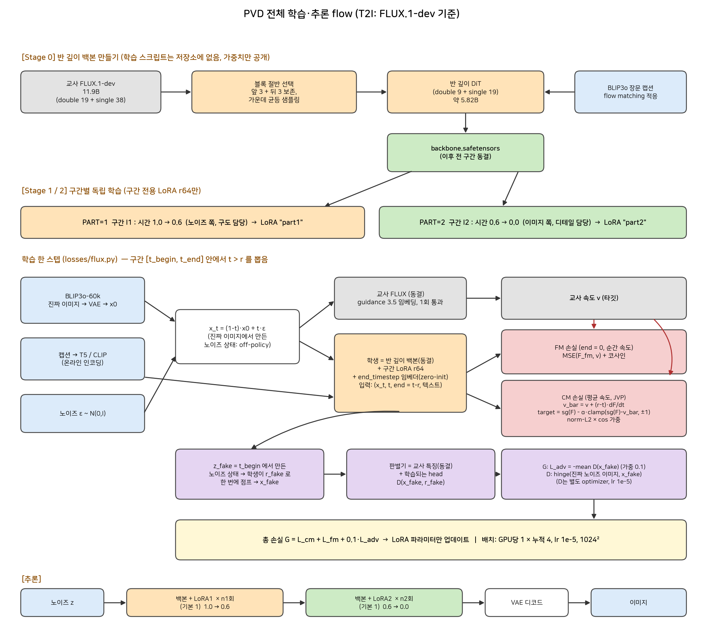
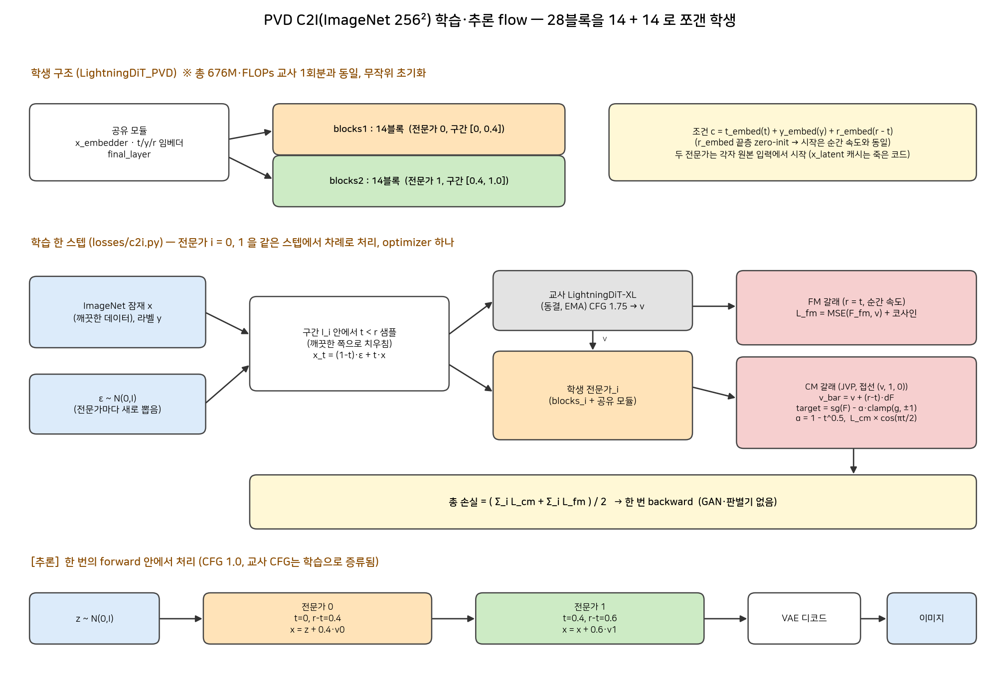

# PVD: Phase-wise Velocity Distillation (Two Halves are More than One)

## 1. 메타 정보

> 이 장을 두는 이유: 나중에 원문·코드를 다시 찾아갈 때 출처를 한 곳에서 바로 확인하기 위해서.

| 항목 | 내용 |
|---|---|
| 제목 | Two Halves are More than One: Phase-wise Velocity Distillation for Fast and High-Quality Image Generation |
| 저자 | Zhen Guo, Rongyuan Wu, Qiaosi Yi, Chenxi Xie, Xinyu Wei, Lei Zhang (PolyU, 소속은 페이지에 미표기) |
| 공개일 | 2026-10-06 (arXiv v1) |
| 분야 | cs.CV — 확산 모델 증류 (1스텝 생성) |
| 논문 | [abs](https://arxiv.org/abs/2610.08070) / [PDF](https://arxiv.org/pdf/2610.08070v1) / [HTML](https://arxiv.org/html/2610.08070v1) |
| 코드 | https://github.com/PolyU-VCLab/PVD (Apache-2.0, 학습코드 + 체크포인트 7종) |
| 사용한 외부 모델/데이터 | 교사: FACM 설정 C2I DiT, SD3.5-Medium, FLUX.1-dev, Qwen-Image / ImageNet 256², Unsplash(추가 학습) |
| 읽은 범위 | HTML 본문 앞 10만 자 + README. **부록 D(데이터·하이퍼파라미터), I(T2I ablation), J(실패 사례)는 미확인** |

## 2. 주요 용어 사전 (Glossary)

> 이 장을 두는 이유: 본문에서 쓰는 용어를 먼저 쉬운 말로 맞춰 두면 뒤 장이 훨씬 빨리 읽히기 때문.

**생성·증류 기본 개념**

| 용어 | 쉬운 풀이 |
|---|---|
| Distillation (증류) | 느리지만 좋은 교사 모델의 출력을 빠른 학생 모델이 흉내 내도록 가르치는 것 |
| NFE | 모델을 한 번 통과시키는 횟수. 1이면 "한 번에 이미지 완성" |
| velocity field (속도장) | 노이즈에서 이미지로 가는 길의 각 지점에서 "어느 방향으로 얼마나 가라"를 알려주는 값 |
| PF-ODE | 노이즈→이미지를 결정적으로 따라가는 미분방정식 경로 |
| over-smoothing | 정답이 여러 개일 때 학생이 평균을 내서 뭉개진 이미지를 내는 현상 |

**PVD 고유 개념**

| 용어 | 쉬운 풀이 |
|---|---|
| Phase (구간) | 생성 시간축을 쪼갠 한 토막. 구간 1=구도 잡기, 구간 2=디테일 다듬기 |
| Average velocity (평균 속도) | 구간 [t, t′] 동안의 속도를 평균 낸 값. 이걸 알면 한 번에 t′까지 점프 가능 (MeanFlow 계열) |
| Semantic Drafting | 앞 구간 [0, 0.4]. 전체 레이아웃을 스케치 |
| Detail Refinement | 뒤 구간 [0.4, 1]. 구조와 고주파 디테일을 마무리 |
| Half-depth backbone | 교사 DiT에서 블록을 절반만 남긴 백본 |
| Phase expert | 공유 백본 위에 구간별로 얹는 전용 파라미터(LoRA 또는 풀 파인튜닝) |

**평가 지표**

| 용어 | 쉬운 풀이 |
|---|---|
| FID / IS | 생성 이미지 분포가 실제와 얼마나 가까운가 / 얼마나 또렷하고 다양한가 |
| GenEval | 객체 수·색·위치 같은 단순 속성을 맞췄는지 보는 벤치 (포화되기 쉬움) |
| DPG, WISE, TIIF, QI-Bench | 긴 프롬프트 준수 / 세계지식 / 지시 따르기 / 품질 벤치 |
| PickScore, ImageReward, Aesthetic | 사람 취향 기반 점수 |
| DreamSim 다양성 | 같은 프롬프트로 뽑은 이미지들이 서로 얼마나 다른가 |
| NFLOPs | 교사 1회 통과 계산량을 기준으로 정규화한 총 계산량 |

## 3. 논문 요약 (TL;DR)

> 이 장을 두는 이유: 전체 그림을 1분 안에 잡고, 뒤 장에서 어디를 볼지 정하기 위해서.

- **한 줄**: 1스텝 증류에서 큰 학생 하나 대신, **반 깊이 전문가 둘**(구도 담당 + 디테일 담당)을 순차로 쓴다. 총 계산량은 교사 1회분이다.
- **핵심 문제**: 1스텝 학생 하나는 구도와 디테일을 동시에 배워야 하고, 노이즈 한 점에 정답이 여러 개라 평균을 내서 뭉개진다. T2I에서는 붕괴하기도 한다.
- **해결책**: 시간축을 [0, 0.4] / [0.4, 1]로 쪼개고, 각 구간을 평균 속도로 한 번에 점프하는 반 크기 전문가를 둔다. 구간이 짧으면 분포 이동이 작아 학습이 쉽다.
- **검증**: ImageNet 256² 1스텝 FID 1.48 (1스텝 중 최고). SD3.5-M/FLUX/Qwen-Image에서 활성 파라미터 약 50%↓, VRAM 약 46~48%↓, 1스텝 baseline을 크게 상회.

## 4. 핵심 기여 (Contributions)

> 이 장을 두는 이유: 논문이 스스로 주장하는 새로움을 분리해 두어야 6장의 비판이 어느 주장을 겨냥하는지 분명해진다.

1. **Phase-wise 분할**: 구도(Semantic Drafting)와 디테일(Detail Refinement)을 별도 전문가에게 분리하는 1스텝 증류 틀.
2. **Average velocity 기반 구간 학습**: 평균 속도 항등식에서 stop-gradient L2 타깃을 만들어 각 구간을 한 번에 점프.
3. **반 크기 전문가 구성법**: 교사에서 블록을 절반으로 추려 flow matching으로 먼저 적응시킨 뒤, 얼린 백본 + 구간별 zero-init 시간 임베딩/LoRA.
4. **이론 두 개**: 평균 속도 오차는 순간 속도 오차로 제어되고(정리 3.1), 짧은 구간일수록 분포 이동이 작다(정리 3.2).
5. **효율**: 교사 대비 활성 파라미터 약 49~51%, 피크 VRAM 약 46~48% 감소.

## 5. 주요 알고리즘 설명

> 이 장을 두는 이유: PVD가 "왜 구간을 나누고, 무엇을 학습시키고, 어떻게 한 번에 점프하는지"를 처음 보는 사람도 따라올 수 있게 풀어 쓰기 위해서. 코드에서 어디에 해당하는지도 함께 적는다 (전체 흐름 그림은 7.0, 코드 흐름은 7장).

**표기 약속**: 이 장은 논문의 표기를 따라 **시간 t=0이 노이즈, t=1이 완성 이미지**다. (T2I 코드는 반대로 t=1이 노이즈라서, 코드와 대조할 때는 t를 1−t로 바꿔 읽는다. 7.1 참조.)

### 5.0 한 장 요약: PVD는 "구간별 점프 전문가 둘"이다

```
[기존 1스텝 증류]   노이즈 ───────────── 큰 학생 1개 ─────────────▶ 이미지
                     (구도도 잡고 디테일도 만들어야 함 → 평균 내서 뭉개짐)

[PVD]               노이즈 ──▶ 전문가 1 ──▶ 중간 상태(t=0.4) ──▶ 전문가 2 ──▶ 이미지
                       "밑그림 화가"                          "마무리 화가"
                       (반 깊이)                              (반 깊이)
```

- **밑그림 화가**는 아무것도 없는 노이즈에서 전체 구도만 잡고, **마무리 화가**는 구도가 잡힌 그림에 디테일을 칠한다. 두 사람이 각자 한 번씩만 붓질(모델 호출)하고, 각자 모델 크기가 절반이라 합치면 교사 1회분 계산이다.
- 이 아이디어를 구현하려면 알아야 할 부품이 4개다: ① 한 번에 점프하는 법(평균 속도, 5.1) ② 구간 나누기(5.2) ③ 두 갈래 손실(5.3) ④ 반 깊이 전문가 만들기(5.4). 보조로 GAN(5.5)과 이론(5.6)이 있다.

### 5.1 "한 번에 점프"하는 법: 평균 속도 (Average velocity)

> 왜 이 소절? 1스텝 증류의 목표가 "여러 번 갈 길을 한 번에 가는 것"인데, PVD는 그것을 수학적으로 어떻게 하는지가 모든 설계의 바탕이기 때문.

**(1) 먼저 알아둘 두 속도**

| 용어 | 뜻 | 비유 (내비게이션) |
|---|---|---|
| 순간 속도 v(x_t, t) (instantaneous velocity) | 지금 이 지점·이 순간에 가야 하는 방향과 크기. 교사가 알려준다 | 계기판의 **현재 시속** |
| 평균 속도 u(x_t, t, r) (average velocity) | 시각 t에서 r까지 가는 동안의 평균 속도 | 이 구간의 **평균 시속** (구간 거리 ÷ 걸린 시간) |

- 교사는 순간 속도 v만 안다. 그래서 교사로 이미지를 만들려면 길을 잘게 쪼개 **계기판을 수십 번 보면서** 조금씩 가야 한다 (50스텝).
- 평균 속도 u를 정확히 알면, **구간 끝까지 한 번에** 간다:

```
x_r = x_t + (r − t) · u(x_t, t, r)       ← 한 번에 점프  (r = 도착 시각)
```

**(2) 그런데 평균 속도 정답을 어떻게 구하나? — 핵심 항등식**

평균 속도는 "구간 안의 순간 속도를 다 더해서 구간 길이로 나눈 것"이다. 이 정의를 시작 시각 t로 미분하면 다음 관계가 나온다 (논문 식 6):

```
u(x_t, t, r)  =  v(x_t, t)  +  (r − t) · d/dt u(x_t, t, r)
 평균 속도   =  지금 순간 속도  +  (남은 구간 길이) × (평균 속도가 시작점에 따라 변하는 비율)
```

- 비유: "이 구간 평균 시속 = 지금 시속 + 보정". 보정은 **구간이 길수록, 평균 속도가 출발점에 민감할수록 커진다**. 구간 길이가 0이면 보정이 사라져서 평균 속도 = 순간 속도다.
- 이 식 덕분에 **정답 평균 속도를 모르는 상태에서도** "순간 속도(교사가 줌) + 보정(학생 자신의 미분)"으로 학습 타깃을 만들 수 있다.

**(3) 미분은 어떻게 계산하나 — JVP**

- d/dt u 는 x_t와 t가 함께 변하는 경로를 따라간 **전체 미분**이다. 경로의 진행 방향이 (x는 v 방향으로, t는 1씩 증가, r은 고정)이므로 PyTorch의 `torch.func.jvp`에 접선 (v, 1, 0)을 넣어 한 번에 얻는다. 코드의 `v_x=v, v_t=ones, v_r=zeros`가 정확히 이 부분이다.

**(4) 실제 타깃과 손실 (FACM 방식을 그대로 가져옴)**

```
v_bar  = v + (r − t) · sg(dF)                 ← 위 항등식으로 만든 "정답 후보"   (sg = stop-gradient, 정답 쪽으로는 미분 안 흘림)
g      = sg(F) − v_bar                        ← 학생 출력 F 와 정답 후보의 차이
target = sg(F) − α · clamp(g, −1, 1)          ← 한 번에 정답으로 끌지 않고 조금씩(최대 ±1) 끌기,  α = 1 − t^p  (p=0.5)
L_cm   = norm-L2(F, target) × cos(πt/2)       ← 오차가 큰 샘플이 학습을 휘두르지 않게 정규화한 L2, 깨끗한 쪽(t→1)은 가중치를 줄임
```

- 쉽게 말해 "정답 후보와 내 출력이 다르면 **조금씩** 정답 쪽으로 이동"하는 안정화 장치다 (FACM의 기법, 저장소 코드 머리말에 출처 명시).

**"stop-gradient L2 타깃"이 뭔가?** (논문 식 7의 표현)

1. **L2 타깃**
   - "내 출력 F를 어떤 목표값(target)에 가깝게 만들자. 가까운 정도는 차이의 제곱(L2)으로 재자"는 뜻이다.
   - 일반 지도학습의 "정답 라벨과의 오차 제곱"과 같은 꼴이다.

2. **stop-gradient (sg, 코드에서는 `.detach()`)**
   - 보통은 정답 라벨이 고정된 숫자라서, 오차를 줄이는 방향으로 **내 출력만** 움직인다.
   - 그런데 여기서는 정답 후보(target)를 **학습 중인 같은 네트워크의 출력과 그 미분(dF)으로 만든다.** 정답지를 내 답으로 만드는 셈이다.
   - 이때 정답지까지 학습으로 같이 움직이게 두면 모델이 쉬운 길을 택한다. 정답지와 내 답을 **같이 끌어서 맞춰버리면** 오차가 0이 되어, 아무것도 배우지 않고 손실만 줄어든다.
   - stop-gradient는 "정답지를 계산에 쓰되, 이 값에는 학습 신호(그래디언트)를 흘려보내지 말고 **고정된 상수처럼** 취급하라"는 표시다.

**비유**: 학생이 자기 시험지를 직접 채점하는데, 채점하면서 정답지도 자기 답에 맞춰 고칠 수 있으면 항상 만점이다. 정답지를 **복사해서 책상 위에 고정해 두고**, 내 답만 정답에 다가가게 하는 것이 stop-gradient다.

**코드에서 어디인가**

| 코드 | 역할 |
|---|---|
| `F_avg_sg = F_avg.detach()` | 현재 출력의 복사본, 정답지 재료 |
| `F_avg_grad = F_avg_grad.detach()` | JVP로 얻은 미분(dF)도 같은 방식으로 고정 |
| `target = F_avg_sg - alpha * g.clamp(-1, 1)` | 고정값들로만 만든 정답지 |
| `cm_loss = norm_l2_loss(F_avg, target)` | 그래디언트가 흐르는 쪽은 `F_avg` 하나뿐 |
| (FLUX) JVP를 `torch.no_grad()` 안에서 계산, 손실용 `F_avg`는 따로 한 번 더 forward | 같은 목적 |

**결론**: 평균 속도 학습은 자기 자신의 출력으로 정답을 만드는 "자기 참조" 구조인데, stop-gradient가 그 정답을 고정해서 **학습이 제자리에서 맴돌거나 무너지지 않게** 잡아준다. 일반 자기지도·일관성 모델에서 쓰는 목표 네트워크(target network)와 같은 취지다.
- 코드: `losses/c2i.py`의 `__call__`(184~203행), `losses/flux.py`의 `PVDLossFLUX.__call__`(152~167행).

### 5.2 구간 나누기: 왜 둘로 쪼개나

> 왜 이 소절? "전문가 둘"이 단순히 모델을 늘린 것이 아니라 **문제를 쉽게 만드는 장치**라는 점을 이해해야 PVD의 존재 이유가 보이기 때문.

**(1) 문제: 노이즈 상태에서는 정답이 너무 많다**

- t=0 근처(거의 순수 노이즈)에서 "이 노이즈에서 나올 수 있는 그럴듯한 이미지"는 수없이 많다. 1스텝 학생이 이걸 한 번에 맞히려면 **정답들의 평균**을 낼 수밖에 없고, 그 결과가 **뭉개진 이미지(over-smoothing)**다.
- 반대로 t=0.4쯤 가면 이미 구도가 정해져 있어서, 남은 후보가 훨씬 적다. 그 상태에서 마무리하는 일은 훨씬 쉬운 문제다.

**(2) 해결: 시간축을 쪼개 문제를 둘로 분리**

| | 구간 | 하는 일 | 문제의 성격 |
|---|---|---|---|
| 전문가 1 | I1 = [0, 0.4] (노이즈 쪽) | 구도·의미 만들기 (Semantic Drafting) | 정답이 많지만 거친 구조만 맞추면 됨 |
| 전문가 2 | I2 = [0.4, 1] (이미지 쪽) | 구조를 다듬고 고주파 디테일 만들기 (Detail Refinement) | 정답이 적고 정밀하게 맞춰야 함 |

- 학습할 때 전문가 i는 **자기 구간 안의 (t, r)만** 본다. 즉 전문가 1은 "0~0.4 사이를 점프하는 법"만, 전문가 2는 "0.4~1 사이를 점프하는 법"만 배운다. 이렇게 하면 한 모델이 [0, 1] 전체의 서로 다른 성격을 동시에 배우는 부담이 사라진다.
- 구간이 짧을수록 구간 안에서 분포가 덜 변한다는 것이 이론 3.2(5.6)의 주장이다.

**(3) 분할 지점은 왜 0.4인가**

- 소형 C2I 모델 ablation(표 2)에서 [0.4, 0.6]이 FID 11.51로 가장 좋았고, [0.5, 0.5]는 12.89, [0.3, 0.7]은 13.34, [0.6, 0.4]는 13.36이었다. 구간 겹침은 0이 가장 나았고 전 구간 겹침(1.0)은 18.69로 크게 나빠졌다. 단 단일 실행이라 이 차이가 우연의 범위 밖인지는 알 수 없다 (Q4 참조).
- 앞 구간(노이즈 쪽)을 더 짧게 잡은 비대칭이 유리하다는 것이 논문 해석이다.

### 5.3 학습 손실: 두 갈래(FM + CM)로 "순간"과 "점프"를 같이 배운다

> 왜 이 소절? 코드를 보면 손실이 두 개 나오는데, 이게 논문의 "t′=t로 두어 순간 매칭을 복원"이라는 문장의 실제 모습이기 때문.

학습 한 스텝에서 전문가 i는 같은 입력으로 **두 번** 학습된다.

| 갈래 | 입력 구간 | 배우는 것 | 손실 |
|---|---|---|---|
| FM (Flow Matching) | r = t (길이 0) | **순간 속도** = 교사 속도 그대로 | MSE(F, v) + (1 − 코사인 유사도) |
| CM (평균 속도) | 구간 안에서 뽑은 t < r | **구간 점프** (5.1의 타깃) | norm-L2(F, target) × cos(πt/2) |

- 두 갈래를 같이 쓰는 이유: ① FM은 교사의 방향을 정확히 복사하는 **닻** 역할이고, ② CM은 "여러 스텝을 한 번에"라는 새 능력을 얹는다. 구간 길이가 0으로 가면 평균 속도가 순간 속도로 수렴하므로, 두 갈래는 **같은 함수의 두 끝**이라서 서로 충돌하지 않고 오히려 서로를 받쳐 준다.
- 교사 속도 v는 학습 상태 x_t에서 교사를 한 번 통과시켜 얻는다 (C2I는 CFG 1.75를 섞음, FLUX는 guidance 3.5 임베딩, SD3.5는 CFG 7.0 두 번 통과).
- 시간 샘플링은 구간 안에서 **깨끗한 쪽 끝으로 치우치게** 뽑는다(코드 `sample_t`).

### 5.4 반 깊이 전문가를 어떻게 만드나

> 왜 이 소절? "전문가 둘이 합쳐서 교사 1회분 계산"이 성립하려면 각 전문가가 교사의 절반 크기여야 하고, 그 절반을 어떻게 만드는지가 재현의 핵심이기 때문.

**(1) T2I: 교사에서 반쪽을 뽑아 쓴다 (FLUX 기준)**

```
교사 FLUX.1-dev  (double 19블록 + single 38블록, 11.9B)
   │  ① 앞 3블록 + 뒤 3블록은 보존 (입출력 쪽 층은 중요하므로)
   │  ② 가운데는 균등 간격으로 골라 전체를 절반으로 (double 9 + single 19)
   ▼
반 깊이 DiT (약 5.82B)
   │  ③ BLIP3o 장문 캡션으로 교사의 순간 속도를 맞추도록 flow matching 미세조정  (→ backbone.safetensors)
   ▼
백본 동결
   │  ④ 구간마다 작은 부품만 붙여 학습
   ├─ part1 : LoRA(rank 64) (+ end_timestep 임베더, 어댑터 포함 여부 미확인 → Q12) →  구간 I1
   └─ part2 : LoRA(rank 64) (+ end_timestep 임베더, 어댑터 포함 여부 미확인 → Q12) →  구간 I2
```

- **백본은 하나, 전문가는 LoRA 두 벌**이다. 그래서 저장 용량·VRAM이 반 깊이 백본 1개 + 작은 어댑터 2개로 끝난다.
- **end_timestep 임베더**: "나는 지금 t에서 얼마(t−r)만큼 점프해야 한다"를 알려주는 입력이다. 이게 있어야 같은 모델이 "순간 속도(길이 0)"와 "구간 점프(길이 > 0)"를 구분한다.
- 모델별 구성:

| 모델 | 공유 백본 | 전문가 | 합계 |
|---|---|---|---|
| FLUX.1-dev | 5.82B | LoRA r64, 0.16B × 2 | 6.14B |
| Qwen-Image | 10.25B | LoRA r32, 0.15B × 2 | 10.55B |
| SD3.5-M | — | 풀 파인튜닝, 1.11B / 구간 | — |

**(2) 초기화: "시작하는 순간에는 교사와 같게"**

- end_timestep 임베더(FLUX)와 r 임베더(C2I)의 마지막 층을 **0으로 초기화**한다. 그러면 학습 시작 시점의 전문가는 "점프 길이 정보를 무시"하므로 백본의 순간 속도 예측과 똑같이 동작한다. 즉 **교사의 지식을 하나도 잃지 않은 채** 점프 학습을 시작한다 (코드: `transformer_flux_distillation.py`의 `end_timestep_embedder` 0 초기화, `lightningdit.py`의 `r_embedder` 끝층 0 초기화).

**(3) C2I(ImageNet)은 구성이 다르다 — 반쪽이 아니라 "쪼갠" 것**

- C2I 학생은 LightningDiT-XL 28블록을 **14블록 + 14블록으로 나눈 것**이다 (`blocks1`, `blocks2`). 전체 파라미터는 676M, 계산량은 교사 1회분이라 **크기 절감은 없다**.
- 입력 임베더·시간/클래스 임베더·출력층(final_layer)은 두 전문가가 **공유**한다.
- 학생은 **무작위 초기화**이고 교사에서 반 깊이를 뽑는 단계는 없다. 두 전문가를 **같은 스텝에서 함께** 학습한다 (T2I는 PART=1, PART=2를 따로 돌림).
- 그래서 C2I의 이득(FID 1.76 → 1.48)은 "같은 크기에서 시간 특화로 얻은 것"이고, 크기 절감 서사(활성 파라미터 50%↓)는 T2I에만 해당한다 (Q5, 7.5 참조).

### 5.5 적대 손실(GAN): T2I에서만 쓰는 보조 장치

> 왜 이 소절? 속도 회귀만으로는 흐려지기 쉬워서 선명도를 보태려고 쓰는 부품이고, 주 손실이 아니라는 점을 분명히 하기 위해서.

```
학생: 구간 시작 상태 z_fake → r_fake 로 한 번에 점프 → x_fake
판별기 D: 교사 특징(동결) 위에 학습되는 head 를 얹은 것
   G(학생) 쪽 :  L_adv = −mean D(x_fake)                (가중치 0.1)
   D 쪽       :  hinge( D(진짜 노이즈 이미지 at r_real) , D(x_fake) )     (별도 optimizer, lr 1e-5)
```

- 총 손실 G = L_cm + L_fm + 0.1 · L_adv. **속도 손실이 주(主)이고 GAN은 보조(0.1)**다 (DMD2의 GAN이 핵심인 것과 대비).
- 구간마다 판별기를 따로 둔다 (논문 서술). C2I에는 판별기가 없다.

### 5.6 이론 두 개 — 직관을 형식화한 것

> 왜 이 소절? 논문이 "구간을 짧게 나누면 왜 좋은가"를 어떤 수학으로 뒷받침하는지 짧게 확인하기 위해서.

| 정리 | 말로 풀면 | 의미 |
|---|---|---|
| 3.1 (적분 오차) | 구간 평균 속도의 오차는 그 구간 순간 속도 오차의 평균 이하 | 순간 속도를 잘 맞추면 평균 속도(=점프)도 믿을 만하다 |
| 3.2 (분포 이동) | 속도 크기가 C 이하이면, 분포의 이동량 ≤ C × 구간 길이 | 구간이 짧을수록 그 구간 안에서 "분포가 덜 변한다" → 전문가 하나가 맡을 일이 쉬워진다 |

- 둘 다 거의 자명한 결과라서 방법의 증명이라기보다 직관을 정리해 준 수준이다. 실제 근거는 5.2의 ablation과 6장 결과에 있다.

### 5.7 추론: 두 전문가를 이어 붙인다

```
C2I : z ~ N(0,I)
      → 전문가 1 (t=0,   점프 0.4)   x_0.4 = z + 0.4 · v1
      → 전문가 2 (t=0.4, 점프 0.6)   x_1   = x_0.4 + 0.6 · v2   → VAE 디코드

T2I : (코드 시간 표기: 1이 노이즈) 1.0 → 0.6 구간 LoRA1,  0.6 → 0.0 구간 LoRA2
      각 구간 기본 1회씩. `--part1_steps`, `--part2_steps` 로 구간별 스텝 수를 늘릴 수 있음 (Q11)
```

- 계산량: 반 깊이 × 2회 ≈ 교사 1회. "1 NFE"는 FLOPs 환산이며 실제로는 모델을 두 번 부른다 (Q3).

### 5.8 논문 개념 ↔ 코드 대응표

| 개념 | 위치 |
|---|---|
| 구간 분할 [0.4, 0.6], overlap 0 | `train.py --intervals 0.4_0.6 --overlap 0.0`, `scripts/train_t2i.sh`(PART=1 → 1.0_0.6, PART=2 → 0.6_0.0) |
| 평균 속도 타깃 (식 6, 7) | `losses/c2i.py` 184~203행, `losses/flux.py` 152~167행 |
| FM 갈래 (t′=t) | 위 두 파일의 `flow_matching_loss` |
| 반 깊이 전문가 (T2I) | `transformer_flux_distillation.py`(num_layers=9, num_single_layers=19), LoRA는 `peft` |
| 14+14 쪼개기 (C2I) | `ldit/lightningdit.py`의 `blocks1`, `blocks2`, `div_blocks` |
| GAN | `losses/flux.py`의 `PVDLossFLUX`(생성자), `DiscriminatorLossFLUXT2I`(판별자) |
| 추론 | `ldit/lightningdit.py`의 `inference`(C2I), `pipelines/flux.py`의 `pvd_infer`(T2I) |

### 5.9 한 줄 정리

> PVD = "교사의 순간 속도를 정답 삼아, 평균 속도 항등식으로 **구간 점프**를 학습시키되, 시간축을 [노이즈 → 구도] / [구도 → 디테일] 두 구간으로 쪼개 **절반 크기 전문가 둘**이 하나씩 맡게 한 것."

## 6. 실험 요약

> 이 장을 두는 이유: 주장이 실제 숫자로 얼마나 뒷받침되는지 표로 한눈에 대조하기 위해서.

### 6.1 ImageNet 256² (1 NFE)

| 방법 | 파라미터 | FID-50K ↓ | IS ↑ |
|---|---|---|---|
| **PVD** | 676M | **1.48** | **295.89** |
| iMF | 610M | 1.72 | 282.00 |
| FACM | 675M | 1.76 | – |
| α-Flow | 675M | 2.58 | – |
| MeanFlow | 676M | 3.43 | – |
| Shortcut | 675M | 10.60 | – |
| iCT | 675M | 34.24 | – |
| (참고) LightningDiT / REPA / SiT-XL/2 / DiT-XL/2, 다단계 | 675M | 1.35 / 1.42 / 2.06 / 2.27 | 295.30 / 284.00 / 278.24 / 270.30 |

### 6.2 T2I: 교사 vs PVD vs 최고 baseline (표 3)

교사 NFLOPs: SD3.5·Qwen-Image=100 (50스텝×CFG 2), FLUX=50.

| 백본 | 모델 | GenEval | DPG | WISE | QI-Bench | Aesthetic | PickScore | ImageReward | Active params | Peak VRAM |
|---|---|---|---|---|---|---|---|---|---|---|
| SD3.5-M | 교사 | 0.6829 | 84.49 | 0.45 | 43.19 | 5.7212 | 21.45 | 0.6127 | 2.24B | 4.99GiB |
| | **PVD** | **0.6948** | 81.81 | 0.40 | 35.51 | 5.4618 | 20.84 | 0.4947 | 1.10B (−50.9%) | 2.67 (−46.5%) |
| | SWD | 0.6286 | 79.23 | 0.36 | 31.44 | 4.9440 | 20.53 | 0.3578 | 2.32B | 5.28 |
| FLUX.1-dev | 교사 | 0.6675 | 83.95 | 0.50 | 43.52 | 5.9286 | 21.81 | 0.8139 | 11.90B | 22.64 |
| | **PVD** | 0.6532 | 82.83 | 0.44 | 43.14 | 5.7145 | 21.32 | 0.6747 | 5.98B (−49.8%) | 12.28 (−45.8%) |
| | SWD | 0.6285 | 82.43 | 0.37 | 39.71 | 5.3846 | 21.22 | 0.6562 | 12.29B | 24.45 |
| Qwen-Image | 교사 | 0.8720 | 89.10 | 0.64 | 48.78 | 5.8584 | 21.90 | 0.9852 | 20.43B | 38.42 |
| | **PVD** | **0.8846** | 86.54 | 0.59 | 46.85 | 5.7526 | 21.66 | 0.9063 | 10.40B (−49.1%) | 19.84 (−48.4%) |
| | TwinFlow | 0.8338 | 86.75 | 0.57 | 46.16 | 5.5880 | 21.42 | 0.9042 | 20.44B | 38.48 |

- 다른 1스텝 baseline: FLUX에서 Pi-Flow GenEval 0.4817, SenseFlow 0.4551, ArcFlow 0.0026(사실상 붕괴).
- 표 3에는 TIIF(short/long)도 있다. SD3.5 PVD 0.6561/0.6638 (교사 0.7166/0.7190), Qwen PVD 0.8604/0.8687 (교사 0.8811/0.8645).

### 6.3 Unsplash 추가 학습 (표 4, PVD → PVD*)

| 백본 | Aesthetic | DreamSim 다양성 | GenEval |
|---|---|---|---|
| SD3.5-M | 6.4753 → 6.5993 | 0.1473 → 0.1832 | 0.6948 → 0.6697 |
| FLUX.1-dev | 6.4471 → 6.7941 | 0.1457 → 0.2238 | 0.6532 → 0.6334 |
| Qwen-Image | 6.6463 → 6.7289 | 0.1079 → 0.1432 | 0.8846 → 0.8594 |

- 같은 PVD 모델인데 표 3과 Aesthetic 값이 다르다 (평가 프로토콜 200 프롬프트×10 시드로 추정, 설명 없음).

### 6.4 Ablation (C2I 133M 소형, 표 2)

| 설정 | FID | IS |
|---|---|---|
| 분할 [0.5, 0.5], overlap 0.25 | 12.89 | 126.70 |
| **분할 [0.4, 0.6]** | **11.51** | 132.12 |
| 분할 [0.3, 0.7] | 13.34 | – |
| 분할 [0.6, 0.4] | 13.36 | – |
| overlap 0.00 / 0.10 | 12.10 / 12.36 | – |
| overlap 1.00 | 18.69 | 101.89 |
| 같은 학생 하나를 두 번 사용 | 26.62 | 77.12 |

- 서술상 기본값(0.4/0.6, overlap 0)이 정확히 표의 행으로 있지는 않다.
- T2I ablation(compact phase-wise가 2배 비용 단일 학생보다 낫다, 적대 손실 추가 이득, 전문가 순서 뒤집기 시 악화)은 부록 I라서 미확인.

### 6.5 한계 (논문 자인)

- 전문가 2개 고정. 최적 개수와 분할 전략은 열린 문제.
- 객체 개수 세기, 드문 공간 관계에서 실패(교사도 어려워함, 부록 J).

## 7. 코드 분석 (PolyU-VCLab/PVD) — 전체 학습 flow

> 이 장을 두는 이유: 논문 서술만으로는 모호했던 "t′=t", "파라미터 수", "전문가 독립 학습"을 실제 코드로 확인하고, 학습 전체 흐름을 한 장의 그림으로 잡기 위해서.
> 정독 범위: `losses/c2i.py`, `losses/flux.py`, `ldit/lightningdit.py`, `infer.py`, `pipelines/c2i.py`·`flux.py`(pvd_infer), `scripts/train_t2i.sh`, `train.py` 일부. SD3.5/Qwen-Image 스크립트는 훑기만 함. 저장소는 커밋 1개(README 갱신)뿐.

### 7.0 전체 학습 네트워크 flow 그림

> 이 소절을 두는 이유: 아래 7.1~7.4의 텍스트 도식을 읽기 전에 그림 한 장으로 전체 흐름을 먼저 잡기 위해서.

**그림 1. T2I(FLUX.1-dev) 전체 학습·추론 flow** — Stage 0(반 깊이 백본) → 구간별 독립 학습(LoRA) → 학습 한 스텝(FM·CM·ADV 손실) → 추론



**그림 2. C2I(ImageNet) 학습·추론 flow** — 28블록을 14+14로 쪼갠 학생, 두 전문가를 한 스텝에서 같이 학습



- 색 구분: 파랑=데이터/입출력, 회색=동결된 교사, 주황=구간 1(구도) 전문가, 초록=구간 2(디테일) 전문가, 빨강=손실, 보라=판별기(GAN), 노랑=요약/설명.
- 두 그림은 코드(`losses/c2i.py`, `losses/flux.py`, `ldit/lightningdit.py`, `pipelines/flux.py`)를 정독해서 그렸다. SD3.5와 Qwen-Image는 FLUX와 같은 골격이고 교사 호출(SD3.5는 CFG 2회)과 LoRA 설정만 다르다고 보지만, 스크립트 전체를 정독하지는 않았다.

### 7.1 전체 파이프라인 한눈에 (T2I 기준)

```
[Stage 0] 교사(FLUX.1-dev 11.9B)
    │  앞3 + 뒤3 블록 보존, 가운데 균등 샘플링 → 깊이 절반 (double 19→9, single 38→19)
    │  BLIP3o 장문 캡션으로 교사의 순간 속도에 flow matching 미세조정
    ▼
 backbone.safetensors (5.82B, 얼림)        ← 이 단계의 학습 스크립트는 저장소에 없음 (가중치만 공개)
    │
    ├──[Stage 1: PART=1] 구간 I1 = 시간 1.0 → 0.6 (노이즈 쪽)   → LoRA r64 "part1"
    │      (독립 학습, BLIP3o-60k 진짜 이미지 사용)
    │
    └──[Stage 2: PART=2] 구간 I2 = 시간 0.6 → 0.0 (이미지 쪽)   → LoRA r64 "part2"
           (독립 학습, 위와 별개 실행)

[추론]  노이즈 ─ part1(백본+LoRA1) 1회 ─▶ 중간 상태(0.6) ─ part2(백본+LoRA2) 1회 ─▶ 잠재 ─ VAE ─▶ 이미지
```

- T2I는 시간 표기가 **t=1이 노이즈, t=0이 이미지**다. 반대로 C2I는 t=0이 노이즈, t=1이 이미지(FACM 관례)다. 논문의 [0, 0.4]/[0.4, 1]은 C2I 표기이고, T2I에서는 같은 분할이 1.0→0.6(길이 0.4) / 0.6→0.0(길이 0.6)으로 나타난다.

### 7.2 C2I 학습 한 스텝 (train.py + losses/c2i.py)

```
ImageNet 잠재 x(깨끗한 데이터), 라벨 y
        │
        │  ┌── 같은 스텝 안에서 전문가 i = 0, 1 을 차례로 처리 (한 optimizer, backward 한 번) ──┐
        ▼  │
   ε ~ N(0,I)   (전문가마다 새로 뽑음)
   u1,u2 ~ 구간 I_i = [0,0.4] 또는 [0.4,1.0] 안 (깨끗한 쪽으로 치우친 분포), t=min, r=max
   x_t = (1−t)·ε + t·x
        │
        ├─▶ 교사 LightningDiT-XL (동결, EMA)  ─ CFG 1.75 ($glow$~$ghigh$ 구간) ─▶ v
        │
        ├─ FM 갈래 : 전문가_i(x_t, t, r=t) = F_fm
        │            L_fm = MSE(F_fm, v) + 코사인(F_fm, v)          ← 여기만 t′=t
        │
        └─ CM 갈래 : JVP( 전문가_i, 입력 (x_t, t, r), 접선 (v, 1, 0) ) → F_avg, dF
                     v_bar  = v + (r−t)·dF
                     g      = sg(F_avg) − v_bar
                     target = sg(F_avg) − α·clamp(g, −1, 1),  α = 1 − t^p  (p=0.5)
                     L_cm   = normL2(F_avg, target) × cos(π·t/2)     ← 구간 평균 속도 학습
   총 손실 = (L_cm 합 + L_fm 합) / 2
```

학생 구조 (`LightningDiT_PVD`, 깊이 28 → 14 + 14):

```
x ─ x_embedder(공유) + pos ─▶ [blocks1 : 14블록]  ─ final_layer(공유) ─▶ v      (전문가 0, 구간 [0,0.4])
x ─ x_embedder(공유) + pos ─▶ [blocks2 : 14블록]  ─ final_layer(공유) ─▶ v      (전문가 1, 구간 [0.4,1])
조건 c = t_embed(t) + y_embed(y) + r_embed(r−t)    (r_embed 끝층 zero-init → 시작은 순간 속도와 동일)
```

C2I 추론 (`LightningDiT_PVD.inference`, 한 번의 forward 안에서 처리):

```
z ~ N(0,I)
 → 전문가0 : t=0,   r−t=0.4 → x_0.4 = z + 0.4·v0
 → 전문가1 : t=0.4, r−t=0.6 → x_1   = x_0.4 + 0.6·v1  → VAE 디코드
(CFG 1.0 = 사용 안 함. 교사 CFG는 학습 때 이미 증류됨)
```

### 7.3 T2I(FLUX) 학습 한 스텝 (losses/flux.py)

```
BLIP3o-60k 진짜 이미지 ─ VAE ─▶ x0        캡션 ─ T5/CLIP(온라인) ─▶ 텍스트 조건
        │
        ▼
   ε ~ N(0,I),  t > r  를 구간 [t_begin, t_end] 안에서 뽑음 (PART1: 1.0→0.6 / PART2: 0.6→0.0)
   x_t = (1−t)·x0 + t·ε                          ← 진짜 이미지에서 만든 노이즈 상태
        │
        ├─▶ 교사 FLUX (동결, guidance 임베딩 3.5로 한 번만 통과) ─▶ v
        │
        ├─ FM : 학생(x_t, t, end=0) → F_fm,  L_fm = MSE + 코사인(F_fm, v)
        ├─ CM : JVP는 no_grad로 따로 계산 → v_bar, target (C2I와 동일 식, α=1−(1−t)^p, β=cos((1−t)π/2))
        │       F_avg는 별도 forward(그래디언트 있음) → L_cm
        └─ ADV: z_fake = t_begin 노이즈 상태 → 학생이 r_fake 로 한 번에 점프 → x_fake
                판별자 = [교사 특징(동결) + 학습되는 head] (x_fake, r_fake) → L_adv = −mean(D(x_fake))
   G 손실 = L_cm + L_fm + 0.1 · L_adv
   D 손실 = hinge( D(진짜 노이즈 이미지 at r_real) , D(x_fake) )   ← 별도 optimizer, disc-lr 1e-5
```

학생 = 반 깊이 FLUX(9 double + 19 single, 얼린 backbone) + 구간별 LoRA(r64) + zero-init `end_timestep_embedder`.
학습 설정(`train_t2i.sh`): 1024², **GPU당 배치 1 × 누적 4**, lr 1e-5, 체크포인트 1000스텝마다.
SD3.5는 교사 호출이 CFG(7.0) 두 번 통과, FLUX는 guidance 임베딩이라 한 번 통과다. Qwen-Image는 LoRA r32.

### 7.4 T2I 추론 (pipelines/flux.py `pvd_infer`)

```
노이즈 latents ─ timesteps1 = linspace(1.0→0.6, n1+1) ─ part1 LoRA 로드 ─ n1회 Euler ─▶
             ─ timesteps2 = linspace(0.6→0.0, n2+1) ─ part2 LoRA 로드 ─ n2회 Euler ─▶ VAE
   (n1 = n2 = 1이 기본값. 구간마다 스텝 수를 늘릴 수 있는 옵션 --part1_steps / --part2_steps 가 있음)
```

### 7.5 코드로 확인된 사실과 새로 발견한 점

| # | 발견 | 의미 |
|---|---|---|
| 1 | **t′=t는 FM 갈래에만** 쓰이고, CM 갈래는 구간 안 t<r로 JVP 평균 속도 학습 | 논문 서술의 모호함 해소. FACM 구조(FM+CM 이중 손실)를 구간 제한으로 재사용한 것 |
| 2 | **C2I 학생은 28블록을 14+14로 쪼갠 것**, 총 676M·FLOPs 교사 1회와 동일. 임베더·final_layer는 두 전문가가 공유 | C2I의 이득(1.76→1.48)은 "같은 크기에서 시간 특화"의 효과. "반 크기 전문가" 서사는 T2I에만 해당 |
| 3 | C2I 학생은 **무작위 초기화**(xavier, adaLN zero-init). 교사 가중치로 반 깊이를 뽑는 단계는 C2I 코드에 없음 | 논문의 "3+3 블록 + 균등 샘플링" 초기화는 T2I 전용으로 보임 |
| 4 | C2I는 두 전문가를 **한 스텝에서 같이 학습**(한 optimizer). 논문의 "독립 학습"은 T2I(PART=1/2 별도 실행)에만 맞음 | 서술 불일치 |
| 5 | C2I `forward`가 주고받는 `x_latent`/`c_pre` 캐시는 `block_forward`에서 **사용되지 않는 죽은 코드** | 전문가 1이 전문가 0의 은닉 상태를 쓰는 구조가 아님. 둘은 각자 원본 x에서 시작해 입력만 이어짐 |
| 6 | T2I phase 2는 **진짜 이미지에서 만든 노이즈 상태**로 학습되고, phase 1의 출력으로는 학습되지 않음 | 추론 때 phase 2가 받는 입력(phase 1 출력)과 학습 입력 분포가 다른 **노출 편향** 가능성. 논문은 이 영향을 따로 측정하지 않은 것으로 보임 |
| 7 | T2I 학습 데이터는 **BLIP3o-60k**(+ Qwen은 Echo-4o) | 둘 다 GPT-4o 생성 이미지로 알고 있고, 특히 BLIP3o-60k는 프롬프트 정합성 개선용으로 알려져 있다. GenEval이 교사를 넘는 현상이 증류 방법이 아니라 **데이터(교사+SFT 효과)** 덕일 가능성이 있는데, "교사를 같은 데이터로 SFT한 대조군"은 확인하지 못했다 |
| 8 | 시간 샘플링은 **구간의 깨끗한 쪽 끝으로 치우침**(arctan·로그정규 기반) | 구간 안 어려운 노이즈 쪽 감독이 상대적으로 적음 |
| 9 | 학습 설정이 작다: GPU당 배치 1 × 누적 4, lr 1e-5 | 8GPU면 유효 배치 32. 학습 규모·GPU시간은 논문 본문에서도 못 찾음 |
| 10 | `pvd_infer`는 `get_model()`을 구간마다 호출하고, 그 안에서 **백본 가중치를 매번 디스크에서 다시 로드** | 메모리는 줄지만 호출당 지연은 늘 수 있다. 논문에 wall-clock 지연이 없는 이유일 수 있다 (추정) |
| 11 | C2I 추론의 겹침(overlap)은 `lightningdit.py` 기본값 0.0이라 학습(`--overlap 0.0`)과 **일치** | 처음에 우려했던 학습/추론 구간 불일치는 없음 (`losses/c2i.py`의 기본값 0.25는 호출 시 덮어쓰여 미사용) |
| 12 | 저장소에 없는 것: Stage 0(반 깊이 백본 추출·적응) 스크립트, FID/GenEval 평가 스크립트 | 결과 재현은 공개 가중치 추론까지만 가능, 백본 초기화 재현은 어려움 |

## 8. 💬 Q&A / 상세 리뷰

> 이 장을 두는 이유: 논문 주장을 그대로 믿지 않고, 어디가 단단하고 어디가 약한지 판단하는 근거를 남기기 위해서.

### Q1. 핵심 아이디어를 한마디로?

1스텝 증류의 큰 학생 하나는 "구도 잡기"와 "디테일 만들기"를 동시에 배워야 한다. 노이즈 한 점에 그럴듯한 정답이 여러 개이면 학생은 평균을 내서 뭉갠다. 그래서 시간 구간을 둘로 쪼개 각 구간의 문제를 쉽게 만들고, 반 깊이 전문가 둘을 순차 실행해서 총 계산량은 교사 1회분으로 맞춘다.

### Q2. "교사와 대등하다"는 주장은 믿을 만한가?

과장이다.

- GenEval에서만 이기거나 비슷하다 (SD3.5 0.683→0.695, Qwen 0.872→0.885, FLUX는 0.668→0.653으로 짐). GenEval은 객체 수·색 같은 단순 속성만 재서 포화·과적합되기 쉬운 지표다.
- 다른 지표는 눈에 띄게 졌다: FLUX ImageReward 0.81→0.67, Qwen ImageReward 0.985→0.906, SD3.5 QI-Bench 43.2→35.5, SD3.5 DPG 84.5→81.8.
- 취향 지표(PickScore, ImageReward)에서 지는 것은 1스텝 증류의 전형적 약점이다.

### Q3. "1 forward pass"는 정확한 표현인가?

정확히는 반 깊이 모델 **2번 호출**이다. FLOPs는 같지만 순차 실행이라, 깊이가 줄어도 GPU 실제 지연이 같은지는 알 수 없다. 논문에 wall-clock 지연 수치가 보이지 않았다. 이득은 주로 메모리와 파라미터 쪽(공유 백본 + LoRA)이다.

### Q4. 핵심 주장 "반쪽 둘 > 큰 것 하나"의 증거는 충분한가?

약하다.

- ablation이 133M 소형 C2I에서 나왔다. 0.4/0.6은 11.51이고 다른 설정은 12.1~13.4다. 단일 실행에서 이 차이가 노이즈 밖인지 알 수 없다.
- "같은 학생을 두 번 쓰기"(26.62)는 전문가 분리 효과를 보여주지만, "같은 FLOPs의 큰 단일 학생"과의 직접 대조는 부록 I라서 미확인.

### Q5. C2I의 676M은 총합인가, 전문가당인가?

**총합이다 (코드 확인, 7.2).** LightningDiT-XL 28블록을 14+14로 나눈 것이라 파라미터·FLOPs 모두 단일 FACM 학생과 같다. 즉 C2I의 FID 1.48 vs FACM 1.76은 "같은 크기에서 시간 특화로 얻은 이득"이다. 반면 "활성 파라미터 50% 절감"은 T2I에만 해당한다 (교사의 절반 깊이를 쓰므로).

### Q6. baseline 수치는 공정한가?

FLUX에서 ArcFlow GenEval 0.0026은 사실상 붕괴다. 설정 불일치이거나 1스텝에 부적합한 방법을 억지로 돌렸을 가능성이 있어, 공정성 검증이 필요하다.

### Q7. 다양성은?

DreamSim 다양성이 0.11~0.15로 낮다. Unsplash 추가 학습(PVD*)으로 0.14~0.22까지 오르는 것은 기본 모델이 모드 붕괴 쪽이라는 방증이다. 추가 학습에서 GenEval이 2~3점 떨어지는 것은 다양성과 정합성의 교환이다 (논문은 Unsplash에 개수·공간 관계 감독이 없어서라고 설명).

### Q8. 독창성은?

제한적이다 (내 지식 기준 판단).

- 시간 구간별 전문가: eDiff-I, SDXL base/refiner, Wan2.2 high/low-noise 전문가에 이미 있다.
- 평균 속도: MeanFlow 계열.
- 새로움은 "이 조합을 1스텝 증류에서 반 깊이 전문가로 쓴 것"에 있다. 엔지니어링 가치는 있지만 개념적 도약은 아니다.

### Q9. 실용적으로 어떻게 쓸까?

- 장점: Apache-2.0 코드, 체크포인트 7종 공개. FLUX와 Qwen-Image의 VRAM을 절반으로 줄여 소비자 GPU에서 20B급 모델 사용 가능.
- 주의: T2I 학습은 PART=1, PART=2를 따로 돌린다. 가중치는 상위 모델 라이선스를 따르므로 상업 사용은 FLUX.1-dev의 비상업 조건 등을 확인해야 한다.
- 판단: 교사 대체라기보다 "빠른 미리보기·저사양 배포"용. GenEval 우위만 보고 교사를 대체한다고 판단하면 위험하다.

### Q10. ArcFlow, DMD2와 비교하면?

ArcFlow와 DMD2는 이미 정리해 둔 [PAPER_ArcFlow.md](PAPER_ArcFlow.md), [PAPER_DMD2.md](PAPER_DMD2.md)를 근거로 했다. PVD는 논문과 코드(7장) 기준이다.

**1. 설계 비교**

| 항목 | PVD | ArcFlow | DMD2 |
|---|---|---|---|
| 핵심 아이디어 | 시간축을 둘로 쪼개 구간별 반 깊이 전문가 2개 | 스텝 안의 속도를 지수 곡선 K=16개의 혼합으로 표현, 적분은 닫힌 식 | 분포 매칭(교사 score − critic score) + 진짜 이미지 GAN |
| 줄이는 대상 | 모델 크기(깊이) | 스텝 수(2 NFE) | 스텝 수(1~4 NFE) |
| 추론 호출 | 반 깊이 × 2회 (FLOPs ≈ 교사 1회) | 전체 모델 2회 | SDXL은 4스텝, ImageNet은 1스텝 |
| 학습 신호 | 교사 속도에 대한 MSE+cos(순간 속도) + MeanFlow식 평균 속도 + 약한 GAN(0.1) | 교사 속도와의 MSE만 (판별기·critic 없음) | critic이 주는 score 차이 + GAN 손실 |
| 학습 데이터 | 진짜 이미지(BLIP3o-60k 등) | **이미지 없음**(프롬프트 230만, data-free) | 프롬프트 + 진짜 이미지(GAN용) |
| 상태 분포 | 진짜 이미지에서 만든 노이즈 상태(off-policy) | 학생이 직접 만든 상태(**on-policy**) | 학생 샘플, backward simulation으로 불일치 제거 |
| 보조 네트워크 | 판별기 head(교사 특징 위) | 없음 | critic(fake score) + 판별기 |
| 학습 파라미터 | LoRA r64(FLUX)/r32(Qwen), C2I는 전체 | rank-256 LoRA ≈ 0.94B (Qwen 20B의 4.7%) | 전체 또는 LoRA(SDXL) |
| 교사 호출 | 스텝당 1회(SD3.5는 CFG 2회) | 학생 스텝당 4회 × 2스텝 (Qwen은 CFG로 2배) | 교사 score + critic 학습 5:1 (TTUR) |
| 교사 대비 메모리 | **약 46~48% 절감** (반 깊이) | 절감 없음 (Qwen 추론 약 57GB) | 절감 없음 |
| 학습 규모 | GPU당 배치 1×누적 4, lr 1e-5 (소규모) | 96×H100, 배치 384, GPU당 약 70GB | 대규모(SDXL 쌍 생성만 700 A100일이라 쌍 방식은 폐기) |
| 불안정 요소 | GAN은 부가 (가중치 0.1) | 거의 없음 (MSE만) | GAN·critic 안정화(TTUR) 필수 |
| 공개 | 학습·추론 코드 + 가중치 7종 | 코드 + 체크포인트 | 코드 + 가중치 |

**2. 결과 비교 (같은 벤치만 직접 비교 가능)**

| 백본 | 지표 | 교사 | PVD (1 NFE급) | ArcFlow (2 NFE) | DMD2 |
|---|---|---|---|---|---|
| Qwen-Image | GenEval | 0.872 | 0.885 | 0.85 | 해당 없음 |
| Qwen-Image | DPG | 89.10 | 86.54 | 88.46 | 해당 없음 |
| FLUX.1-dev | GenEval | 0.668 | 0.653 | 0.65 | 해당 없음 |
| FLUX.1-dev | DPG | 83.95 | 82.83 | 84.29 | 해당 없음 |
| FLUX.1-dev | 다양성 | – | DreamSim 0.146 | OneIG-Div 0.210 (교사 0.238) | – |
| SDXL | CLIP-FID | 19.36 | 해당 없음 | 해당 없음 | **19.32 (4스텝)** |
| ImageNet 64 | FID | 1.79 (EDM) | 해당 없음 | 해당 없음 | **1.28 (1스텝)** |
| ImageNet 256 | FID | 1.35 (LightningDiT) | **1.48** | 해당 없음 | 해당 없음 |

세 방법은 서로 같은 백본에서 직접 겨룬 적이 없다. DMD2는 SDXL과 ImageNet 64만, PVD는 SD3.5/FLUX/Qwen-Image만, ArcFlow는 Qwen/FLUX만 다룬다. 위 표는 공통 벤치(GenEval, DPG)만 나란히 놓은 것이고, 평가 프로토콜 차이도 있어서(ArcFlow의 교사 수치는 타 논문 인용값) 엄밀한 비교는 아니다.

**3. 읽어낼 점**

1. **PVD 논문의 "ArcFlow GenEval 0.0026"은 공정한 비교가 아닐 가능성이 크다.**
   - ArcFlow는 2-NFE 설계인데, PVD 표는 1 NFE 예산으로 놓은 것으로 보인다. PAPER_ArcFlow.md에도 "1-NFE로 돌리면 흐려져 실패"라고 적혀 있다. 이건 추정이라 PVD 부록 D/I에서 baseline 평가 설정을 확인해야 한다 (Q6의 의문에 대한 유력한 설명).
   - 반대로 ArcFlow가 2 NFE로 FLUX GenEval 0.65, DPG 84.29를 내는 수치는 PVD(0.653, 82.83)와 거의 같다. 즉 **정합 점수만 보면 PVD가 ArcFlow보다 뚜렷이 낫다는 근거는 없고**, PVD의 실질적 차별점은 메모리 절반이다.

2. **풀려는 문제가 서로 다르다.**
   - ArcFlow와 DMD2는 "스텝 수 줄이기"다. 모델은 그대로 크고, 호출 횟수를 1~4회로 줄인다.
   - PVD는 "모델 크기 줄이기 + 1~2회 호출"이다. 20B를 10B로 줄여 VRAM 38GiB → 20GiB로 만드는 것이 이득의 중심이다.
   - 이론상 직교라서 "PVD로 반 깊이 전문가를 만들고 각 전문가에 ArcFlow식 곡선 속도를 쓰기" 같은 결합도 가능하다.

3. **학습 철학 차이**
   - DMD2는 분포를 맞추므로 교사를 넘을 수 있다(ImageNet 64에서 교사 FID 1.79보다 낮은 1.28). 대신 critic·GAN 때문에 불안정하고 튜닝 비용이 크다.
   - ArcFlow는 교사 궤적을 따라가는 imitation이라 안정적이고 다양성이 보존되지만, 교사를 넘지 못한다.
   - PVD는 둘 사이다. 속도 회귀가 주 손실이고 GAN은 보조(0.1)다. 다만 진짜 이미지 off-policy라서, 구간 2가 구간 1의 출력을 입력으로 받는 추론 때와 학습 분포가 다르다(7.5의 6번). ArcFlow와 DMD2는 학생 자신의 상태에서 학습하므로 이 문제를 구조적으로 피한다.

4. **비용**
   - ArcFlow는 학생 스텝당 교사를 4번 부르고 96×H100이 필요해서, "학습 파라미터는 적지만 학습은 무겁다".
   - PVD는 한 스텝에 교사 1번 + JVP로 가볍지만, 배치가 작은(유효 32) 학습 설정이다.
   - DMD2는 critic까지 학습해야 해서 가장 복잡하다.

5. **데이터 변수도 다르다.** PVD는 BLIP3o-60k 같은 GPT-4o 생성 이미지로 학습했고, ArcFlow는 이미지 없이 프롬프트만 썼다. 그래서 PVD의 GenEval 상승에는 "교사 + 정합 개선 데이터 SFT" 효과가 섞여 있을 수 있다. 이 효과를 분리한 실험은 아직 못 찾았다.

### Q11. PVD는 1스텝만 되나?

1스텝에 고정된 구조는 아니다. 다만 논문 결과는 전부 기본값인 구간당 1회 기준이다.

**T2I(SD3.5, FLUX, Qwen-Image)**
- `infer.py`에 `--part1_steps`와 `--part2_steps` 옵션이 있고, 기본값이 둘 다 1이다. FLUX 기준으로 구간 1은 1.0→0.6, 구간 2는 0.6→0.0을 각각 n1회, n2회 Euler로 나눠 간다.
- 예를 들어 2+2로 주면 반 깊이 모델을 4번 부른다. 이는 교사 전체 모델 2회분 계산이라, "교사 1회분 계산량"이라는 장점은 사라진다.
- 학습 쪽도 이를 막지 않는다.
  - FM 갈래(t′=t)는 순간 속도를 학습하므로 작은 스텝에 맞다.
  - CM 갈래는 구간 안에서 t<r을 무작위로 뽑아 학습하므로 임의의 부분 구간 점프를 배운다.
- 그래서 스텝을 늘리는 건 구조상 가능하다. 하지만 늘렸을 때 품질이 실제로 좋아지는지는 읽은 범위(본문 앞 10만 자, 표 1~4)에 수치가 없다. 부록 I에 있을 수 있어 아직 확인하지 못했다.

**C2I(ImageNet)**
- 스텝 수가 고정이다. `consistency_model_sampler`는 `num_steps=1`만 쓰고, 모델 내부에서 전문가 0 → 전문가 1을 한 번씩 부르는 흐름이 하드코딩되어 있다. 구간당 여러 스텝으로 늘리는 옵션은 없다.

**"1스텝"이라는 말의 의미**
- 정확히는 "반 깊이 전문가 2번 호출"이다. 논문과 README가 말하는 1 NFE는 FLOPs 기준 환산이다.
- 스텝을 늘려서 더 좋은 품질을 얻을 수 있는지는 부록 확인 + `--part1_steps 2` 같은 실험이 필요하다.

### Q12. 전문가 1, 2는 뭐고, 따로 학습한 건가?

**전문가란?** "시간 구간 하나를 전담해서 점프하는 모델 한 벌"이다.

- 전문가 1은 노이즈에서 중간 상태(t=0.4)까지 가면서 구도를 잡는 역할이고, 전문가 2는 중간 상태에서 완성 이미지까지 가면서 디테일을 칠하는 역할이다.
- 추론 때 전문가 1의 출력을 전문가 2가 받아서 이어 쓴다.
- 둘 다 교사의 **절반 크기**라서, 합쳐도 교사를 한 번 부르는 정도의 계산량이다.

"한 벌"이 실제로 무엇인지는 모델마다 다르다.

| 모델 | 전문가 1, 2의 실체 |
|---|---|
| FLUX, Qwen-Image | **공유 반 깊이 백본(동결) + 구간 전용 LoRA 한 벌씩.** 백본은 하나이고 LoRA만 두 벌(`part1`, `part2`) |
| SD3.5 | 반 깊이 모델을 풀 파인튜닝한 **독립된 가중치 두 개**(`part1.safetensors`, `part2.safetensors`) |
| C2I(ImageNet) | 28블록을 **14블록 + 14블록으로 나눈 것**(`blocks1`, `blocks2`). 입력·시간 임베더와 출력층은 둘이 공유 |

**따로 학습했나?**

- **T2I(FLUX, SD3.5, Qwen-Image): 따로 학습한다.**
  - `PART=1`로 한 번 학습하고, `PART=2`로 **별도 실행**을 한 번 더 한다.
  - PART=1은 시간 구간 1.0→0.6(노이즈 쪽)만, PART=2는 0.6→0.0(이미지 쪽)만 본다. 두 실행은 서로의 결과를 쓰지 않는다.
  - FLUX 코드는 `requires_grad`가 켜진 파라미터, 즉 LoRA 쪽만 업데이트한다. 다만 end_timestep 임베더까지 LoRA 어댑터에 포함되는지는 확인하지 못했다.
  - 학습 스크립트가 `weights/pvd_flux/part1` 같은 **어댑터 폴더가 이미 있다고 가정**한다. 없으면 에러를 내므로, 처음부터 직접 재현하려면 공개된 어댑터 구성이 필요하다.
  - 여기서 "독립"이란 **전문가 2가 전문가 1의 출력으로 학습하지 않는다**는 뜻이다. 전문가 2는 진짜 이미지에서 만든 0.6 시점의 노이즈 상태를 입력으로 배운다. 그런데 추론 때는 전문가 1이 만든 중간 상태를 받으므로, 학습 입력과 추론 입력의 분포가 다를 수 있다 (7.5의 6번 항목, 노출 편향).
- **C2I: 같이 학습한다.**
  - 한 스텝 안에서 전문가 0과 전문가 1을 차례로 처리하고, optimizer 하나에 backward 한 번으로 끝난다.
  - 임베더와 출력층을 공유하므로 완전히 분리된 두 모델도 아니다. 논문의 "독립 학습"은 T2I에만 맞는 서술이다 (7.5의 4번 항목).

**요약**: 전문가는 "구간 하나 담당 모델 한 벌"이고, T2I는 구간별로 따로 학습, C2I는 한 번에 같이 학습한다.

### Q13. "노이즈 ──▶ 전문가 1 ──▶ 중간 상태(t=0.4) ──▶ 전문가 2 ──▶ 이미지"에서 전문가는 뭘 의미하나?

그림에서 "전문가"는 **이미지를 한 단계 앞으로 보내주는 신경망(DiT, 트랜스포머) 하나를 한 번 실행하는 것**이다. 사람이나 별도 시스템이 아니라 모델이다.

**전문가 1회 실행이 하는 일**

```
입력:  지금의 이미지 상태(잠재) + 지금 시각 t + 점프할 길이 + (텍스트 프롬프트)
         │
         ▼
      [전문가 = 신경망 1개]
         │
출력:  "이 방향으로 이만큼 가라" (속도 v)
         │
         ▼
다음 상태 = 지금 상태 + 점프 길이 × v      ← 이 계산으로 다음 이미지 상태가 나옴
```

| 그림의 부분 | 실제로 일어나는 일 |
|---|---|
| 노이즈 | 무작위 노이즈 잠재 (입력) |
| 전문가 1 | 신경망을 **한 번** 실행 → 속도를 얻어 t=0에서 t=0.4까지 한 번에 점프 |
| 중간 상태(t=0.4) | 아직 흐릿하지만 **전체 구도는 잡힌** 잠재 |
| 전문가 2 | 신경망을 **한 번 더** 실행 → t=0.4에서 t=1까지 점프 |
| 이미지 | 완성된 잠재 (이후 VAE로 그림으로 변환) |

**전문가 1과 2는 뭐가 다른가**

- **구조는 같다.** 같은 종류의 신경망이고, 가진 **가중치(학습된 값)**가 다르다.
- 다른 점은 **어떤 시간 구간만 보고 학습했느냐**다.
  - 전문가 1은 노이즈에서 구도를 만드는 구간(0~0.4)만 학습했다.
  - 전문가 2는 구도에서 디테일을 칠하는 구간(0.4~1)만 학습했다.
- 한 구간만 집중해서 배웠기 때문에 "전문가"라고 부르는 것이고, 특별한 부품이 있는 건 아니다.

**FLUX로 예를 들면**

- 전문가 1 = 반 깊이 FLUX 백본 + LoRA1을 **한 번 실행**
- 전문가 2 = 같은 반 깊이 FLUX 백본 + LoRA2를 **한 번 실행**

두 번 실행하지만 각각 교사의 절반 크기라서, 합치면 교사 모델을 한 번 돌리는 정도의 계산량이다.

### Q14. "속도를 얻어 t=0에서 t=0.4까지 한 번에 점프"에서 t를 실제로 어떻게 적용하나?

t는 두 군데에 서로 다른 방식으로 들어간다. **네트워크 안에서는 "지금이 몇 시인지 알려주는 조건"**으로, **네트워크 밖에서는 "점프할 길이를 곱하는 산수"**로 쓰인다.

**1. 네트워크 안: t는 조건 신호로 들어간다**

- t는 숫자 하나(예: 0.0)다. 이것을 **시간 임베더**(timestep embedder)에 넣어 긴 벡터로 바꾼다. 사인·코사인 파형으로 펼친 뒤 작은 MLP를 통과시킨다.
- 이 벡터가 클래스(또는 텍스트) 조건과 더해져서, 모든 트랜스포머 블록의 **정규화 층을 조절하는 값(adaLN)**으로 쓰인다. 블록마다 "지금 노이즈 정도가 이만큼이니 이 정도로 처리하라"고 알려주는 역할이다.
- C2I 코드(`ldit/lightningdit.py`):

```
t_emb = t_embedder(t)            ← 지금 시각
y_emb = y_embedder(y)            ← 클래스
r_emb = r_embedder(r − t)        ← 점프할 길이 (PVD가 추가한 입력)
c = t_emb + y_emb + r_emb        ← 이 c 가 모든 블록에 조건으로 들어감
```

- FLUX 코드(`transformer_flux_distillation.py`)도 같은 구조다. 시각 임베딩 + guidance 임베딩 + **end_timestep 임베딩(= 점프 길이)**을 더해서 조건으로 쓴다.
- 중요한 점은 네트워크가 받는 시간 정보가 **t 하나가 아니라 "t와 점프 길이"**라는 것이다. 그래야 같은 모델이 "길이 0(순간 속도)"과 "길이 0.4(구간 점프)"를 구분한다.

**2. 네트워크 밖: t는 점프 길이를 곱하는 산수에 쓰인다**

네트워크는 속도 v만 내놓고, **이동은 바깥에서 계산**한다.

```
다음 상태 = 지금 상태 + (r − t) × v          (r = 도착 시각, 코드: x_t = x_next + v * (r − t))
```

C2I 추론에서 전문가 1은 t=0, r=0.4이므로 점프 길이 (r − t) = 0.4다.

**3. 숫자 한 개로 따라가 보기**

이미지(깨끗한 값) = 1.0, 노이즈 = −1.0이라는 1차원 장난감 예시다. 시간 0이 노이즈, 1이 이미지다. 속도의 정답은 "이미지 − 노이즈 = 2.0"이고, 경로가 직선이라고 가정한다.

| 단계 | 네트워크 입력 | 네트워크 출력 | 바깥 계산 | 결과 |
|---|---|---|---|---|
| 시작 | – | – | – | 상태 = −1.0 (t=0) |
| 전문가 1 | 상태 −1.0, t=0, 점프 길이 0.4 | v = 2.0 | −1.0 + 0.4 × 2.0 | 상태 = **−0.2** (t=0.4) |
| 전문가 2 | 상태 −0.2, t=0.4, 점프 길이 0.6 | v = 2.0 | −0.2 + 0.6 × 2.0 | 상태 = **1.0** (t=1.0) |

검산: 학습 때 쓰는 식 (1−t)×노이즈 + t×이미지에 t=0.4를 넣으면 0.6×(−1.0) + 0.4×1.0 = −0.2로 위 결과와 일치한다.

**4. 실제로는 직선이 아니라서 "평균 속도"가 필요하다**

- 실제 경로는 휘어 있어서 순간 속도가 시각마다 다르다. 시작점의 순간 속도로 0.4를 곱해 점프하면 **도착점이 어긋난다.**
- 그래서 전문가가 내놓는 값은 시작점의 순간 속도가 아니라, **구간 전체(0~0.4)의 평균 속도**다. 이 평균 속도를 곱해야 한 번에 정확히 도착한다 (5.1 참조).
- 점프 길이가 임베딩으로 같이 들어가는 이유도 같다. 평균을 낼 구간이 어디까지인지 알아야 하기 때문이다.

**5. T2I(FLUX)에서 달라지는 점**

- 시간 표기가 반대다(1이 노이즈). 그래서 이동식이 `latents + (t_next − t) × v`이고, t_next가 t보다 작아서 이 곱셈이 부호까지 알아서 맞춰준다.
- 시각은 내부에서 1000을 곱해 임베딩된다 (`end_timestep × 1000`).

### 후속 확인 TODO

- FLUX LoRA 어댑터에 end_timestep 임베더가 포함되는지, `weights/pvd_flux/part*` 어댑터 설정 확인 (5.4, Q12).
- PVD 부록에서 baseline(ArcFlow 등) 평가 NFE 설정 확인 (Q10-3.1).
- 구간당 스텝을 늘렸을 때의 품질 변화 (Q11).
- 부록 D(데이터·하이퍼파라미터), I(T2I ablation), J(실패 사례) 읽기.
- ~~코드에서 t′=t 구현, 분할점 처리, C2I 파라미터 수 검증~~ → 7장에서 완료.
- 남은 것: SD3.5/Qwen-Image 학습 스크립트 정독(FLUX·C2I만 정독함), "교사 + 같은 BLIP3o 데이터 SFT" 대조 실험 여부.

## 9. 한 줄 요약 (전체)

구도 전문가와 디테일 전문가를 반 깊이로 나눠 순차 실행하면 1스텝 생성에서 메모리를 절반으로 줄이며 GenEval·FID 같은 지표는 교사 수준까지 올라가지만, 취향 지표와 다양성은 여전히 교사에 못 미치고 핵심 ablation은 소형 모델·단일 실행에 의존한다.

## 10. 관련 메모리 링크

- [[paper_dmd2]] — 1스텝/소스텝 증류 표준 (DMD2)
- [[paper_danceopd]], [[paper_diffusionopd]] — 다능력 증류 계열
- [[paper_qwen_image]] — PVD의 교사 중 하나
