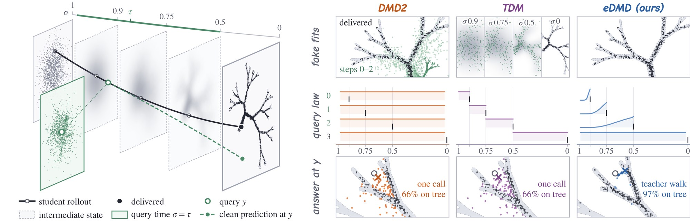
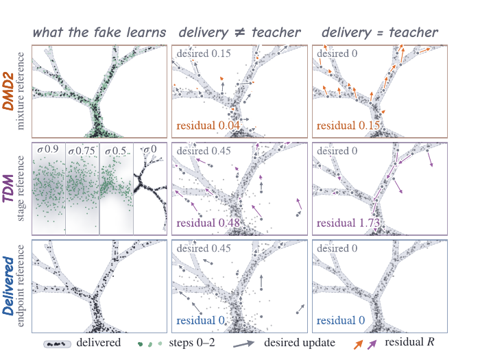
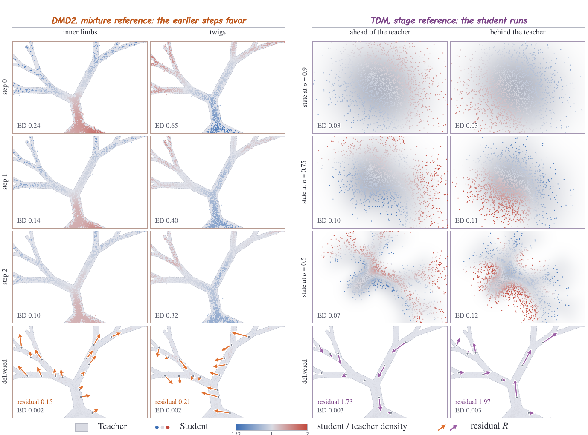
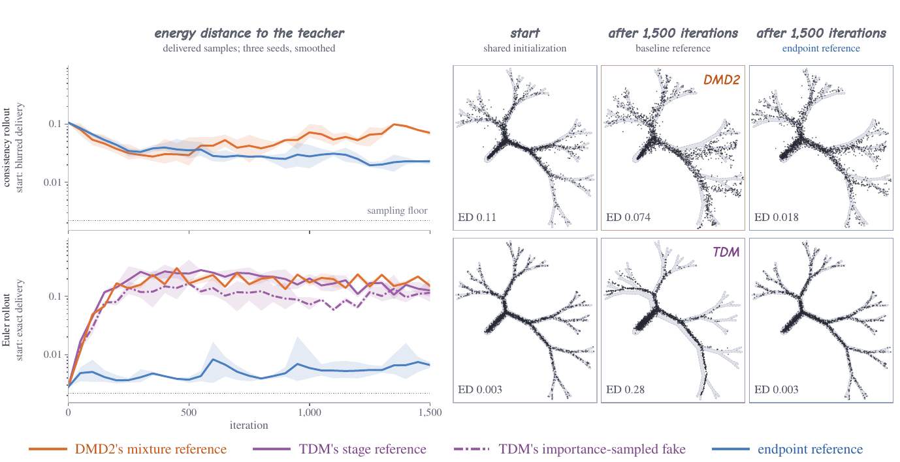
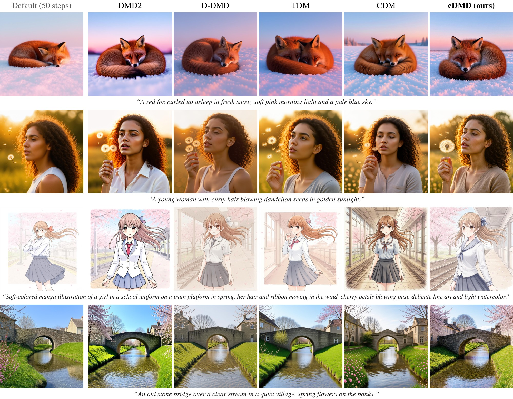
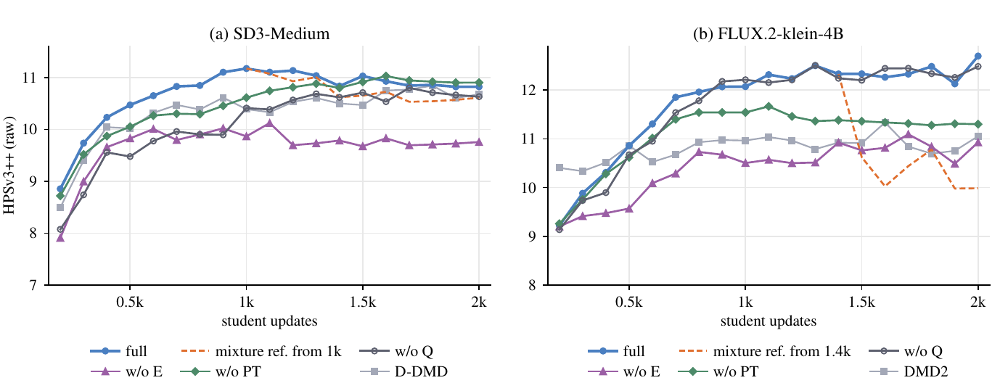
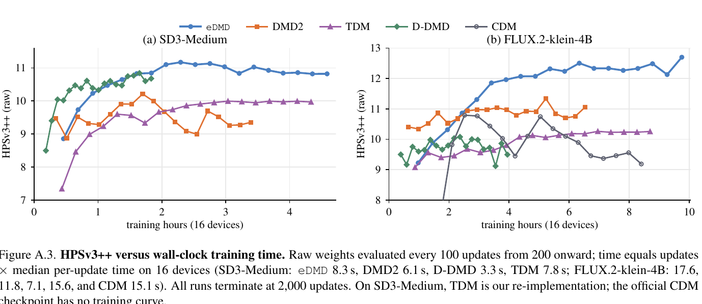

# eDMD: Endpoint Distribution Matching for Few-Step Diffusion Distillation

## 0. 메타 정보

| 항목 | 내용 |
|---|---|
| 제목 | eDMD: Endpoint Distribution Matching for Few-Step Diffusion Distillation |
| 저자 | Tong Zhao, Xianfang Zeng, Yucheng Han, Ruoyu Wang, Mingkun Lei, Gang Yu, Chi Zhang† (Zhejiang Univ. · AGI Lab, Westlake Univ. · StepFun) |
| 게재 | arXiv 2611.17194 v1 (2026-11-12). 본문 9쪽 + 참고문헌 + 부록 20쪽 (총 32쪽) |
| 분야 | cs.CV. few-step diffusion distillation(소수 스텝 확산 증류), distribution matching distillation(DMD, 분포 매칭 증류) |
| 링크 | https://arxiv.org/abs/2611.17194 · https://arxiv.org/pdf/2611.17194 |
| 코드 | https://github.com/Westlake-AGI-Lab/eDMD (커밋 24b44e5, 2026-11-13, Apache-2.0). 가중치 https://huggingface.co/zttzzt/eDMD: SD3-Medium·FLUX.2-klein 4B/9B LoRA 공개, Qwen-Image-2.1 LoRA는 TODO |
| 교사 / 데이터 | 교사: SD3-Medium, FLUX.2-klein-base 4B/9B, Qwen-Image-2.1. 학습 프롬프트: CDM의 mixed_200k (191,500개; Qwen은 prompt enhancer로 재작성한 189,719개). **실제 이미지 0장** |
| 하드웨어 | SD3·FLUX: Ascend 910B2C NPU 16장 / Qwen: H800 GPU 8장 |
| 검증 범위 | PDF 전문(부록 증명·toy experiment·구현 세부 포함)을 직접 읽음. 저장소의 알고리즘 코드(`edmd/algo/`, `edmd/methods/step.py`, `edmd/cli/calibrate.py`)와 설정 파일(`configs/`)을 전부 논문과 대조함. 학습은 돌려 보지 않음 |

---

## 0-1. 이 논문은 무엇인가? (What)

*이 절을 두는 이유: 수식에 들어가기 전에 "무엇을 고친 논문이고, 무엇은 건드리지 않았는지"를 먼저 잡아 두면 뒤의 증명이 왜 필요한지 보인다.*

### 한 문장
**4스텝 student 모델은 final output만 내놓으니, student를 평가하는 fake model도 final output만 보고 학습해야 한다.** 이것이 이름의 endpoint다.

### 풀어 쓰면
- 목표: 40스텝으로 이미지를 생성하는 teacher(교사) 모델을 4스텝 student(학생) 모델로 압축하는 distillation(증류).
- DMD는 두 denoiser의 예측 차이로 student를 학습시킨다.
  - **teacher 모델**: teacher 분포 p를 학습한 denoiser.
  - **fake model**: student 출력 분포 q를 학습 중에 실시간으로 학습하는 denoiser.
  - 두 모델의 예측이 다른 만큼 student 출력을 교정한다.
- 4스텝 학생은 **intermediate prediction 3개 + final output 1개**를 만든다. 기존 방법(DMD2, TDM)은 fake에게 intermediate prediction까지 섞어 보여줬다.
- 논문의 주장: 그러면 final output이 이미 완벽해도 "intermediate prediction이 다르다"는 이유로 엉뚱한 교정이 계속되거나, 반대로 final output이 틀렸는데 교정이 멈춘다. 이걸 수학으로 증명하고, fake를 final output만으로 학습시키는 방법(eDMD)을 제안한다.
- 덤으로 teacher 예측을 다듬는 장치 두 개를 더한다: precise teacher(PT)와 calibrated query density(Q).

### 비유
그림 학원에서 학생 실력을 평가관(fake)이 판단한다. 평가관이 학생의 "최종 제출작"이 아니라 "연습장 + 제출작" 묶음을 보고 실력을 판단하면, 제출작이 만점이어도 "연습장이 지저분하다"며 계속 고치라고 한다. eDMD는 평가관에게 제출작만 보게 한다.

### 새 모델이 아니라 학습법
- 구조는 바꾸지 않는다. 학생 = 교사 + LoRA rank 32. 추론은 4스텝 Euler 샘플링.
- 바뀌는 것은 학습 중의 두 가지뿐이다: "fake가 무엇을 배우나"와 "teacher 예측을 어떻게 얻나".
- 그래서 추론 비용은 다른 4스텝 학생과 똑같다. PT의 추가 비용도 학습 중에만 든다.


*그림 1. Qwen-Image-2.1에서 증류한 eDMD 4스텝 샘플. 교사 40스텝의 1/10로 사진·글자·다양한 화풍을 그린다.*

---

## 1. 주요 용어 사전 (Glossary)

*이 절을 두는 이유: 이 논문은 "reference distribution", "endpoint", "잔차" 같은 말을 새로 정의해서 쓰므로, 본문 전에 뜻을 맞춰 두어야 증명을 따라갈 수 있다.*

### 기본 개념
| 용어 | 쉬운 풀이 |
|---|---|
| few-step distillation(소수 스텝 증류) | 수십 번 계산해야 이미지가 나오는 생성 모델을 1~4번 계산으로 압축하는 학습 |
| teacher(교사) / student(학생) | 원래 모델 / 압축된 모델. 여기서 학생은 교사에 LoRA를 붙인 것 |
| noise level(노이즈 레벨) τ, σ | 0이면 깨끗한 샘플, 1이면 순수 노이즈. 섞는 법: `y = (1−τ)·x + τ·ε` |
| denoiser(디노이저) D | noisy sample y를 보고 원본 x의 조건부 평균 `E[x | y]`를 예측하는 모델. 어떤 분포 r로 학습했는지에 따라 D_r로 씀 |
| velocity(속도) v | flow matching 모델의 출력. clean prediction `x̂ = 현재 상태 − σ·v` |
| rollout(롤아웃) | 학생이 노이즈에서 출발해 실제로 4스텝 샘플링해 보는 과정 |
| clean prediction x̂k | student가 k번째 스텝에서 예측한 노이즈 없는 샘플. 마지막 스텝의 x̂가 final output |
| intermediate prediction | 마지막 스텝 이전(k < K−1) 스텝들의 clean prediction |
| final output | 마지막 스텝의 출력. 실제로 사용자에게 나가는 샘플(논문 표현 delivered sample) |
| Gaussian noise(가우시안 노이즈) ε | 평균 0·분산 1인 정규분포에서 좌표마다 독립으로 뽑은 노이즈 `ε ~ N(0, I)` |
| forward noising | 깨끗한 샘플에 Gaussian noise를 섞어 노이즈 레벨 τ의 샘플을 만드는 과정 |
| query(쿼리) y | clean prediction에 노이즈를 섞어 만든 입력. 여기서 teacher와 fake의 예측을 비교 |
| toy experiment(토이 실험) | 실제 이미지 대신 2D 점 분포로 단순화해, 정답 denoiser를 수식으로 정확히 계산할 수 있는 검증 실험 |

### DMD 계열
| 용어 | 쉬운 풀이 |
|---|---|
| DMD (distribution matching distillation, 분포 매칭 증류) | 학생 출력의 분포를 교사 분포에 맞추는 방법. "teacher 예측 − fake 예측" 방향으로 학생을 민다 |
| fake score model / critic(크리틱) F | student 출력으로 학습 중 실시간으로 학습되는 denoiser. student 출력 분포를 근사 |
| reverse KL(역 KL 발산) | DMD가 줄이는 거리. student 출력을 teacher 분포의 밀도가 높은 곳으로 몰아준다(mode-seeking, 모드 추구). 다양성 손실의 원인으로 알려짐 |
| correction(교정 신호) C | `C = A − F`. 학생을 미는 방향. A는 teacher 예측 |
| normalizer(노멀라이저) ω | x̂와 teacher 예측의 평균 절대 차이. C를 이 값으로 나눠 업데이트 크기를 안정화 |
| stop-gradient(미분 차단) sg | 그 값을 상수 취급해서 그쪽으로는 미분하지 않음 |
| TTUR (two time-scale update rule) | fake를 학생보다 자주 업데이트(여기선 5:1)해서 fake가 학생을 잘 따라가게 함 |

### 이 논문의 개념
| 용어 | 쉬운 풀이 |
|---|---|
| endpoint distribution q | 학생 **최종 출력**(delivered sample)의 분포 |
| reference distribution ν | fake가 **실제로 학습하는** 샘플들의 분포 |
| mixture reference | DMD2/D-DMD 방식. 여러 스텝의 clean prediction을 섞어 fake를 학습 |
| stage reference | TDM 방식. 각 스텝의 중간 상태를 그 노이즈 구간에서 따로 맞춤 |
| endpoint reference | eDMD 방식. 최종 출력만으로 fake를 학습 |
| reference residual R | fake가 endpoint distribution가 아닌 것을 배워서 생기는 불필요한 교정. `R = Dq − Dν` |
| teacher enhancement(교사 강화) | CFG 등으로 teacher 예측을 일부러 과장한 몫. `A − Dp` |
| endpoint matching | teacher 분포와 student final output 분포의 차이. `Dp − Dq`. 진짜로 원하는 correction |
| precise teacher(PT) | teacher 예측을 1회 호출로 얻는 대신, teacher ODE를 4스텝 Euler로 적분한 결과로 대신함 |
| single-step prediction | denoiser를 한 번 호출해 얻은 예측. PT와 대비되는 기본 방식 |
| calibrated query density(Q) ρk | 중간 스텝에서 "어느 노이즈 레벨로 물어볼지" 뽑는 확률. teacher 예측이 레벨 간 일관된 곳을 우대 |
| drift(드리프트) b̂ | 노이즈 레벨을 올릴 때 teacher 예측이 정상적인 averaging(평균화)을 넘어 변하는 정도 |
| landing level s = σ_{k+1} | k번째 스텝이 도착하는 노이즈 레벨 |

### 가이던스
| 용어 | 쉬운 풀이 |
|---|---|
| CFG (classifier-free guidance) | 조건부 답을 무조건부 답 반대쪽으로 더 밀어 과장. 배율 w |
| PAG (perturbed-attention guidance) | self-attention을 망가뜨린 교사를 "나쁜 답"으로 써서 같은 원리를 적용 |
| autoguidance(자기 가이던스) | 약한 모델을 "나쁜 답"으로 쓰는 가이던스. 혼합 잔차가 이와 같은 꼴이 됨 |

### 수학 도구
| 용어 | 쉬운 풀이 |
|---|---|
| score(스코어) | 로그 확률밀도의 기울기 `∇ log p`. 밀도가 높아지는 방향 |
| Tweedie formula(트위디 공식) | denoiser 예측값을 score로 표현하는 공식. 이 논문 모든 증명의 엔진 |
| SNR (signal-to-noise ratio, 신호 대 잡음비) | `((1−τ)/τ)²`. 깨끗할수록 큼 |
| probability flow ODE(확률 흐름 ODE) | 노이즈에서 샘플까지 결정론적으로 가는 경로. PT가 이 경로를 적분 |
| Euler step(오일러 스텝) | `z_{k+1} = z_k + (σ_{k+1} − σ_k)·v`. 속도 방향으로 줄일 노이즈만큼 이동 |
| energy distance(ED, 에너지 거리) | 두 점구름 분포 사이 거리. 0이면 같음. toy experiment 지표 |

### 비교 대상
| 용어 | 쉬운 풀이 |
|---|---|
| DMD2 | DMD의 다단계 확장. 무작위 스텝의 clean prediction으로 fake 학습(mixture reference). → [PAPER_DMD2.md](PAPER_DMD2.md) |
| D-DMD (Decoupled DMD) | "CFG 몫이 창, 분포 매칭이 방패"라며 두 교정 항을 분리해 정규화 |
| TDM (Trajectory Distribution Matching) | 스텝마다 그 구간의 중간 분포를 맞춤(stage reference) |
| CDM (Continuous-Time DM) | 무작위 길이·격자의 롤아웃 혼합으로 fake 학습 + 궤적 밖 교정 항 |

### 평가
| 용어 | 쉬운 풀이 |
|---|---|
| HPSv3++ | 사람 선호를 예측하는 보상 모델 점수. 이 논문의 주 지표이자 체크포인트 선택 기준 |
| DrawBench-1000 | DrawBench 프롬프트 200개 × 시드 5개 = 이미지 1,000장 |
| DPG-Bench | 긴 프롬프트를 얼마나 따르는지 질의응답(mPLUG)으로 채점 |
| peak(최고점) | 100 업데이트마다 raw/EMA 가중치를 평가해 HPSv3++가 가장 높은 체크포인트의 점수 |

---

## 2. 논문 요약 (TL;DR)

- **한 줄**: 다단계 DMD에서 fake 모델은 "학생 최종 출력"만 배워야 한다. 그래야 교정 신호에 섞인 엉뚱한 성분(reference residual)이 정확히 0이 된다.
- **문제**: DMD2·TDM은 fake에 중간 예측까지 넣는다. 그러면 final output이 이미 교사와 같아도 교정이 멈추지 않거나(TDM), final output이 틀렸는데 멈춘다(DMD2).
- **해결**:
  - (E) endpoint fake: fake 하나를 최종 출력만으로 학습해 모든 스텝 교정에 같이 씀
  - (PT) 마지막 스텝의 저노이즈 query에는 teacher 4스텝 적분 결과를 사용
  - (Q) 중간 스텝 query 레벨을 교사 일관성(drift b̂)으로 보정
- **검증**: SD3-Medium, FLUX.2-klein 4B/9B, Qwen-Image-2.1을 4스텝으로 증류. HPSv3++ 최고점이 교사 4개 모두에서 1위. ablation에서 E가 가장 큰 기여.

---

## 3. 핵심 기여 (논문 주장)

1. **목표 불일치의 이론화**: 중간 예측으로 fake를 학습하면 reference residual R이 생겨 분포 매칭이 왜곡된다. "R = 0 ⇔ fake가 endpoint distribution를 배움"을 증명(명제 1). 세 참조 방식의 교정 멈춤 조건을 비교(명제 2).
2. **eDMD**: 공유 fake 하나를 최종 출력만으로 학습하고 모든 스텝 교정에 사용.
3. **교사 감독 강화**: precise teacher(PT)와 calibrated query density(Q).
4. **실험**: 백본 4개에서 기존 분포 매칭 방법 대비 일관된 개선, 세부 묘사 향상, 구조적 아티팩트 감소.

---

## 4. 주요 알고리즘 설명

*이 절을 두는 이유: 이 논문의 핵심은 수식이고, 수식이 어렵다는 게 가장 큰 진입 장벽이다. 논문 순서대로 식 하나씩 "말로" 풀고, 각 식이 코드 어디에 어떻게 구현됐는지를 바로 아래에 붙인다.*

> 코드 링크는 모두 커밋 24b44e5 고정. `G` = https://github.com/Westlake-AGI-Lab/eDMD/blob/24b44e50d02ab48e892a2bbfeffbd0a5f19a500b


*그림 2. 2D 나무 모양 toy 분포(회색)에서 본 eDMD 개요. 왼쪽: 4스텝 student가 노이즈(σ=1)에서 final output(σ=0, "delivered")까지 가고, 한 스텝의 clean prediction에 레벨 τ의 노이즈를 섞은 query y에서 teacher와 fake를 비교한다. 오른쪽 세 줄: (위) fake가 배우는 것 — DMD2는 intermediate prediction(초록, steps 0–2)+final output 혼합, TDM은 단계별 중간 상태, eDMD는 final output만. (가운데) query 레벨 분포 — DMD2는 전 구간 균등, TDM은 자기 구간만, eDMD는 landing level 위에서 보정된 밀도. (아래) query에 대한 teacher 예측 — single-step prediction(one call)은 66%만 나무 위, eDMD의 teacher walk(PT)는 97%가 나무 위.*

### 4.1 기본 재료: forward noising과 denoiser (3.1절, 부록 식 A.1–A.2)

*이 절을 두는 이유: 뒤의 모든 식이 이 두 재료로 만들어지고, 특히 Tweedie 공식 한 줄이 모든 증명의 엔진이다.*

**forward noising** (깨끗한 샘플 x에 Gaussian noise ε를 τ 비율로 섞음):
```
y = (1 − τ)·x + τ·ε,    ε ~ N(0, I)
```

**denoiser**: 분포 r로 학습한 모델이 noisy sample y에서 원본 x를 예측한 조건부 평균 `D_r(y, τ) = E[ x | y ]`.

**Tweedie 공식** (식 A.2). denoiser 예측값을 score로 쓴 것:
```
D_r(y, τ) = [ y + τ² · ∇_y log r_τ(y) ] / (1 − τ)
```
말로 풀면: "noisy sample y에서 출발해, 분포 r의 밀도가 높아지는 방향(score, ∇ log r_τ)으로 τ²만큼 이동한 다음, (1−τ)로 나눠 원래 스케일로 되돌린다."

**핵심 귀결**: 같은 y에 대해 두 분포 a, b의 denoiser를 빼면 y 항은 지워지고 score 차이만 남는다.
```
D_a − D_b = τ²/(1−τ) · ∇_y log( a_τ / b_τ )
```
→ 명제 1, 식 5, 부록 A.13 등 이 논문의 거의 모든 증명이 이 한 줄로 돌아간다.

### 4.2 DMD 기본식 (식 1, 2)

*이 절을 두는 이유: eDMD는 DMD 위에 얹은 수정이라, 원래 학생을 어떻게 업데이트하는지 먼저 알아야 무엇이 바뀌었는지 보인다.*

**식 1** (1스텝 student, 학생 파라미터 θ에 대한 역 KL 기울기):
```
∇_θ KL(q_τ ‖ p_τ) = − (1−τ)²/τ² · E[ (Dp(y,τ) − Dq(y,τ)) · ∂x̂/∂θ ]
```
말로 풀면: 학생 출력 x̂에 노이즈를 섞어 y를 만들고, "teacher 예측 Dp(y) − student 분포의 예측 Dq(y)" 방향으로 x̂를 옮겨라. 앞의 `(1−τ)²/τ²`는 SNR이라 항상 양수이고, 방향은 그대로 두고 세기만 조절한다.

> 비유: 흐린 사진을 두 감정사에게 보여준다. 진짜 감정사는 "원래 털이 살아 있는 여우였겠네", 학생 감정사는 "학생 그림이면 털이 뭉개진 여우였겠지"라고 한다. 그 차이가 "털을 살려라"라는 지시다.

student 분포의 denoiser Dq는 알 수 없으므로 fake F를 student 출력으로 실시간 학습해 대신한다. 그래서 교정은
```
C = A − F      (A: teacher 예측, 보통 CFG 적용; F: fake 예측)
```

**식 2** (실제로 쓰는 손실, surrogate loss):
```
L_G = E ‖ x̂k − sg( x̂k + C/ω ) ‖²,     ω = ‖x̂k − A‖₁ / n
```
- sg(stop-gradient)는 상수 취급이라, 이 MSE를 미분하면 정확히 "x̂를 C/ω 방향으로 밀어라"가 된다. 원하는 방향을 autograd에 전달하기 위한 surrogate loss일 뿐이다.
- ω(normalizer)는 x̂와 teacher 예측의 평균 절대 차이(n은 좌표 수). 차이가 크면 크게 나눠서 업데이트 크기를 일정하게 유지한다.

→ **코드 확인**: [`edmd/algo/generator.py:84`](https://github.com/Westlake-AGI-Lab/eDMD/blob/24b44e50d02ab48e892a2bbfeffbd0a5f19a500b/edmd/algo/generator.py#L84) `surrogate_loss`. eDMD 설정은 `placement: loss`로 `‖x̂ − sg(x̂+C)‖² / ω` 형태다. MSE에서는 두 형태(`target`/`loss`)의 그래디언트가 `−2C/(ωN)`로 같다고 파일 docstring(1–21행)에 적혀 있고, 실제로 같다.

### 4.3 문제 제기: 4스텝이면 fake는 무엇을 배워야 하나 (3.1절 후반)

*이 절을 두는 이유: 1스텝 student에서는 "clean prediction = final output"이라 이 질문 자체가 없었다. 여러 스텝이 되면서 처음 생긴 설계 선택이다.*

학생은 노이즈 격자를 따라 4번 움직인다(SD3: `1 → 0.9 → 0.75 → 0.5 → 0`, FLUX: `1 → 0.967 → 0.908 → 0.767 → 0`). 매 스텝 clean prediction x̂0, x̂1, x̂2, x̂3을 내고, final output은 x̂3(= z_K)이다. 스텝별 clean prediction 분포를 qk, final output 분포를 q(endpoint distribution)라고 한다. fake가 학습하는 샘플 분포가 **reference distribution ν**다.

| 방식 | fake가 보는 것 | 참조 ν |
|---|---|---|
| DMD2, D-DMD, CDM | 무작위로 고른 스텝의 x̂k | 스텝별 분포의 **혼합** `Σ πk·qk` |
| TDM | 각 스텝의 중간 상태 z_{k+1} | **스텝별** 중간 분포 rk |
| **eDMD** | **최종 출력 x만** | **endpoint distribution q 그 자체** |

### 4.4 식 3: 교정 신호를 세 조각으로 쪼개기

*이 절을 두는 이유: "fake가 무엇을 배우느냐"가 학생 업데이트에 어떤 영향을 주는지 보려면, 교정 C를 원하는 성분과 원치 않는 성분으로 분리해야 한다.*

fake가 자기 참조를 정확히 배웠다고 가정(F = Dν)하고, Dp와 Dq를 한 번씩 더했다 빼면:
```
C = (A − Dp)  +  (Dp − Dq)  +  (Dq − Dν)
    교사 강화      endpoint matching      reference residual R
```
새 가정은 없다. 같은 항을 더했다 뺐을 뿐이다.

| 조각 | 이름 | 뜻 | 원하는 힘인가? |
|---|---|---|---|
| A − Dp | teacher enhancement(교사 강화) | CFG로 과장한 몫 | 의도한 힘 (D-DMD는 이걸 "창"이라 부름) |
| Dp − Dq | endpoint matching | teacher 분포와 student final output 분포의 차이 (= 식 1의 방향) | **진짜 목표** |
| Dq − Dν | reference residual R | fake가 final output이 아닌 것을 배워서 생긴 힘 | 불필요 |

0-1절의 평가관 비유에서 "연습장이 지저분하다"는 지적이 바로 R이다.

### 4.5 명제 1 (식 4): 잔차의 정체와 0이 되는 유일한 조건

*이 절을 두는 이유: R을 없애려면 R이 정확히 무엇인지, 언제 0이 되는지를 알아야 한다.*

4.1의 핵심 귀결을 q와 ν에 적용하면:
```
R = Dq − Dν = τ²/(1−τ) · ∇_y log( q_τ / ν_τ ),     그리고   R ≡ 0  ⇔  ν = q
```
- 말로 풀면: R은 student final output 분포(q)의 밀도가 fake의 reference distribution(ν)보다 상대적으로 높은 쪽으로 미는 힘이다.
- 논리의 사슬:
  1. R이 어디서나 0
  2. ⇔ 밀도 비율 `q_τ/ν_τ`가 어디서나 일정
  3. ⇔ 확률 총합이 1이므로 두 노이즈판 분포가 같다 (`q_τ = ν_τ`)
  4. ⇔ 원래 분포도 같다 (`q = ν`)
- 4번이 성립하는 이유: forward noising은 분포를 Gaussian과 convolution해 퍼뜨릴 뿐 정보를 지우지 않는다. 특성함수(푸리에) 관점에서 이 convolution은 절대 0이 되지 않는 값 `e^{−τ²‖ω‖²/2}`을 곱하는 것이라 되돌릴 수 있다(식 A.6). 2→3은 열린 집합에서 0이면 전체에서 0이라는 해석함수의 항등정리(identity theorem)로 보인다.
- 경계 레벨(τ=0, τ=1)은 제외: τ=0이면 관측이 곧 원본이고, τ=1이면 denoiser가 평균만 돌려준다.
- **결론**: fake가 endpoint distribution를 정확히 배우는 것 말고는 잔차를 없앨 방법이 없다.

### 4.6 식 5: mixture reference(DMD2)의 잔차는 어디로 미나

*이 절을 두는 이유: "잔차가 있다"를 넘어 "어느 방향으로 학생을 망가뜨리는지"를 알면 실제 증상(밋밋한 질감)과 연결된다.*

스텝 선택을 확률변수 J로 두면(πk = P(J=k)), mixture reference의 잔차는 마지막 스텝에서
```
R_mix(y, τ) = τ²/(1−τ) · ∇_y log P( J = K−1 | Y_τ = y )
```
- 말로 풀면: "noisy sample y가 마지막 스텝에서 나왔을 사후확률"이 올라가는 쪽으로 최종 출력을 민다. 즉 최종 출력을 **intermediate prediction들과 구별되는 쪽으로** 밀어낸다.
- 그래서 intermediate prediction이 바뀌면 final output이 의도치 않게 영향을 받는다.
- final output이 완벽할 때(q = p)도 `R_mix = (1−ϖ)(Dp − D_q̄)`가 남는다(ϖ는 마지막 스텝의 사후확률, q̄는 intermediate prediction들의 혼합). 이것은 "intermediate prediction(약한 모델 역할)에서 멀어지는 외삽"으로, autoguidance와 같은 꼴이다(식 A.28–A.29).

### 4.7 명제 2 (식 6): 교정은 언제 멈추나

*이 절을 두는 이유: 좋은 학습법은 "목표에 도달했을 때 정확히 멈춰야" 한다. 세 방식이 언제 멈추는지가 곧 무엇을 목표로 하는지다.*

teacher 예측이 무가이던스(A = Dp)이고 denoiser가 정확하다고 할 때, 모든 스텝·모든 query에서 교정이 0이 되는 학생의 집합:
```
endpoint:  { q = p }
mixture:   { Σk πk·qk = p }
stage:     { q = p,  rk = p_{σ_{k+1}}  ∀ k < K−1 }
```

| 참조 | 교정이 0이 되는 학생 | 문제점 |
|---|---|---|
| **endpoint (eDMD)** | final output = 교사 | 없음. 정확히 원하는 곳에서 멈춤 |
| 혼합 (DMD2) | 4스텝 평균 = 교사 | final output이 틀려도 intermediate prediction이 오차를 상쇄하면 멈춤 |
| 단계 (TDM) | final output = 교사 **이면서** 모든 중간 상태 = 교사의 중간 상태 | final output이 완벽해도 중간이 다르면 계속 밀어냄 |

**숫자 예시 (부록 A.3, 두 갈래 rL/rR, 스텝 선택 균등 1/4)**

| | rL 비율 | rR 비율 |
|---|---|---|
| 교사 p | 50% | 50% |
| intermediate prediction q0, q1, q2 각각 | 40% | 60% |
| 최종 q3 | **80%** | **20%** |
| 혼합 ν (intermediate prediction ¾ + 최종 ¼) | 0.75×40 + 0.25×80 = **50%** | **50%** |

final output은 80:20으로 엉망인데 혼합은 50:50이라 교사와 같다 → DMD2는 교정 0. endpoint reference라면 80:20 ≠ 50:50이라 계속 교정한다.

**혼합이 만드는 반대 방향 편향** (식 A.25–A.31): K=4, 균등 선택에서 ν = p를 만족시키면 `q − p = −3·(q̄ − p)`. 즉 intermediate prediction이 교사보다 한쪽으로 치우친 만큼 final output은 **반대쪽으로 3배** 치우쳐야 균형이 맞는다. 1차원 예: intermediate prediction 분산 β, 교사 분산 1이면 final output 분산 `v = 1 + 3(1 − β)` — intermediate prediction이 좁으면(β<1) final output은 지나치게 넓어진다.

**TDM 쪽 예시** (Lemma 2): 1차원 가우시안, 2스텝에서 final output이 정확히 교사와 같아도(q = p), 중간 상태 분산 a₀²이 교사 중간 분산 S_s와 다르면 교정 기울기 부호가 `a₀² − S_s`로 0이 아니다 → 한 번 업데이트하면 final output 분산이 1에서 벗어난다. 또 TDM 실제 코드는 중요도 가중 `w^{1/n}`(차원 평균)을 쓰는데, 이 경우에도 교사의 확률 흐름을 그대로 따르는 학생조차 교정이 0이 되지 않음을 반례로 보였다(식 A.38–A.42, 표 A.1).

### 4.8 2D toy experiment 검증 (3.3절, 그림 3·A.1·A.2, 부록 B)

*이 절을 두는 이유: 이론은 "정확한 denoiser" 가정 위에 있으므로, 정답을 식으로 알 수 있는 toy experiment에서 실제로 그 현상이 보이는지 먼저 확인한다.*

- 교사: Karras 등의 프랙탈 나무 벤치마크를 한 단계 줄인 분포. 가지 63개 × 2D 가우시안 8개 = 504개 성분. 노이즈판 밀도와 denoiser를 닫힌 형태로 계산 가능.
- 학생 격자는 SD3와 같은 `(1, 0.9, 0.75, 0.5, 0)`, teacher 예측은 무가이던스 A = Dp(그래서 교정 = endpoint matching + 잔차만 남음).


*그림 3. 세 참조(위: DMD2 혼합, 가운데: TDM 단계, 아래: eDMD endpoint). 왼쪽: fake가 배우는 것. 가운데: final output이 틀린 학생(q≠p)의 한 번 업데이트. 오른쪽: final output이 맞는 학생(q=p). 회색 화살표 = 원하는 업데이트(endpoint matching), 주황/보라 화살표 = 잔차가 더한 엉뚱한 이동. 맞는 학생에게 원하는 업데이트는 0인데, 혼합(0.15)·단계(1.73)는 계속 민다. endpoint는 잔차 0.*


*그림 A.1. 최종 출력은 교사와 같고(q=p) intermediate prediction 편향만 반대인 두 학생. 왼쪽 DMD2(intermediate prediction이 안쪽 가지 선호 vs 잔가지 선호), 오른쪽 TDM(교사보다 앞서감 vs 뒤처짐). 맨 아래 줄: 잔차가 만드는 업데이트가 두 학생에서 정반대 방향.*

- **정반대 업데이트**: 최종 출력이 같은 두 학생에서 잔차 업데이트의 중앙값 코사인이 −0.97(DMD2), −0.999(TDM). 음의 코사인을 받는 샘플 비율 94%, 97%. endpoint reference는 두 학생 모두 업데이트 0.


*그림 A.2. 1,500 iteration 학습. 위: blurred final output에서 출발한 consistency 학생 — endpoint reference가 더 교사에 가까워짐. 아래: final output이 정확한(q=p) Euler 학생 — 혼합·단계·중요도 가중 fake는 모두 final output을 망가뜨리고(ED 0.003 → 0.28 등), endpoint는 0.003 유지.*

**final output이 이미 완벽한 학생(S3)에서 출발한 결과** (ED, 바닥 0.002, 1,500 iteration, 3시드 중앙값)

| 참조 | 결과 ED |
|---|---|
| TDM stage reference | 0.18 (망가짐. 그 사이 중간 상태 ED는 0.066 → 0.018~0.028로 오히려 교사에 가까워짐) |
| TDM 실제 코드 (중요도 가중) | 0.092 |
| DMD2 혼합 | 0.19 |
| **endpoint** | **0.004 (유지)** |

**불완전한 학생에서 출발한 결과**
- Consistency 롤아웃(DMD2 스타일): mixture reference는 4스텝 혼합 거리를 0.14 → 0.03~0.04로 줄이지만 final output은 0.063에 머문다. endpoint는 0.027, 바깥 잔가지 샘플 비율도 11% → 19%로 회복(교사 20%).
- Euler 롤아웃(교사 초기화 T4): stage reference 0.045, mixture reference 0.33, endpoint 0.021.

→ **코드 확인**: 이 toy experiment 코드는 **저장소에 없다**. [`edmd/models/toy.py`](https://github.com/Westlake-AGI-Lab/eDMD/blob/24b44e50d02ab48e892a2bbfeffbd0a5f19a500b/edmd/models/toy.py#L1)는 "CPU-only checks"용 선형층 스텁이다. 그림 2·3·A.1·A.2는 재현할 수 없다.

### 4.9 식 7–8: eDMD의 fake 학습과 학생 업데이트 (4.1절)

*이 절을 두는 이유: 명제 1이 "fake가 endpoint를 배워야 한다"고 했으니, 그걸 그대로 구현하는 부분이다.*

**식 7** (fake 손실; 최종 출력 x에 노이즈를 섞고 "원본을 맞혀봐"를 시키는 평범한 denoiser 학습):
```
L_F = E[ λ(τ) · ‖ F((1−τ)·x + τ·ε, τ) − x ‖² ],   ε ~ N(0,I),  τ ~ U[0.02, 0.99)
λ(τ) = min{ max{ SNR(τ), 1 }, 10 },   SNR(τ) = ((1−τ)/τ)²
```
- 가중치 λ: τ ≤ 0.24이면 상한 10(SNR=10이 되는 점이 τ≈0.240), τ ≥ 0.5이면 하한 1, 그 사이는 10에서 1로 감소.
- 뜻: 깨끗한 레벨의 오차를 최대 10배까지만 중시해 폭주를 막는다.
- 최적해는 F = Dq → 식 3의 잔차가 어떤 teacher 예측 A에 대해서든 사라지고 **C = A − Dq**가 모든 스텝에서 성립.

**따름정리 1**: ν = q일 때, A가 어떤 분포 p*의 denoiser(A = D_{p*})라면 "모든 스텝·모든 query에서 교정 0 ⇔ q = p*". 중간 스텝 분포나 query 밀도와 무관하다.

**식 8** (학생 업데이트의 기댓값):
```
Δθ ∝ Σk πk · E[ (∂x̂k/∂θ)ᵀ · (A(yk, τ) − Dq(yk, τ)) / ωk ]
```
샘플마다 스텝 k를 확률 πk(= 1/4)로 뽑고, 그 스텝의 x̂k를 같은 fake로 교정한다. 롤아웃은 미분이 차단돼 있어 그래디언트는 뽑힌 스텝의 x̂k로만 흐른다.

→ **코드 확인**:
- [`edmd/algo/critic.py:57`](https://github.com/Westlake-AGI-Lab/eDMD/blob/24b44e50d02ab48e892a2bbfeffbd0a5f19a500b/edmd/algo/critic.py#L57) `fresh_label_loss`는 속도 공간 잔차로 계산한다. s=0(깨끗한 출력이 출발점)일 때 잔차 = `t·(v_F − (z − x0))` = fake의 x0 오차와 같고(x0 오차 = τ × 속도 오차), 가중치 `((1−t)/t)²`를 곱하면 정확히 x0 MSE × SNR이다.
- [`critic.py:89`](https://github.com/Westlake-AGI-Lab/eDMD/blob/24b44e50d02ab48e892a2bbfeffbd0a5f19a500b/edmd/algo/critic.py#L89)에서 endpoint 샘플(`s == 0`)만 SNR을 `terminal_clamp: [1, 10]`으로 자른다 → 식 7, 표 A.2와 일치.
- Qwen은 run 파일에서 `terminal_clamp: [null, 5.0]`(min(SNR, 5), 하한 없음) → 부록 F와 일치.
- fake 학습 query: `critic.query`가 `lo: 0.02, margin: 0.01`, 구간 `overlap` → τ ∈ [0.02, 0.99).

### 4.10 식 9: 가이던스 (4.2절)

*이 절을 두는 이유: 무가이던스 교사에 맞추면 학생은 교사의 "가이던스 없는" 분포를 배운다. 실제로 좋은 그림을 얻으려면 teacher 예측을 가이던스로 강화해야 한다(D-DMD의 결론).*

```
B = T + γ·(T − T⁻)
```
"좋은 답 T에서 덜 좋은 답 T⁻의 반대쪽으로 γ만큼 더 간다."
- **CFG**: T = Tc(조건부, 프롬프트 있음), T⁻ = Tu(무조건부). 흔히 쓰는 배율로는 `B = Tu + w·(Tc − Tu)`, w = 1 + γ. SD3 w=7, FLUX w=4(각 교사 기본값).
- **Qwen-Image-2.1**: 기본 w=1(CFG 없음) → **PAG** 사용: `B = Tc + γ·(Tc − Tc^pag)`, Tc^pag는 6번 블록의 self-attention을 망가뜨린 교사, γ=5. 블록은 40스텝 교사·128 프롬프트로 고르고 γ는 {3,4,5}에서 선택. 마지막 스텝 입력 레벨(σ_{K−1})보다 높은 노이즈에만 적용.

→ **코드 확인**: [`edmd/algo/generator.py:47`](https://github.com/Westlake-AGI-Lab/eDMD/blob/24b44e50d02ab48e892a2bbfeffbd0a5f19a500b/edmd/algo/generator.py#L47) `coupled_correction`: `C = (T_c − F) + (w−1)(T_c − T_u) = T^w − F`. 정확히 식 9의 B − F. PAG는 `step.py`의 `_pag_increment`에서 `band: compose`일 때 `t > σ_{K−1}`인 query에만 `scale·(T_c − T_c^deg)`를 더한다.

### 4.11 식 10 + 부록 A.5: precise teacher PT

*이 절을 두는 이유: endpoint fake가 "학생 쪽 기준"을 고쳤다면, PT는 "교사 쪽 답"을 날카롭게 만든다. teacher 예측이 blurry하면 student도 blurry한 이미지를 학습한다.*

**문제**: 한 번의 denoiser 호출은 "가능한 답들의 평균"이다. 정답 후보가 두 갈래면 평균은 두 갈래 사이의 빈 곳에 떨어지고, 그림으로는 흐릿함이 된다.

> 비유: 갈림길 앞에서 "평균 목적지"를 한 번에 찍으면 두 길 사이 숲속에 떨어진다. 네 걸음으로 나눠 걸으면 어느 한 갈래 위에 도착한다.

**식 10**:
```
A(y, τ) = Φ^B_{τ→0}(y)   if  k = K−1  and  τ < σ_{K−1}
          B(y, τ)         otherwise
```
- Φ^B_{τ→0}: 가이던스를 적용한 교사 B의 ODE를 query 지점 y에서 0까지 적분한 도착점.
- 적분은 Euler 4스텝, 노드 `τ × {1, ¾, ½, ¼}` → 0. 마지막 스텝(τ/4 → 0)은 τ/4에서의 denoiser 예측과 같다.
- 마지막 스텝의 저노이즈 query에만 적용: 마지막 스텝이 곧 final output을 만들기 때문에 세부 묘사를 다듬는 곳에 집중.

**근거 1: toy experiment의 on-tree 비율(teacher 분포 위에 놓인 비율)** (부록 B.3, 마지막 구간의 갈림 영역)

| τ | 0.15 | 0.25 | 0.32 | 0.45 |
|---|---|---|---|---|
| single-step prediction Dp(y, τ) | 96% | 83% | 66% | 42% |
| PT | 99% | 98% | 97% | 96% |

**근거 2: 가우시안 계산** (Lemma 3, 교사 p = N(μ, λ))
- single-step prediction의 분산 = `ρ_τ²·λ` (ρ_τ < 1은 X와 Y_τ의 상관계수) → 퍼짐이 줄어 밋밋해진다.
- ODE 도착점의 분산 = `λ` → 원래 퍼짐을 보존한다.
- 대신 평균 제곱 오차는 single-step prediction이 작다: `λ(1−ρ²)` vs `2λ(1−ρ)` (차이 `λ(1−ρ)² ≥ 0`). 즉 **"평균은 오차 점수에는 유리하고 질감에는 불리"**. 이것이 PT를 쓰는 이유다.
- 4스텝 Euler의 계수 c₄는 single-step prediction과 정확한 흐름 사이에 끼인다(`g_τ < c₄ < h_τ`). λ=1, τ=½에서 c₄ = 1.3045, 정확한 흐름 1.4142.
- Lemma 4: endpoint fake + PT(아래 구간)·single-step prediction(위 구간) 혼합 목표에서 크기만 조절하는 학생의 평형 분산은 `λ < v < (1 + 1/ρ_s)·λ`로 유한하게 잡힌다(τ~U[0.02,0.99), s=0.5에서 정확 적분 1.38λ, 4스텝 Euler 1.27λ). 즉 PT 목표는 "교사보다 약간 넓게" 평형이 잡히고 폭주하지 않는다.

**비용** (식 A.61): PT가 걸리는 query 비율
```
f_PT = (σ_{K−1} − 0.02) / (0.97·K)     → SD3 12.4%, FLUX 19.3%
```
선택적으로 계산하면 샘플당 평균 `3·f_PT`번의 가이던스 교사 호출만 추가된다.

**PT 범위가 중요하다**: 모든 스텝·모든 query로 확장하면 FLUX 4B에서 학습이 붕괴(1k 업데이트에서 HPSv3++ −1.23), SD3에서는 500 업데이트 시점에 전체 방법보다 1.43 낮다.

**PT 이득의 출처** (부록 C): 정규화 ω만 PT 값으로 바꾸면 SD3 변화 없음, FLUX −0.07. 조건부 Tc만 적분하고 CFG 몫은 single-step prediction 값을 유지하면 SD3는 전체와 같고 FLUX는 이득 0.53 중 0.46 회복 → **궤적 적분 자체가 주된 원인**.

→ **코드 확인**:
- [`edmd/algo/engine.py:23`](https://github.com/Westlake-AGI-Lab/eDMD/blob/24b44e50d02ab48e892a2bbfeffbd0a5f19a500b/edmd/algo/engine.py#L23) `walk_grid`: 노드 = `t × linspace(1, 1/4, 4)` 후 0 → 논문과 일치. [`engine.py:41`](https://github.com/Westlake-AGI-Lab/eDMD/blob/24b44e50d02ab48e892a2bbfeffbd0a5f19a500b/edmd/algo/engine.py#L41) `walk`는 스텝 길이 가중 평균 속도 `v̄`를 돌려줘서 `x_t − t·v̄`가 정확히 도착점이 되게 한다.
- [`edmd/methods/step.py:404`](https://github.com/Westlake-AGI-Lab/eDMD/blob/24b44e50d02ab48e892a2bbfeffbd0a5f19a500b/edmd/methods/step.py#L404) `_read_walked`: 창 안(마지막 스텝, `t ≤ σ_{K−1}`)이면 walk 결과, 밖이면 첫 노드 예측(= single-step prediction)을 쓰고, ω도 그 teacher 예측 기준으로 계산 → 부록 C "PT는 A와 ω 둘 다 바꾼다"와 일치.
- Qwen에서 walk 노드는 모두 `t ≤ σ_{K−1}`이라 PAG 몫이 0이 되므로 Tc만 적분 → 부록 F와 일치.
- 단, FSDP 제약("FSDP needs identical forwards on every rank", engine.py docstring) 때문에 **배치 전체에 4노드 × (조건부+무조건부) = 8번의 교사 호출**을 하고, 창 밖 샘플(80~88%)은 나머지 3노드 결과를 버린다. 논문은 이 구현으로 시간을 쟀다고 밝혔다.

### 4.12 식 11–12 + 부록 D: query 레벨 보정 Q

*이 절을 두는 이유: 중간 스텝은 "어느 노이즈 레벨에서 교사에게 물어볼지"에 따라 다른 지시를 받는다. teacher 예측이 흔들리는 레벨에서 물으면 엇갈린 감독을 받는다.*

**식 11** (결정론적 Euler 롤아웃; 속도 방향으로 줄일 노이즈만큼 한 스텝):
```
v̂k = Gθ(zk, σk),    x̂k = zk − σk·v̂k,    z_{k+1} = zk + (σ_{k+1} − σk)·v̂k
```
이것은 DDIM 결정론적 전이와 같다(부록 C: `z_{k+1} = (σ_{k+1}/σk)·zk + (1 − σ_{k+1}/σk)·x̂k`). DMD2·D-DMD는 매 스텝 새 노이즈를 뽑는다는 점이 다르다.

**query 범위**: 스텝 k는 자기가 도착하는 레벨 s = σ_{k+1} 이상(노이즈가 더 많은 쪽)에서만 질문한다. 그보다 세밀한 것은 다음 스텝의 몫이다.

**식 12**:
```
τ ~ ρk ∝ exp( − b̂_{σ_{k+1}}(τ) )    on  [σ_{k+1}, 1)    (실제 상한 0.99)
```

**drift b̂ 측정을 단계별로** (식 A.62–A.64):
1. teacher가 생성한 샘플 X(teacher 기본 샘플러: SD3 28스텝 w=7, FLUX 50스텝 w=4, Qwen 40스텝 w=1)에 레벨 s의 노이즈를 섞어 `Ys = (1−s)·X + s·ε`. 같은 Ys에 노이즈를 더 섞어 레벨 τ로 올리면
   ```
   Ỹτ = a·Ys + √(τ² − a²s²)·ζ,     a = (1−τ)/(1−s)
   ```
   같은 샘플을 낮은 레벨 s와 높은 레벨 τ에서 관측한 짝이다. (Ỹτ는 X에 대해 조건부로 보면 새 노이즈 query `(1−τ)X + τε`와 분포가 같다.)
2. 이상적(무가이던스, 정확한) 교사라면 `Dp(Ỹτ, τ) = E[ Dp(Ys, s) | Ỹτ ]` — "높은 레벨에서의 예측 = 낮은 레벨 예측들의 조건부 평균". 정보가 줄어든 만큼 averaging되는 것이 정상이다. 이를 넘는 차이가 **drift**다.
3. 차이 `Δ = T^w(Ỹτ, τ) − T^w(Ys, s)`, 교사 자기 오차 `err_s = E‖Tc(Ys, s) − X‖²`.
4. drift는 직접 재기 어렵다 → feature φ ∈ {T^w, Tc, T^w − Tc}(모두 (Ỹτ, τ)에서 계산)로 "Δ가 feature와 얼마나 같은 방향인가"를 잰다:
   ```
   b̂_s(τ) = max_φ  ( E⟨Δ, φ⟩ )² / ( E‖φ‖² · err_s )
   ```
   φ는 Ỹτ의 함수라서 정상적인 averaging 부분은 φ와 직교해 내적에서 빠진다. 그래서 코시-슈바르츠 부등식으로 **"drift가 적어도 이만큼은 있다"는 하한**이 된다: `b̂_s(τ) ≤ E‖T^w(Ỹτ,τ) − m_{s,τ}‖² / err_s`.
5. 밀도 ρ는 exp(−b̂)에 비례: b̂가 1 늘 때마다 뽑힐 확률이 약 1/2.7배.

> 비유: 같은 질문에 증언이 오락가락하는 증인에게는 덜 묻는다.

측정은 landing level마다 학습 프롬프트 256개 × 노이즈 짝 2개, s 위의 레벨 13개. 학습 전 교사·격자마다 1회만(SD3 5.4분, FLUX 4B 15.8분, 9B 33.7분). 학습 중에는 선형 보간 + 역CDF 샘플링이라 교사 호출이 추가되지 않는다.

**실측값** (표 A.3; 유효 지지 비율 = e^{엔트로피}/(0.99 − s), 균등이면 1)

| 교사 | landing level s | b̂_s(0.99) | 평균 query 레벨 (ρk / 균등) | 유효 지지 비율 |
|---|---|---|---|---|
| SD3 (w=7) | 0.900 / 0.750 / 0.500 | 13.6 / 26.9 / 52.7 | 0.913/0.945, 0.793/0.870, 0.608/0.745 | 0.39 / 0.46 / 0.55 → 도착점 근처 집중 |
| FLUX 4B (w=4) | 0.967 / 0.908 / 0.767 | 0.36 / 1.02 / 1.63 | 0.978/0.979, 0.942/0.949, 0.853/0.879 | 0.99 / 0.96 / 0.92 → 거의 균등 |
| FLUX 9B (w=4) | 0.967 / 0.908 / 0.767 | 0.33 / 0.87 / 1.53 | 0.978/0.979, 0.942/0.949, 0.853/0.879 | 0.99 / 0.96 / 0.92 → 거의 균등 |
| Qwen (w=1) | 0.857 / 0.666 / 0.400 | 1.94 / 3.10 / 5.73 | 0.915/0.923, 0.811/0.828, 0.663/0.695 | 0.95 / 0.94 / 0.92 → 거의 균등 |

→ CFG가 강할수록(SD3 w=7) 교사가 레벨마다 흔들리고 Q가 의미를 가진다. FLUX와 Qwen에서는 사실상 균등 샘플링이다.

→ **코드 확인**:
- [`edmd/cli/calibrate.py:1`](https://github.com/Westlake-AGI-Lab/eDMD/blob/24b44e50d02ab48e892a2bbfeffbd0a5f19a500b/edmd/cli/calibrate.py#L1) docstring이 식 A.63–A.64를 그대로 적고 있다. [`calibrate.py:284`](https://github.com/Westlake-AGI-Lab/eDMD/blob/24b44e50d02ab48e892a2bbfeffbd0a5f19a500b/edmd/cli/calibrate.py#L284) `pair_statistics`가 Δ, err_s, feature 3종의 내적·제곱을 모으고, [`calibrate.py:503`](https://github.com/Westlake-AGI-Lab/eDMD/blob/24b44e50d02ab48e892a2bbfeffbd0a5f19a500b/edmd/cli/calibrate.py#L503) `drift_bound`가 "feature별 r² 중 최댓값"을 고른다.
- 저장된 보정표의 0.99 값이 표 A.3과 전부 일치: [`configs/calibration/sd3_medium.json`](https://github.com/Westlake-AGI-Lab/eDMD/blob/24b44e50d02ab48e892a2bbfeffbd0a5f19a500b/configs/calibration/sd3_medium.json) 13.5763 / 26.8515 / 52.6571, FLUX 4B 0.361 / 1.020 / 1.627, 9B 0.328 / 0.866 / 1.529, Qwen 1.938 / 3.104 / 5.734.
- 학습 중: [`edmd/algo/queries.py:122`](https://github.com/Westlake-AGI-Lab/eDMD/blob/24b44e50d02ab48e892a2bbfeffbd0a5f19a500b/edmd/algo/queries.py#L122)가 원래 쓰던 균등 난수 u를 그대로 역CDF에 넣어 레벨을 정한다(추가 난수·중요도 가중치 없음). 마지막 스텝은 균등 레벨 그대로. [`edmd/algo/calibration.py:82`](https://github.com/Westlake-AGI-Lab/eDMD/blob/24b44e50d02ab48e892a2bbfeffbd0a5f19a500b/edmd/algo/calibration.py#L82)의 역CDF는 구간별 지수 밀도라 닫힌 형태다.

### 4.13 학습 루프 (알고리즘 1, 4.4절)

*이 절을 두는 이유: 위의 부품(E, PT, Q)이 한 업데이트 안에서 어떤 순서로 돌아가는지 한 장으로 본다.*

```
초기화: 학생 Gθ, fake F 모두 교사에서 시작 (교사 + LoRA r32; FLUX 9B의 fake만 전체 파라미터)

반복 (학생 업데이트 1회):
 ┌ fake 업데이트 × 5  (매번 새 프롬프트 16개 + 새 롤아웃)
 │   1. z0 ~ N(0,I), 학생으로 4스텝 Euler 롤아웃 (미분 없음) → 최종 출력 x
 │   2. τ' ~ U[0.02, 0.99), y' = (1−τ')x + τ'ε'
 │   3. F ← F − η_F ∇ L_F(y', τ')                       [식 7, endpoint만]
 └ 학생 업데이트 × 1  (마지막 롤아웃 재사용)
     4. 샘플마다 스텝 k ~ U{0,1,2,3}
     5. τ: k < 3이면 ρk(보정 밀도) [식 12], k = 3이면 U[0.02, 0.99)
     6. x̂k = zk − σk·Gθ(zk, σk)   ← 유일하게 미분이 흐르는 계산
     7. y = (1−τ)·x̂k + τ·ε  (새 노이즈; Qwen만 z_{k+1}에 노이즈를 더 섞음)
     8. A = B(y, τ)  또는  k=3 & τ<σ3 이면 PT 4스텝 적분   [식 9, 10]
     9. C = A − F(y, τ),  ω = mean|x̂k − A|
    10. θ ← θ − η ∇ L_G                                  [식 2]
```
- 처음에는 fake = 교사이므로 C = (w−1)(Tc − Tu), 즉 CFG 몫(D-DMD의 "창")부터 학생에게 전달된다.
- fake:학생 = 5:1은 DMD2의 TTUR과 같은 비율.
- 중간 스텝 query는 SD3·FLUX에서는 "자기 x̂k에 새 노이즈"(fresh-noise). Qwen만 "자기 landing state z_{k+1}에 노이즈를 더 섞어 τ까지 올림"(landing-state, 식 A.66): 8픽셀 주기 점무늬가 300 업데이트 시점 첫 128장 중 28.1% → 7.8%로 줄고 최고점 14.41 → 14.61(γ=3). 반대로 SD3·FLUX에서는 landing-state가 최고점을 0.10, 0.33 낮춰서 fresh-noise를 유지.

→ **코드 확인**:
- [`edmd/methods/step.py:560`](https://github.com/Westlake-AGI-Lab/eDMD/blob/24b44e50d02ab48e892a2bbfeffbd0a5f19a500b/edmd/methods/step.py#L560) `order == "critic_first"`: fake 5회 후 마지막 micro-batch 롤아웃으로 학생을 업데이트.
- [`queries.py:196`](https://github.com/Westlake-AGI-Lab/eDMD/blob/24b44e50d02ab48e892a2bbfeffbd0a5f19a500b/edmd/algo/queries.py#L196)이 fresh-noise 분기(`waypoint_noise: fresh`), [`queries.py:200`](https://github.com/Westlake-AGI-Lab/eDMD/blob/24b44e50d02ab48e892a2bbfeffbd0a5f19a500b/edmd/algo/queries.py#L200)이 Qwen의 landing-state 분기(`waypoint_noise: own`, bf16 오차를 피하려 float32로 계산).
- [`step.py:197`](https://github.com/Westlake-AGI-Lab/eDMD/blob/24b44e50d02ab48e892a2bbfeffbd0a5f19a500b/edmd/methods/step.py#L197) `_predict`: 미분 차단된 롤아웃 상태 zk에서 학생을 다시 한 번 호출해 x̂k를 만든다 → 그래디언트는 이 한 번의 호출로만 흐름.

### 4.14 중간 스텝을 "지역적으로" 고쳐도 되나 (명제 3, 부록 A.2·G)

*이 절을 두는 이유: eDMD는 중간 스텝 x̂k를 "자기 x̂k에 노이즈를 섞은 query"로 직접 고친다. 정석(최종 출력까지 미분을 역전파)과 방향이 어긋나지 않는지 확인이 필요하다.*

- **이론** (명제 3, 좌표별 가우시안 롤아웃): 정석(역전파 endpoint 업데이트)과 지역 업데이트를 비교하면
  - landing-state query: 두 업데이트의 부호가 반대가 되는 일이 없다.
  - fresh-noise query: 학생 계수 a > 0이면 부호가 반대가 되지 않는다. a·g < 0일 때만 반대가 된다.
  - 단 좌표별 결론이라, 좌표를 공유하는 파라미터에서는 합산 부호가 다를 수 있다고 논문이 명시.
- **toy experiment**: 지역 업데이트와 역전파 endpoint 교정의 평균 코사인이 학습 내내 양수(교사 초기화 T4에서 0.22~0.73, 정확한 학생 S3에서 0.83~0.98).
- **실제 모델**:
  - 지역 업데이트에 역전파 endpoint 교정을 **더하면** 오히려 SD3 −0.28, FLUX 4B −1.74 (300 업데이트 이후 평균). 9B에서는 같은 LoRA fake 기준 동률. 중간 스텝이 역전파 그래디언트 노름의 75~88%를 차지하고 clipping이 잦아진다.
  - 역전파 endpoint 교정**만** 쓰면 최고점이 FLUX 4B 5.01, Qwen 13.60 (eDMD 12.70, 14.69).
  - 최종 스텝만 업데이트(π_{K−1} = 1, 중간은 가중치 공유로만 변함): FLUX 4B 7.5~8.4에서 정체, SD3 최고 4.64 → **중간 스텝의 지역 교정은 필수**.
- **"중간 스텝의 자유" 증거** (부록 G): endpoint reference 아래에서 중간 스텝은 평형에서 제약이 없다(최종 출력이 p와 같기만 하면 됨).
  - FLUX 4B에서 중간 x̂0, x̂1의 크기가 최종 출력의 2.6배·2.2배(1k) → 3.3배·2.6배(2k)로 커진다. 9B는 1.75·1.49(1k), SD3는 11% 이내.
  - TDM은 이 비율을 1.15/1.14/0.99로 묶어 두고, TDM에 endpoint reference를 끼우면 2.51/2.17/1.24로 풀린다.
  - eDMD를 1.4k에서 mixture reference로 바꾸면 비율이 2.93/2.35 → 1.43/1.24로 눌리며 HPSv3++가 100 업데이트 만에 −1.71.

### 4.15 하이퍼파라미터 (표 A.2) ↔ 코드 대조

*이 절을 두는 이유: 재현할 때 실제로 바꿔야 할 값이 어디 있는지, 논문 값과 코드 값이 같은지 한 표로 확인한다.*

| 항목 | 논문 (표 A.2) | 코드 위치 | 일치 |
|---|---|---|---|
| 학생 | LoRA r32, α=64 | `configs/models/*.yaml` `roles.student.lora` | ✅ |
| fake | 학생과 같음; FLUX 9B는 전체 파라미터 | `configs/runs/flux2_klein_9b/edmd.yaml:20` `fake.train: full` | ✅ |
| 학생 옵티마이저 | AdamW lr 6e-6 (9B 3e-6), β=(0, 0.95), wd 0.01, clip 3 | `configs/methods/edmd.yaml` `updates.student` / 9B run | ✅ |
| 학생 스케줄 | 워밍업 100 후 상수; SD3·9B는 1,200부터 절반 코사인 → 0 | `constant_with_warmup` / `constant_then_cosine decay_start: 1200` | ✅ |
| fake 옵티마이저 | AdamW lr 2e-5 (9B 1.5e-6), β=(0, 0.95), wd 0.01, clip 1, 상수 | `updates.fake` / 9B run | ✅ |
| fake 업데이트 | 학생 1회당 5회, 매번 새 프롬프트·새 롤아웃 | `ratio: 5`, `order: critic_first` | ✅ |
| fake 손실 | 식 7, τ~U[0.02, 0.99), 가중치 min{max{SNR,1},10} | `critic.query lo 0.02 margin 0.01`, `terminal_clamp [1,10]` | ✅ |
| 롤아웃 | 결정론적 Euler, 교사 기본 격자 | `rollout: {sampler: euler, grid: fixed}` | ✅ |
| 스텝 선택 | k ~ U{0..K−1} (샘플별) | `step_select: per_sample` | ✅ |
| 중간 스텝 query | τ~ρk on [σ_{k+1}, 0.99), y = (1−τ)x̂k + τε (새 ε) | run 파일 `waypoint: calibrated`, `waypoint_noise: fresh` | ✅ (run 파일에만, §5.3 참조) |
| 마지막 스텝 query | τ~U[0.02, 0.99) | `interval: overlap` 기본 균등 | ✅ |
| 교사 목표 | T^w; τ < σ_{K−1}에서 PT 4노드 τ{1, ¾, ½, ¼} | `precise_teacher: {nodes: 4, window: {lo: 0, hi: 1}}` | ✅ |
| 정규화 | ω = mean\|x̂k − A\| (샘플별) | `normalization: {reference: guided}` | ✅ |
| 가이던스 | SD3 w=7, FLUX w=4 (Qwen w=1 + PAG γ=5, block 6) | 각 run 파일 `engine.cfg`, `engine.pag` | ✅ |
| 격자 | SD3 1, 0.9, 0.75, 0.5, 0; FLUX 1, 0.967, 0.908, 0.767, 0 | 보정표 `landing` 값으로 확인 (FLUX 0.9674/0.9081/0.7672) | ✅ |
| 배치·해상도 | 프롬프트 16개, 1024² | `global_batch_size: 16`, `resolution: 1024` | ✅ |
| 업데이트·EMA | 2,000회 (Qwen 600); EMA 0.999 | `max_steps: 2000` (Qwen run 600), `ema.decay 0.999` | ✅ |

---

## 5. 코드 분석 (논문 대조)

*이 절을 두는 이유: §4의 각 절 아래에 붙인 "코드 확인"은 논문 주장별 증거다. 여기서는 그 바깥에서, 코드를 읽어야만 보이는 구조·함정·재현성을 정리한다.*

### 5.1 저장소 구성

- 약 14K줄 파이썬. 핵심 알고리즘은 `edmd/algo/`(queries, critic, generator, engine=PT, rollout, calibration, fm)와 `edmd/methods/step.py`(한 번의 학생 업데이트)에 있고, 나머지는 모델 어댑터(sd3/flux2/qwen_image), FSDP2·LoRA·EMA·체크포인트, 평가(DrawBench-1000, 보상 모델 7종), 보정 CLI.
- 설정은 `model + method + eval + run` 네 층을 합성. 논문 메인 실험마다 run 파일이 하나씩 있다(SD3·FLUX 4B/9B는 5개 방법 전부, Qwen은 DMD2·TDM·eDMD).
- Ascend NPU와 NVIDIA GPU 모두 지원. NPU에서 float64가 조용히 float32로 바뀌는 문제를 감지해 host로 보내는 처리(`fm.float64_ok`)까지 있다.

### 5.2 같은 엔진, 설정만 다른 여섯 방법

*왜 중요한가: 베이스라인을 같은 엔진 안에서 설정값만 바꿔 구현했기 때문에, 방법 간 차이를 "어느 설정 줄이 다른가"로 정확히 읽을 수 있다. `step.py` docstring도 "nothing here branches on the method's name"이라고 명시. DMD2와의 1:1 상세 비교(학습 절차·하이퍼파라미터·결과)는 Q2.*

| 방법 | 롤아웃 | fake 학습 대상 (`critic.source`) | fake 라벨·가중치 | 생성기 교정 | PT | fake:학생 |
|---|---|---|---|---|---|---|
| DMD2 | x0 예측 후 매 스텝 새 노이즈, 무작위 exit 스텝까지 (backward simulation) | `exit_x0` (그 스텝의 x̂) | ε-공간 MSE | 한 항(coupled), raw 시간 U[0.02,0.98] | ✗ | 5:1, 학생 먼저 |
| TDM (공식) | Euler | `phase_state` (스텝 x̂ → 다음 레벨 상태) | x0 라벨, min(SNR,5)×중요도 가중 | 자기 구간만(separate), Huber | ✗ | 1:1 |
| TDM ℓ2 (FLUX 행) | Euler | `phase_state` | 같음 | 자기 구간, MSE | ✗ | 5:1 |
| D-DMD | Euler, 샘플별 anchor 1스텝 | `anchor_x0` | 속도 MSE | CA(아래 구간) + DM 두 항을 따로 정규화 | ✗ | 2:1 |
| CDM | Euler, 무작위 격자 1~28스텝 | `anchor_x0` | 속도 MSE, 매 fake 스텝 후 `fake ← 0.999·fake + 0.001·student` | CA + DM + 궤적 밖 CDM 세 항 | ✗ | 2:1 |
| **eDMD** | Euler 고정 격자 | **`final` (최종 출력)** | ε-공간, SNR clamp [1,10] | 한 항, 중간=보정 레벨·마지막=균등 | **✓** | 5:1, fake 먼저 |

### 5.3 코드에서만 보이는 것 / 함정

| 항목 | 내용 | 영향 |
|---|---|---|
| **메서드 기본값 함정** | [`configs/methods/edmd.yaml:25`](https://github.com/Westlake-AGI-Lab/eDMD/blob/24b44e50d02ab48e892a2bbfeffbd0a5f19a500b/configs/methods/edmd.yaml#L25)의 생성기 query 기본값은 `source: next_state`에 `waypoint` 없음 = "landing state + 균등 레벨"(Qwen식 query에서 Q만 뺀 것). SD3·FLUX 논문 레시피(새 노이즈 + 보정 레벨)는 run 파일 override에만 있다 | 새 모델에 `method: edmd`만 쓰면, 논문이 SD3/FLUX에서 −0.10/−0.33으로 보고한 landing-state 변형 + Q 없음이 된다. 새 교사에는 보정표를 측정하고 run 파일처럼 `generator.terms`를 통째로 override해야 함 |
| **9B fake 용량 비대칭** | eDMD 9B run만 `model.roles.fake.train: full`, 9B 베이스라인 run 4개(DMD2·TDM·D-DMD·CDM)는 LoRA r32 fake | 표 1 9B 비교에 용량 차이가 섞임 (§7.2-4) |
| PT 연산 낭비 | 배치 전체에 4노드 × (조건부+무조건부) = 8번 교사 호출, 창 밖 80~88% 샘플은 3노드 결과를 버림 (FSDP 동일 forward 제약) | 학생 업데이트의 교사 연산이 약 4배. 논문 시간 측정에 포함·공개됨 |
| 중복 forward (경미) | [`step.py:217`](https://github.com/Westlake-AGI-Lab/eDMD/blob/24b44e50d02ab48e892a2bbfeffbd0a5f19a500b/edmd/methods/step.py#L217) `source == "final"`: fake 학습 샘플을 마지막 스텝을 다시 계산해 얻음. 롤아웃의 마지막 Euler 결과(`x − σ·v`)와 같은 값 | fake 업데이트마다 학생 forward 1회 추가 (학생 업데이트 1회당 5회) |
| PT 창 경계 | 코드는 `t ≤ σ_{K−1}` (포함), 논문은 `τ < σ_{K−1}` | 측도 0이라 무시 가능 |

### 5.4 재현성 정리

| 대상 | 상태 |
|---|---|
| 메인 표 1·2 (SD3·FLUX 4B/9B·Qwen) | run 파일 + 보정표 공개, 학습 프롬프트는 CDM 저장소에서 내려받음 → 재현 가능 (NPU/GPU 16장급) |
| 공개 가중치 | SD3·FLUX 4B/9B 학생 LoRA 공개. Qwen LoRA는 README TODO |
| 표 3 ablation (w/o E·PT·Q) | run 파일 없음. `--set` override로 구성은 가능 |
| toy experiment (그림 2·3·A.1·A.2) | 코드 없음 → 재현 불가 |
| 단위 테스트 | 저장소에 tests/ 없음. 보정 CLI에만 `selftest`(가우시안·toy) 포함 |

---

## 6. 실험 요약

*이 절을 두는 이유: 이론이 실제 대형 T2I 모델에서도 이득으로 이어지는지, 그리고 이득이 어느 부품에서 오는지 확인한다.*

### 6.1 설정
- 교사 4종을 4스텝 학생으로, 실제 이미지 없이 프롬프트만으로 증류.
- SD3·FLUX: CDM의 191,500 프롬프트, 2,000 업데이트, NPU. Qwen: prompt enhancer 재작성 프롬프트, 600 업데이트, H800.
- 평가: DrawBench-1000(1024², 시드 42+i)에서 HPSv3++, HPSv3, PickScore, Aesthetic, HPSv2.1, ImageReward, CLIP(ViT-B/32), 그리고 DPG-Bench.
- 체크포인트 선택: 100 업데이트마다 raw/EMA를 평가해 HPSv3++ 최고점(peak). 고정 시점(@1k, @2k) raw 점수도 보고.
- 베이스라인: DMD2(GAN 제외), D-DMD는 이 코드베이스에서 재학습. SD3의 TDM·CDM은 공식 체크포인트, FLUX의 TDM은 자체 ℓ2 재구현, CDM은 재학습. FLUX 공식 4스텝 증류판과 Qwen 8스텝 Turbo는 순위 밖 참고용.

### 6.2 메인 결과 (표 1·2)

**HPSv3++ 최고점 요약**

| 방법 | SD3-M | FLUX 4B | FLUX 9B | Qwen-2.1 |
|---|---|---|---|---|
| 교사 (28 / 50 / 50 / 40스텝) | 8.554 | 9.236 | 9.785 | 13.767 |
| 공식 증류판 (참고, 순위 제외) | – | 10.509 | 11.526 | 13.850 (8스텝 Turbo) |
| DMD2 | 10.270 | 11.337 | 11.104 | 14.212 |
| TDM | 10.386* | 10.259 | 11.084 | 13.787 |
| D-DMD | 10.841 | 10.228 | 11.325 | – |
| CDM | 10.396* | 10.790 | 11.077 | – |
| **eDMD** | **11.171** | **12.699** | **12.431** | **14.691** |

(*공식 체크포인트)

**전체 지표** (최고점 체크포인트 기준; @1k/@2k는 raw HPSv3++)

| 교사 / 방법 | HPSv3++ | HPSv3 | Pick | Aes. | HPSv2.1 | IR | CLIP | DPG | @1k | @2k |
|---|---|---|---|---|---|---|---|---|---|---|
| **SD3-M** 교사 | 8.554 | 9.257 | 22.429 | 5.350 | 0.2849 | 0.964 | 0.3263 | 85.93 | – | – |
| DMD2 | 10.270 | 10.129 | 22.455 | 5.547 | 0.3052 | 1.136 | 0.3210 | 84.77 | 10.209 | 9.354 |
| TDM* | 10.386 | 10.418 | 22.495 | 5.499 | 0.2996 | 1.016 | 0.3183 | 83.59 | – | – |
| D-DMD | 10.841 | 11.161 | 22.587 | 5.563 | 0.3041 | 1.043 | 0.3203 | 84.49 | 10.388 | 10.677 |
| CDM* | 10.396 | 11.890 | 22.622 | 5.490 | 0.2984 | 0.994 | 0.3234 | 84.56 | – | – |
| eDMD | 11.171 | 11.336 | 22.589 | 5.547 | 0.3097 | 1.115 | 0.3211 | 85.33 | 11.171 | 10.820 |
| **FLUX 4B** 교사 | 9.236 | 9.255 | 22.360 | 5.371 | 0.2760 | 0.832 | 0.3166 | 83.12 | – | – |
| 공식 4스텝* | 10.509 | 10.586 | 22.815 | 5.352 | 0.2904 | 1.057 | 0.3182 | 85.79 | – | – |
| DMD2 | 11.337 | 10.626 | 22.302 | 5.582 | 0.3004 | 1.025 | 0.3076 | 83.22 | 10.966 | 11.055 |
| TDM | 10.259 | 9.635 | 22.268 | 5.477 | 0.2857 | 0.961 | 0.3119 | 82.09 | 10.075 | 10.254 |
| D-DMD | 10.228 | 9.803 | 22.308 | 5.428 | 0.2828 | 0.939 | 0.3100 | 81.36 | 9.793 | 9.495 |
| CDM | 10.790 | 10.350 | 22.500 | 5.658 | 0.2995 | 1.033 | 0.3062 | 83.19 | 9.445 | 9.185 |
| eDMD | 12.699 | 11.829 | 22.721 | 5.600 | 0.3042 | 1.129 | 0.3099 | 83.41 | 12.072 | 12.699 |
| **FLUX 9B** 교사 | 9.785 | 9.648 | 22.673 | 5.290 | 0.2815 | 0.979 | 0.3266 | 85.68 | – | – |
| 공식 4스텝* | 11.526 | 10.954 | 23.062 | 5.400 | 0.2992 | 1.188 | 0.3249 | 86.37 | – | – |
| DMD2 | 11.104 | 9.761 | 22.652 | 5.505 | 0.3007 | 1.168 | 0.3183 | 82.93 | 11.038 | 10.416 |
| TDM | 11.084 | 9.988 | 22.585 | 5.424 | 0.2979 | 1.135 | 0.3223 | 84.36 | 11.062 | 11.004 |
| D-DMD | 11.325 | 10.076 | 22.674 | 5.490 | 0.3015 | 1.182 | 0.3198 | 83.84 | 11.027 | 11.135 |
| CDM | 11.077 | 10.292 | 22.799 | 5.540 | 0.2987 | 1.137 | 0.3183 | 84.38 | 8.239 | 10.587 |
| eDMD | 12.431 | 11.493 | 22.984 | 5.458 | 0.3085 | 1.242 | 0.3260 | 86.41 | 11.887 | 12.283 |

**Qwen-Image-2.1** (표 2, 모두 w=1, 600 업데이트 내 최고점)

| 방법 | HPSv3++ | HPSv3 | Pick | Aes. | HPSv2.1 | IR | CLIP |
|---|---|---|---|---|---|---|---|
| 교사 (40스텝) | 13.767 | 12.493 | 23.097 | 5.671 | 0.2974 | 1.057 | 0.3144 |
| Turbo* (8스텝) | 13.850 | 12.171 | 23.023 | 5.675 | 0.2985 | 1.064 | 0.3164 |
| DMD2 | 14.212 | 13.073 | 23.090 | 5.781 | 0.3032 | 1.049 | 0.3126 |
| TDM | 13.787 | 12.804 | 23.101 | 5.743 | 0.3003 | 1.072 | 0.3129 |
| eDMD | 14.691 | 13.186 | 23.175 | 5.788 | 0.3109 | 1.104 | 0.3138 |

- 같은 PAG를 베이스라인에 줘도(표 A.5) DMD2+PAG 14.094, TDM+PAG 13.674로 최고점이 오르지 않음.
- **선택 편향 점검**: 프롬프트를 100/100으로 나눠 한쪽에서 체크포인트를 고르고 다른 쪽에서 채점하는 분할 1,000회 모두에서 eDMD 1위. 가장 강한 베이스라인 대비 +0.30(SD3), +1.37(4B), +1.11(9B), +0.47(Qwen). 전체 집합 선택은 홀드아웃 선택보다 평균 최대 0.06 높을 뿐.
- **시드 변동**: SD3에서 eDMD 추가 시드 2개 최고점 10.98, 11.01 → 3시드 평균 11.05 ± 0.10, 여전히 모든 베이스라인보다 높음.


*그림 4. FLUX.2-klein-4B 정성 비교. 맨 왼쪽: 교사(50스텝, w=4), 나머지: 4스텝 학생(같은 프롬프트·노이즈). 털·머리카락·풀 같은 세부 구조에서 eDMD가 더 풍부한 디테일과 적은 아티팩트를 보인다고 논문은 주장.*

### 6.3 Ablation (표 3, 처음부터 따로 학습, 각 1회)

*왜 보는가: E·PT·Q 중 어느 부품이 이득을 만드는지 분리한다.*

| 변형 | SD3-M HPSv3++ | FLUX 4B HPSv3++ | 비고 |
|---|---|---|---|
| Full | 11.171 | 12.699 | |
| w/o E (TDM식 단계 fake, 중요도 가중 `w^{1/n}`) | 10.122 (−1.05) | 11.095 (−1.60) | 가장 큰 하락, 후반까지 격차 유지 |
| w/o PT (모든 query single-step prediction) | 11.026 (−0.15) | 11.667 (−1.03) | SD3는 초반 이득, FLUX는 지속 이득 |
| w/o Q (중간 스텝 U[σ_{k+1}, 0.99)) | 10.798 (−0.37) | 12.507 (−0.19) | FLUX는 보정 밀도가 거의 균등 |
| 재실행 표준편차 | 0.074 | 0.11 | w/o Q를 두 번 학습해 matched 체크포인트 비교 |


*그림 A.4. ablation 학습 곡선(raw HPSv3++, 100 업데이트마다). 주황 점선: 학습된 eDMD를 mixture reference로 바꿔 이어 학습한 경우 — FLUX 4B에서 1.4k 이후 급락.*

**E의 일반성 / 강건성** (부록 G·H)
- TDM에 endpoint fake만 끼워도(학생 목적·롤아웃 유지) 최고점 +0.61(SD3) / +1.45(4B) / +0.53(9B), 1k·2k 시점에도 유지 (표 A.7).
- 9B에서 w/o E는 300 업데이트 이후 평균 0.53 뒤짐(30개 중 27개 체크포인트), 최고점 11.54 vs 12.43.
- DMD2의 가중치 없는 혼합 fake로 처음부터 학습하면 FLUX 4B 평균 −1.59(36개 중 34개), 최고점 10.79.
- 학습된 eDMD를 mixture reference로 바꾸면 FLUX 4B −1.71(100 업데이트 내), SD3 평균 −0.22 raw / −0.12 EMA. 혼합 fake를 학생을 고정한 채 1,000 업데이트 미리 맞춰도 −2.07. 샘플은 질감이 매끈해지고 배경이 단순해짐(그림 A.6).
- 9B에서 LoRA r32 fake를 써도 eDMD 12.00 — 표 1의 모든 베이스라인을 Aesthetic 외 모든 지표에서 앞섬(표 1의 9B 수치는 전체 파라미터 fake).

### 6.4 비용

*왜 보는가: eDMD는 업데이트당 가장 느리므로, "같은 시간이면 누가 이기나"를 봐야 공정하다.*

| | SD3-M | FLUX 4B | FLUX 9B |
|---|---|---|---|
| eDMD 업데이트당 (16장) | 8.3초 | 17.6초 | 53.6초 |
| 2,000 업데이트 | 4.6시간 | 9.8시간 | 29.8시간 |
| 보정(1회) | 5.4분 | 15.8분 | 33.7분 |
| 베이스라인 업데이트당 | DMD2 6.1 / D-DMD 3.3 / TDM 7.8 | DMD2 11.8 / D-DMD 7.1 / TDM 15.6 / CDM 15.1 | – |


*그림 A.3. 벽시계 시간 대비 HPSv3++. SD3: eDMD가 TDM(0.9시간)·DMD2(1.1시간) 최고점을 넘고, D-DMD 최고점(10.84)과 약 1.8시간에 동률(D-DMD가 2,000 업데이트에 쓰는 시간). FLUX 4B: 3.4시간 안에 모든 베이스라인 최고점 추월(DMD2는 5.2시간에 최고점 도달).*

---

## 7. 비판적 평가

### 7.1 좋은 점

*이 절을 두는 이유: 급소를 보기 전에 무엇이 견고한지 먼저 확인해 두면, 비판이 어디까지 유효한지 선을 그을 수 있다.*

- **문제 정의가 날카롭다**: "다단계 DMD에서 fake가 무엇을 배워야 하나"라는, 다들 관행으로 넘어가던 설계 선택을 처음으로 정면으로 다뤘다.
- **증거 사슬이 탄탄하다**: 주장(식 3 분해) → 증명(명제 1·2) → 정확한 toy experiment(그림 3·A.1·A.2) → 실제 모델 4개 → 다른 방법(TDM)에 이식 → 학습된 학생의 참조를 바꾸는 개입 실험(혼합 전환 시 급락)까지.
- **ablation이 정직하다**: 효과 없는 부품(FLUX의 Q)도 그대로 보고하고, 재실행 표준편차를 함께 제시.
- **코드가 논문을 충실히 구현**: §4의 코드 확인 전부와 §4.15 하이퍼파라미터 표가 일치. 베이스라인을 같은 엔진·설정 차이로 구현해 비교가 읽기 쉽다.
- **평가 투명성**: 베이스라인 lr 스윕·재구현 세부(부록 E), 홀드아웃 선택 편향 점검, 학습 프롬프트와 DrawBench 중복 점검(완전 일치 1개, 부분 문자열 2개).

### 7.2 급소

*이 절을 두는 이유: 이 논문의 주장 중 어디까지가 증명·실험으로 뒷받침되고, 어디부터가 일반화인지 구분한다.*

1. **이론 보장이 실제 설정에는 그대로 적용되지 않는다.**
   - "교정 0 ⇔ final output = 교사"(따름정리 1)는 teacher 예측 A가 어떤 단일 분포의 정확한 denoiser일 때만 성립한다.
   - 실험 4개는 전부 CFG 또는 PAG에 PT까지 쓴다. PT는 σ_{K−1}을 경계로 목표 자체가 바뀐다. 부록 A.5도 "CFG 목표는 일반적으로 어떤 하나의 분포의 노이즈판이 아니다"라고 인정한다.
   - 따라서 실험에 실제로 남는 보장은 "잔차 R이 제거된다(C = A − Dq)"까지다. 그 C를 0으로 만드는 학생은 존재하지 않을 수 있다(Lemma 4는 가우시안·무가이던스에서만 평형을 보임).
   - 또 fake는 LoRA r32를 학생 업데이트마다 5스텝씩만 학습하는 근사 denoiser다. "정확한 denoiser" 가정과 거리가 있다.

2. **다양성 지표가 하나도 없다.**
   - FID, recall, 시드 간 LPIPS 다양성 등이 모두 없다.
   - DMD 계열(역 KL = mode-seeking)은 다양성 손실로 알려져 있고, PT(날카로운 목표) + CFG는 그 손실을 키울 수 있는 방향이다.
   - SD3·FLUX에서 학생이 교사를 HPSv3++로 2.6~3.5점 "추월"한다(FLUX 4B 9.24 → 12.70). 이는 "교사와 같아짐"이 아니라 "보상 모델이 좋아하는 쪽으로 쏠림"일 수 있는데, 이를 가려낼 지표가 없다.

3. **"전 지표 압승"은 아니다.**
   - 주 지표와 체크포인트 선택 기준이 같은 HPSv3++다.
   - SD3: HPSv3는 CDM 11.890 > eDMD 11.336, ImageReward는 DMD2 1.136 > 1.115, CLIP은 CDM 0.3234 > 0.3211.
   - FLUX 4B: 순위에서 빠진 BFL 공식 4스텝 증류판이 DPG 85.79 > 83.41, PickScore 22.815 > 22.721, CLIP 0.3182 > 0.3099. eDMD의 4B DPG 83.41은 교사 83.12와 거의 같아 **지시 따르기는 개선되지 않았다**. CLIP은 교사(0.3166)보다 낮다.
   - 논문의 "DPG·HPSv2.1 세 교사 모두 1위"는 순위 대상(직접 학습한 학생) 안에서의 이야기다.

4. **9B 비교에 fake 용량 비대칭이 있다.**
   - 표 1의 9B eDMD(12.431)는 fake를 전체 파라미터로 학습했고, 베이스라인은 전부 LoRA r32 fake다(§5.3 코드 확인).
   - LoRA fake를 쓴 eDMD는 12.00(부록 C에 한 줄).
   - 그래도 1위(차점은 공식판 11.526, 학습된 베이스라인 중 최고 D-DMD 11.325)지만, 공식판 대비 격차가 0.91 → 0.47로 절반쯤 줄어든다.

5. **ablation이 1회씩이라 작은 효과는 잡음 수준이다.**
   - FLUX의 Q 효과 −0.19는 재실행 표준편차 0.11의 약 1.7배, SD3의 PT 효과 −0.15는 약 2배.
   - b̂의 단위(err_s로 나누기)와 exp(−b̂)의 온도(=1)는 저자가 고른 값인데 ablation이 없다. "모든 교사에 같은 규칙"이라고 하지만 그 규칙의 세기는 임의로 정해졌다.

6. **베이스라인을 줄여서 재구현했다.**
   - DMD2는 핵심 부품인 GAN(실제 이미지 사용)을 뺐다. 실제 이미지 0장이라는 설정 때문에 의도된 선택이긴 하다.
   - D-DMD는 공식 학습 코드가 없어 CDM의 재구현을 기반으로 했다.
   - FLUX의 TDM은 자체 ℓ2 재구현(공식 Huber 레시피보다 높게 나옴, 표 A.4).
   - lr 스윕 등 공정하려는 노력은 보이지만, eDMD 쪽 기본값이 자기 방법에 맞춰져 있다는 점은 피할 수 없다. CDM은 FLUX 4B에서 600 업데이트에 최고점을 찍고 @2k 9.185로 불안정했다.

7. **(추론) endpoint fake는 자기가 본 적 없는 query에 답해야 한다.**
   - fake는 "최종 출력 + 노이즈"로만 학습하는데, 중간 스텝 교정 때는 "x̂k + 노이즈"로 질문을 받는다.
   - FLUX 4B에서는 x̂k 크기가 최종 출력의 2.9배까지 커지므로(§4.14) 학습 분포 밖의 query다.
   - 다만 중간 스텝 query는 τ ≥ σ_{k+1}(FLUX에서 0.767 이상)이라 노이즈가 압도하므로, 실제 영향은 작을 가능성이 크다.
   - 논문은 이 지점에서 fake가 얼마나 정확한지 측정하지 않았다.

---

## 8. 💬 Q&A

### Q1. 수식이 어려운데, 식 하나하나가 무슨 말인지 한 장으로 정리하면?

*처음 리뷰 요청 때 "수식이 어렵다, 누구라도 이해하게"라고 해서 만든 색인. 각 식을 한 줄로 요약하고 자세한 풀이 위치를 연결한다.*

**읽는 요령**: 이 논문의 증명은 거의 전부 "Tweedie 공식으로 두 denoiser를 빼면 y가 지워지고 score 차이만 남는다"(§4.1) 한 수로 돌아간다. 이것만 잡으면 명제 1, 식 5, 부록 A.13이 같은 계산의 변형으로 보인다.

| 식 | 한 줄 뜻 | 자세히 |
|---|---|---|
| `y = (1−τ)x + τε` | 깨끗한 샘플과 Gaussian noise를 τ 비율로 섞기 (forward noising) | §4.1 |
| Tweedie (A.2) | 예측값 = (noisy sample y + τ² × score) ÷ (1−τ) | §4.1 |
| 식 1 | student를 "teacher 예측 − student 분포 예측" 방향으로 민다 | §4.2 |
| 식 2 | 그 방향을 autograd에 전달하는 surrogate loss. ω(normalizer)로 업데이트 크기 정규화 | §4.2 |
| 식 3 | 교정 = 교사 강화 + endpoint matching + reference residual | §4.4 |
| 식 4 (명제 1) | 잔차 = 두 분포 밀도비의 로그 기울기. fake가 endpoint distribution을 학습할 때만 0 | §4.5 |
| 식 5 | 혼합 잔차 = "마지막 스텝 출신" 확률이 오르는 쪽으로 미는 힘 | §4.6 |
| 식 6 (명제 2) | 교정이 멈추는 학생: endpoint=final output 일치, mixture=평균 일치, stage=전부 일치 | §4.7 |
| 식 7 | 최종 출력만으로 fake를 평범한 denoiser로 학습, SNR을 [1,10]으로 자름 | §4.9 |
| 식 8 | 스텝을 무작위로 골라 같은 fake로 교정 | §4.9 |
| 식 9 | 좋은 답에서 나쁜 답 반대쪽으로 더 가기 (CFG/PAG) | §4.10 |
| 식 10 | 마지막 스텝의 저노이즈 query에는 teacher ODE를 4스텝 적분해 예측을 얻음 | §4.11 |
| 식 11 | Euler 스텝: 속도 방향으로 줄일 노이즈만큼 이동 | §4.12 |
| 식 12 | teacher 예측이 흔들리는 레벨일수록 덜 묻는다: ρ ∝ exp(−b̂) | §4.12 |
| A.61 | PT가 걸리는 query 비율 (SD3 12.4%, FLUX 19.3%) | §4.11 |
| A.62–A.64 | drift b̂: 같은 샘플의 낮은/높은 노이즈 레벨 관측에서 teacher 예측이 정상적 averaging을 넘어 변한 양의 하한 | §4.12 |

### Q2. DMD2와 차이점을 테이블로 보여줘

*DMD2가 eDMD의 직접 출발점(mixture reference의 출처)이라, 1:1로 무엇이 달라졌는지 항목별로 비교한다. 여섯 방법 전체를 설정 기준으로 나란히 본 표는 §5.2.*

DMD2 칸은 두 가지를 구분해서 적었다. eDMD 논문이 비교에 쓴 DMD2(GAN을 뺀 재구현, `configs/methods/dmd2.yaml`)와, 원본 DMD2 논문([PAPER_DMD2.md](PAPER_DMD2.md))이 다른 경우 "원본"으로 표시한 내용이다.

#### 1. 핵심 차이: fake가 무엇을 배우나

| 항목 | DMD2 | eDMD | 결과적으로 |
|---|---|---|---|
| fake가 학습하는 샘플 | 무작위로 고른 스텝의 clean prediction x̂k. 4스텝이 섞임 | 최종 출력 x만 | DMD2는 mixture reference, eDMD는 endpoint reference |
| reference distribution ν | 4스텝 분포를 평균 낸 혼합 | endpoint distribution q 그 자체 | |
| reference residual R | 0이 아님. final output을 "intermediate prediction과 구별되는 쪽"으로 밀어냄 (§4.6) | 정확히 0 (명제 1, §4.5) | |
| 교정이 멈추는 때 | 4스텝 평균이 교사와 같을 때. final output이 틀려도 멈출 수 있음 (§4.7의 50:50 예시) | final output이 교사와 같을 때만 | |
| final output이 이미 완벽할 때 | 계속 밀어냄. toy experiment에서 ED 0.003 → 0.19 | 그대로 유지. ED 0.004 | |
| intermediate prediction x̂의 크기 (FLUX 4B) | 최종 출력의 1.3배 이내로 묶임 | 최종 출력의 2.9배까지 자유롭게 커짐 | intermediate prediction이 final output처럼 생길 필요가 없어짐 |

#### 2. 학습 절차 차이

| 항목 | DMD2 | eDMD |
|---|---|---|
| rollout(롤아웃, student가 4스텝 샘플링해 보기) | backward simulation. 매 스텝 x̂를 예측하고 새 노이즈를 섞어 다음 레벨로 감(확률적) | 결정론적 Euler. 현재 상태에 속도 × 노이즈 차이만큼 이동 |
| 추론 샘플러 | 위와 같음 (원본 SDXL은 LCMScheduler, 999/749/499/249) | Euler, 교사 기본 격자 |
| 학생을 고칠 스텝 | 한 번에 exit 스텝 하나. 모든 GPU가 같은 스텝 | 샘플마다 4스텝 중 하나를 균등 추첨 |
| query 노이즈 레벨 | 모든 스텝이 전 구간 균등 (0.02~0.98) | 중간 스텝은 landing level 위에서 보정 밀도 ρk, 마지막 스텝은 0.02~0.99 균등 |
| query 만드는 법 | x̂에 새 노이즈 | x̂에 새 노이즈 (Qwen만 landing state에 노이즈를 더 섞음) |
| teacher 예측 | CFG를 적용한 single-step prediction | single-step prediction + 마지막 스텝 저노이즈(τ<σ3) query는 PT로 4스텝 적분 |
| fake 손실 가중치 | ε-공간 MSE (SNR 무제한) | x0 MSE × SNR을 1~10으로 자른 값 |
| fake 학습 노이즈 범위 | 0~0.999 | 0.02~0.99 |
| normalizer(정규화) ω | 평균 절대 차이 (float64) | 같음, 단 PT를 쓰면 PT 결과 기준 |
| fake:학생 업데이트 비율 | 5:1, 학생 먼저 | 5:1, fake 먼저 (마지막 롤아웃 재사용) |
| 실제 이미지 / GAN | 원본은 real-image GAN 손실 사용, 재구현은 제외 | 없음 (실제 이미지 0장) |
| 회귀 손실 L_reg | 없음 (DMD2가 제거) | 없음 |

#### 3. 하이퍼파라미터 차이 (코드 기준)

| 항목 | DMD2 | eDMD |
|---|---|---|
| 학생 lr | 원본 5e-5 → 재구현 2e-5 (SD3·FLUX 4B), 1e-6 (9B) | 6e-6 (9B 3e-6) |
| fake lr | 5e-5 (9B 2.5e-5) | 2e-5 (9B 1.5e-6) |
| Adam betas | (0.9, 0.999) | (0, 0.95) |
| gradient clip | 10 / 10 | 학생 3 / fake 1 |
| EMA | 원본 없음 (재구현은 평가용으로 켬) | 0.999 |
| fake 파라미터 | LoRA r32 | LoRA r32 (9B만 전체 파라미터) |

#### 4. 비용과 결과

| 항목 | DMD2 | eDMD |
|---|---|---|
| 업데이트당 시간 (16장) | SD3 6.1초 / FLUX 4B 11.8초 | 8.3초 / 17.6초 (PT 때문에 더 느림) |
| HPSv3++ 최고점, SD3-M | 10.270 | 11.171 |
| HPSv3++ 최고점, FLUX 4B | 11.337 | 12.699 |
| HPSv3++ 최고점, FLUX 9B | 11.104 | 12.431 |
| HPSv3++ 최고점, Qwen-2.1 | 14.212 | 14.691 |
| 다른 지표에서 DMD2가 앞선 것 | SD3 ImageReward 1.136 > 1.115, FLUX 4B CLIP 0.3076 < 0.3099 (eDMD 우위) | |

#### 5. 이 차이 중 무엇이 효과를 냈나

논문 실험에서 "fake를 무엇으로 학습하나" 하나만 바꿔본 결과.

| 실험 (FLUX 4B) | 결과 |
|---|---|
| eDMD의 fake만 DMD2식 혼합으로 바꿔 처음부터 학습 | 최고점 10.79 (eDMD 12.70), 평균 −1.59 |
| 학습된 eDMD를 1.4k에서 mixture reference로 전환 | 100 업데이트 만에 −1.71, intermediate prediction 크기 비율도 2.93 → 1.43으로 눌림 |
| PT 제거 | −1.03 |
| Q 제거 | −0.19 (FLUX에서는 보정 밀도가 거의 균등이라 차이가 작음) |

**한 줄**: DMD2와의 차이는 많아 보이지만, 효과가 가장 큰 것은 fake의 학습 대상(혼합 → endpoint) 하나다. 코드로는 `critic.source: exit_x0`를 `final`로 바꾼 한 줄이다. PT는 FLUX에서 그다음으로 컸고, Q는 강한 CFG를 쓰는 SD3에서만 의미 있었다.

### Q3. endpoint distribution q 그 자체로 하면 이점은?

#### 한 문장 요약
교정 신호에서 "엉뚱한 성분(reference residual R)"이 정확히 0이 된다. 그래서 학생을 미는 힘이 "최종 출력을 교사에 맞춰라"라는 진짜 목표 하나만 담게 되고, 아래 이점들이 모두 여기서 나온다.

> 평가관이 제출작만 보면 세 가지가 달라진다. 제출작이 만점일 때 정확히 지적을 멈추고, 연습장을 어떻게 쓰든 간섭하지 않고, 연습장 버릇만 다른 두 학생에게 같은 피드백을 준다.

#### 이점 6가지

| # | 이점 | 쉬운 뜻 | 근거 |
|---|---|---|---|
| 1 | **정확한 지점에서 멈춤** | final output이 교사와 같아지면 교정이 0이 되고, 그 전에는 멈추지 않음 | 명제 2 (§4.7). 혼합(DMD2)은 final output이 틀려도 intermediate prediction이 상쇄하면 멈추고(50:50 예시), 단계(TDM)는 final output이 맞아도 계속 민다 |
| 2 | **이런 성질을 가진 유일한 선택** | "final output = 교사 ⇔ 교정 0"을 만족하는 참조는 endpoint 하나뿐 | 부록 Lemma 1 (two-way test). 고정 비율 혼합 중 intermediate prediction을 조금이라도 섞으면 이 성질이 깨진다고 증명 |
| 3 | **잘 학습된 학생을 망가뜨리지 않음** | 이미 완벽한 학생을 계속 학습시켜도 그대로 유지 | toy experiment에서 endpoint는 ED 0.004 유지, 혼합 0.19·단계 0.18로 망가짐 (§4.8). 실제 모델에서도 eDMD를 mixture reference로 바꾸자 100 업데이트 만에 −1.71 |
| 4 | **중간 스텝의 자유** | intermediate prediction은 final output처럼 생길 필요가 없어서, 4스텝 압축에 유리한 모양을 학생이 스스로 찾음 | FLUX 4B에서 intermediate prediction 크기가 최종 출력의 2.9배까지 커짐. mixture reference를 강제하면 1.4배로 눌리면서 점수가 떨어짐 (§4.14) |
| 5 | **방향이 흔들리지 않음** | 최종 출력이 같으면 intermediate prediction의 bias과 무관하게 같은 교정을 받음 | toy experiment에서 혼합·stage reference는 최종 출력이 같은 두 학생을 정반대로 밀었음(코사인 −0.97, −0.999). endpoint는 둘 다 교정 0 |
| 6 | **교사 쪽 개선과 깔끔하게 분리됨** | 교정이 항상 "teacher 예측 − student final output 분포의 예측(Dq)"이라, teacher 예측만 바꾸면 그 효과가 그대로 학생에게 전달됨 | 그래서 CFG, PT, PAG를 잔차 간섭 없이 얹을 수 있었음(PT 단독 효과: FLUX 4B −1.03) |

#### 구현 면의 이점

| 이점 | 내용 |
|---|---|
| fake가 배우기 쉬운 대상 | endpoint는 "깨끗한 샘플 하나의 분포"라 fake가 평범한 diffusion 학습을 하면 된다. TDM의 stage reference는 "어떤 깨끗한 분포의 노이즈판도 아닐 수 있는" 중간 상태를 배워야 한다(부록 A.7) |
| 보조 장치가 필요 없음 | TDM처럼 중요도 가중치, 구간별 query, 스텝별 분포를 다룰 필요가 없다. 코드상 차이는 `critic.source: final` 한 줄 (롤아웃은 그대로 있음 → Q4) |
| 다른 방법에도 붙일 수 있음 | TDM에 endpoint fake만 끼워도 SD3 +0.61, FLUX 4B +1.45, 9B +0.53 (표 A.7) |

#### 실제 효과 크기
부품을 하나씩 뺀 ablation(§6.3)에서 endpoint(E)을 빼면 SD3 −1.05, FLUX 4B −1.60으로 가장 크게 떨어졌다. PT를 빼면 −0.15/−1.03, Q를 빼면 −0.37/−0.19.

#### 그렇다고 만능은 아니다 (§7.2 참조)
- **"정확히 멈춘다"는 보장은 이상적 조건에서만 성립한다.** teacher 예측이 가이던스 없는 정확한 denoiser일 때의 이야기다. 실제 실험은 모두 CFG·PAG·PT를 쓰므로, 실제로 남는 이점은 "잔차가 사라진다"까지다.
- **fake가 본 적 없는 query에 답해야 한다(추론).** fake는 final output에 노이즈를 섞은 것만 보고 배우는데, 중간 스텝 교정 때는 intermediate prediction에 노이즈를 섞은 query를 받는다. 다만 그 query는 노이즈가 커서 영향은 작을 가능성이 크다.
- **다양성은 이 선택과 별개 문제다.** 역 KL 기반이라 mode-seeking(모드 추구) 성향은 그대로이고, 논문은 다양성을 측정하지 않았다.

### Q4. 여기서는 롤아웃 없어?

*endpoint fake가 "최종 출력만 본다"는 설명과 Q3의 "코드상 차이는 한 줄" 때문에 롤아웃이 생략되는 것처럼 들릴 수 있어 정리한다.*

있다. 오히려 eDMD는 업데이트할 때마다 4스텝을 **끝까지** 굴려야 한다. 최종 출력(endpoint)은 4스텝을 다 가야만 나오기 때문이다.

Q3의 "코드상 차이는 한 줄"은 롤아웃이 없다는 뜻이 아니다. 롤아웃은 모든 방법에 있고, 그중 **무엇을 꺼내서 fake에게 보여주느냐**가 한 줄 차이라는 뜻이다.

#### eDMD의 롤아웃

| 항목 | 내용 |
|---|---|
| 방식 | 결정론적 Euler 4스텝. 노이즈에서 출발해 1 → 0.967 → 0.908 → 0.767 → 0 (FLUX 기준) |
| 언제 | fake 업데이트마다 새 프롬프트 16개로 새로 굴림. 학생 업데이트 1회당 5번 |
| 미분 | **안 함** (no_grad). 롤아웃 상태는 상수로 취급 |
| fake 업데이트에서 | 롤아웃의 최종 출력 x만 꺼내 노이즈를 섞고 fake를 학습 |
| 학생 업데이트에서 | 5번째 롤아웃을 재사용. 샘플마다 스텝 k를 하나 뽑고, 저장된 상태 zk에서 학생을 **한 번만 다시 호출**해 x̂k를 만듦. 그래디언트는 이 호출로만 흐름 |

한 업데이트를 그림으로 보면:

```
[fake 업데이트 ×5]
  노이즈 → 학생 → 학생 → 학생 → 학생 → 최종 출력 x   (미분 없음)
                                         └→ x에 노이즈 섞어 fake 학습

[학생 업데이트 ×1]  (5번째 롤아웃 재사용)
  저장된 z0, z1, z2, z3 중 k를 뽑음
  zk → 학생(미분 O) → x̂k → 노이즈 섞어 교사·fake에 query → x̂k를 교정
```

→ **코드 확인**: [`edmd/methods/step.py` student_step](https://github.com/Westlake-AGI-Lab/eDMD/blob/24b44e50d02ab48e892a2bbfeffbd0a5f19a500b/edmd/methods/step.py#L529)에서 fake 업데이트마다 `_micro_rollouts`로 새로 굴리고, 마지막 롤아웃(`last`)으로 학생을 업데이트한다. 롤아웃 함수 [`edmd/algo/rollout.py` euler_rollout](https://github.com/Westlake-AGI-Lab/eDMD/blob/24b44e50d02ab48e892a2bbfeffbd0a5f19a500b/edmd/algo/rollout.py#L70)에는 `@torch.no_grad`가 붙어 있다.

#### DMD2와 롤아웃 비교

| 항목 | DMD2 | eDMD |
|---|---|---|
| 얼마나 굴리나 | 무작위 exit 스텝 k까지만 (0~3스텝, backward simulation) | 항상 4스텝 끝까지 |
| 스텝 사이 이동 | 매 스텝 x̂를 예측하고 **새 노이즈**를 섞어 다음 레벨로 | 속도 방향으로 Euler 이동 (새 노이즈 없음) |
| fake에게 보여주는 것 | exit 스텝의 clean prediction x̂k → 스텝이 섞임 | 4스텝 끝의 최종 출력 x |
| 롤아웃당 학생 호출 (미분 없음) | 평균 약 2.5회 (k스텝 + exit 스텝 예측 1회) | 5회 (4스텝 + 마지막 스텝 재계산 1회) |
| 롤아웃을 거꾸로 미분하나 | 안 함 | 안 함 |

eDMD가 업데이트당 더 느린 이유(SD3 8.3초 vs 6.1초) 중 하나가 이렇게 매번 끝까지 굴리는 비용이다. 나머지는 PT다. 위 표의 "재계산 1회"는 롤아웃 최종값과 같은 결과라 사실상 중복 호출이다(§5.3의 경미한 비효율).

#### "롤아웃을 거꾸로 미분하면 더 정확하지 않나?"
논문이 직접 실험했다(§4.14).

| 방식 | FLUX 4B 결과 |
|---|---|
| eDMD (롤아웃 미분 차단, 뽑은 스텝만 교정) | 12.70 |
| 여기에 롤아웃 역전파 교정을 **추가** | 평균 −1.74 |
| 롤아웃 역전파 교정**만** 사용 | 5.01 (붕괴) |

**한 줄**: 롤아웃은 매번 끝까지 하되, 그 결과는 "fake 학습 재료"와 "학생이 서 있을 위치(zk)"로만 쓰고 미분은 하지 않는다.

---

## 9. 한 줄 요약 (전체)

"4스텝 student는 final output만 내놓으니 fake model도 final output만으로 학습하라." 이 한 줄로 기존 다단계 DMD의 교정 신호에 섞여 있던 엉뚱한 성분(reference residual)을 수학적으로 없앴고(명제 1·2), teacher 예측을 4스텝 적분(PT)과 레벨 보정(Q)으로 다듬어 백본 4개 모두에서 HPSv3++ 1위를 했다. 코드는 논문을 충실히 구현했다. 다만 이론 보장은 가이던스 없는 이상적 설정에서만 성립하고, 다양성은 전혀 측정하지 않았으며, 9B 비교에는 fake 용량 비대칭이 있다.

---

## 10. 관련 메모리 링크

- [[paper-edmd]] — 이 문서의 메모리 포인터
- [[paper-dmd]] → [PAPER_DMD.md](PAPER_DMD.md) — DMD 원논문 (score 차이 기울기 + fake critic)
- [[paper-dmd2]] → [PAPER_DMD2.md](PAPER_DMD2.md) — mixture reference의 출처, TTUR 5:1
- [[paper-diffusionopd]] → [PAPER_DiffusionOPD.md](PAPER_DiffusionOPD.md), [[paper-danceopd]] → [PAPER_DanceOPD.md](PAPER_DanceOPD.md) — on-policy 증류 계열 비교
- [[paper-qwen-image-2-1]] → [PAPER_Qwen-Image-2.1.md](PAPER_Qwen-Image-2.1.md) — 교사로 쓰인 Qwen-Image-2.1
