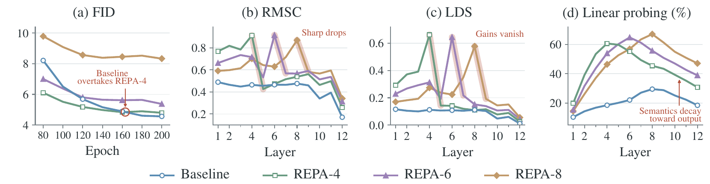
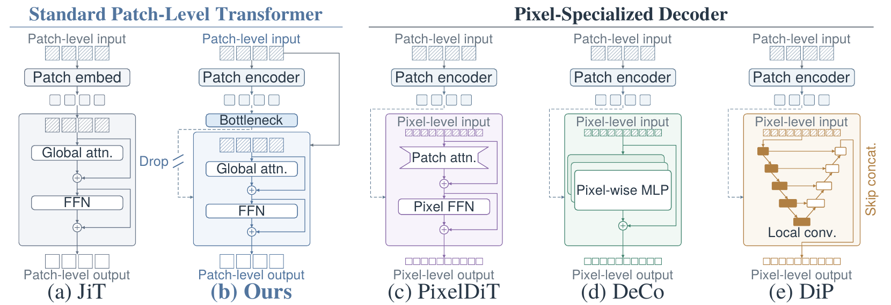
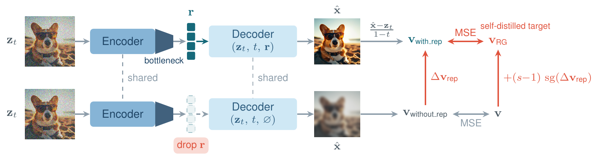
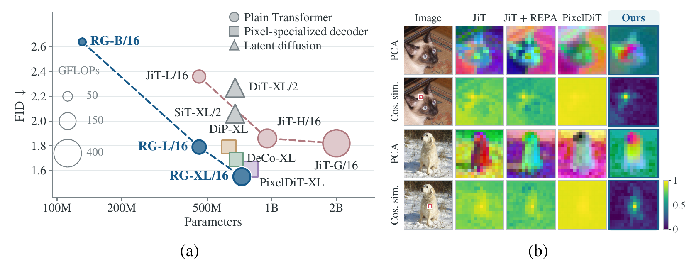
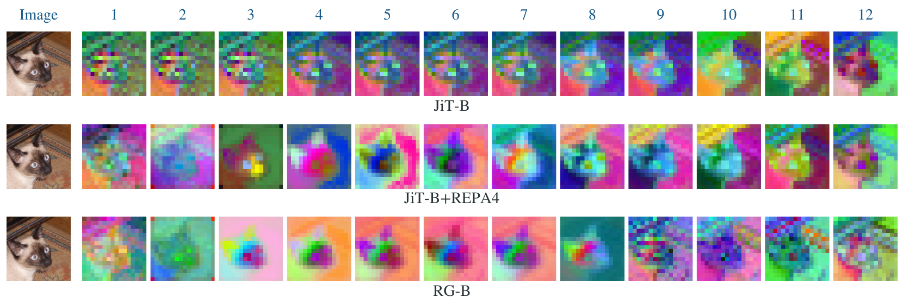
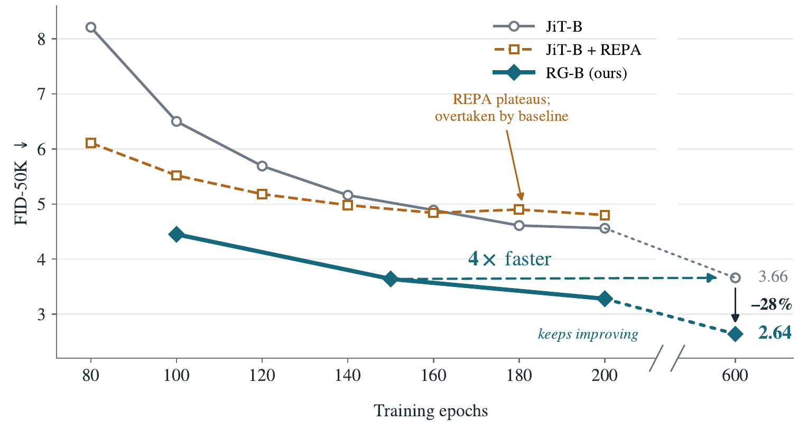

# RG: Learning Representations to Guide Pixel Diffusion Transformers

## 📑 메타 정보

| 항목 | 내용 |
|---|---|
| **제목** | Learning Representations to Guide Pixel Diffusion Transformers |
| **약칭** | RG (Representation Guidance, 표현 가이던스) |
| **저자** | Zihao Pan, Mengting Chen(†Project leader), Cheng Shi, Taihang Hu, Zhengrong Yue, Zikang Wang, Yuan Wang, Wei Li, Sibei Yang(교신) |
| **소속** | Sun Yat-sen University · Alibaba Group(타오바오) · HKU · 상해교통대 |
| **공개일** | 2026-10-09 (arXiv 2610.12978v1, Preprint) |
| **분야** | pixel diffusion(픽셀 확산), class-conditional / text-to-image generation, representation learning(표현 학습) |
| **논문 링크** | [abstract](https://arxiv.org/abs/2610.12978) · [PDF](https://arxiv.org/pdf/2610.12978) · [HTML](https://arxiv.org/html/2610.12978v1) |
| **코드** | [github.com/Pan-Zihao/Representation-Guidance](https://github.com/Pan-Zihao/Representation-Guidance) — ⚠️ 2026-10-14 기준 **README + 그림 2장뿐, 코드·가중치 없음** |
| **프로젝트** | [pan-zihao.github.io/Representation-Guidance](https://pan-zihao.github.io/Representation-Guidance) |
| **외부 모델/데이터** | ImageNet-1K(256²/512²), DINOv2-B/14 w/ registers(REPA 정렬 대상, 동결), T2I: FLAN-T5-Large(동결 텍스트 인코더) + CC12M(LLaVA-NeXT 캡션) + BLIP3o-60K·DALL-E 3·ShareGPT-4o-Image 120K, 1024²는 사내 데이터 |

---

## 📖 주요 용어 사전 (Glossary)

### 아키텍처
- **pDiT (pixel Diffusion Transformer, 픽셀 확산 Transformer)** — VAE로 압축하지 않고 원본 RGB 픽셀 위에서 바로 노이즈 제거를 학습하는 DiT. 표현 학습과 이미지 합성이 한 네트워크 안에서 end-to-end(처음부터 끝까지)로 일어난다.
- **JiT (Just image Transformers)** — Li & He(Kaiming He 그룹, CVPR 2026)의 픽셀 확산 baseline. 아무 특수 부품 없는 plain ViT(평범한 Vision Transformer)에 16×16 픽셀 패치를 넣고 **x-prediction(깨끗한 이미지 직접 예측)** 을 시키는 것만으로 경쟁력 있는 픽셀 생성이 된다는 걸 보였다. 이 논문의 출발점. → Q1 참조
- **plain Transformer(평범한 Transformer)** — 픽셀 전용 conv·MLP 디코더 같은 특수 모듈 없이 표준 attention+FFN 블록만 쌓은 구조. RG가 "유지한다"고 강조하는 성질.
- **pixel-specialized decoder(픽셀 전용 디코더)** — PixelDiT(픽셀 단위 FFN), DeCo(픽셀별 MLP), DiP(conv U자 망)처럼 패치 단위 인코더 뒤에 픽셀 단위 처리를 붙인 설계. 이 논문이 "효과 없다"고 반박하는 대상.
- **decoupled architecture(분리 구조)** — DDT식 Encoder(의미 담당) + Decoder(픽셀 담당) 분할. RG는 인코더 8층 + 디코더 4층(B 기준).
- **bottleneck(병목)** — 인코더 출력(768차원)을 선형층으로 128차원까지 좁혔다가 다시 넓히는 통로. 필요한 정보만 압축해 담도록 강제한다.
- **implicit latent space(암묵적 잠재공간)** — 병목의 128차원 공간. VAE latent처럼 작고 공간적으로 정돈되지만, 매 스텝 노이즈 이미지에서 새로 계산되고 생성 손실로 학습된다는 점이 다르다.
- **adaLN (adaptive LayerNorm)** — 조건 신호로 정규화 계수를 조절해 블록에 주입하는 방식. RG는 표현 r을 **토큰별(token-wise)** adaLN 조건으로 디코더에 넣는다.

### 핵심 개념
- **representation(표현)** — 네트워크 중간층이 만든 특징 벡터. 여기선 인코더가 디코더로 넘기는 r.
- **formed / exploited(잘 형성됨 / 실제로 쓰임)** — 논문이 말하는 "쓸모 있는 생성 표현"의 두 조건. 병목이 전자, 가이던스가 후자 담당.
- **Representation Guidance (RG, 표현 가이던스)** — "표현 넣은 예측 − 표현 뺀 예측"의 차이만큼 학습 정답(target)을 밀어주는 기법. CFG를 학습 정답에 미리 구워 넣는 것과 같은 형태. → 알고리즘 ③, 숫자 예시는 Q2
- **Δv_rep (representation-induced velocity offset, 표현이 유발한 속도 차이)** — 같은 입력에서 r 있음/없음 두 예측 velocity의 차이.
- **stop-gradient(sg, 기울기 차단)** — 계산은 하되 역전파는 막는 연산. 정답 쪽 항이 학습으로 같이 움직이지 않게 고정.
- **EMA teacher(지수이동평균 교사)** — 학습 가중치의 이동평균 네트워크로 Δv_rep를 계산해 정답을 안정화. MG에서 가져온 관행.
- **lazy aggregation(게으른 집계)** — 감독 신호가 허용하는 지름길(국소 연산)만 타고 고수준 표현을 안 만드는 현상. 저자가 픽셀 모델의 의미 소실을 이걸로 해석.

### 비교 기법
- **REPA (REPresentation Alignment, 표현 정렬)** — 중간층 특징을 DINOv2 등 사전학습 표현에 맞추는 보조 손실. 잠재 확산에선 큰 가속이지만 픽셀 JiT에선 결국 손해(→ 알고리즘 ①).
- **CFG (Classifier-Free Guidance)** — 추론 때 "조건 있음 − 조건 없음" 차이를 w배 키워 조건을 강하게 반영.
- **MG (Model-guidance, Tang et al. 2025 "Diffusion models without CFG")** — CFG를 학습 정답에 구워 넣어 추론 CFG를 없애는 방법. RG의 정답 형태·EMA teacher가 여기서 옴.
- **Autoguidance / IG (Internal Guidance)** — 약한 자기 버전(작은 모델 / 중간층 보조 head)과의 차이로 가이드하는 자기 가이던스 기법. 부록 비교 대상.

### 평가 지표
- **FID (Fréchet Inception Distance)** — 생성 분포와 진짜 분포의 거리. **낮을수록 좋음.**
- **RMSC (공간 다양성)** — 한 이미지 안 패치 토큰들이 서로 얼마나 다른가. 높을수록 위치별 정보가 살아 있음.
- **LDS (Local-vs-Distant Similarity, 국소 vs 원거리 유사도)** — 이웃 패치끼리는 비슷하고 먼 패치와는 다른 정도. 높을수록 공간 구조가 뚜렷.
- **linear probing(선형 탐침)** — 특징 위에 선형 분류기만 학습해 ImageNet 정확도를 잼. 전역 의미(global semantics) 지표.
- **GenEval / DPG-Bench** — T2I 프롬프트 준수도 벤치마크(553 / 1,065 프롬프트).

---

## 🎯 논문 요약 (TL;DR)

**한 줄:** 픽셀 확산 Transformer(JiT)에 **128차원 bottleneck(병목)** 과 **"표현 있음/없음 예측 차이만큼 학습 정답을 미는" Representation Guidance** 를 더해, plain Transformer만으로 ImageNet 256² FID **1.55**(픽셀 공간 1위)를 달성.

- **핵심 문제:** 픽셀 모델에서 REPA로 의미를 주입해도 출력 쪽 층이 지워버려 최종 FID는 오히려 나빠지고(4.56 → 4.80), 픽셀 전용 디코더를 붙여도 의미/공간 역할 분담만 바뀔 뿐 좋아지지 않는다.
- **진단:** 쓸모 있는 생성 표현은 **잘 형성되고(formed)** 동시에 **실제로 쓰여야(exploited)** 한다.
- **해결책:** ① DDT식 인코더-디코더 사이에 선형 병목(768→128→768) = 형성 담당, ② r을 10% 확률로 지워 만든 "표현 없는 예측"과의 차이를 (s−1)배 해서 정답에 더함 = 활용 담당. 수렴 시 "학습된 표현을 조건으로 한 CFG"가 1/(2−s)배로 모델에 내장된다.
- **검증:** ImageNet 256² RG-XL 1.55 / RG-L(459M) 1.79 > JiT-G(2B) 1.82, 512² 1.74, T2I GenEval 0.89 / DPG 87.1. 추론 비용 증가 0.
- **⚠️ 주의:** 클래스 조건이 r을 통해서만 들어가므로 "표현 가이던스"에 학습 중 클래스 CFG(MG)가 섞여 있고, 이를 분리하는 대조군이 없다(→ Q6).

---

## 🏆 핵심 기여 (Contributions)

1. **진단 1** — 픽셀 JiT에서 REPA로 올린 의미·공간 구조가 정렬 층 직후 소실되고, 최종 FID는 baseline에 추월당함을 층별 지표(RMSC/LDS/linear probing)로 보임.
2. **진단 2** — 픽셀 전용 디코더(PixelDiT/DeCo/DiP)는 인코더 표현의 "의미 vs 공간" 비율만 재분배할 뿐 생성 이득이 없음을 동일 예산 비교로 보임.
3. **Implicit latent space** — 인코더-디코더 사이 저차원 선형 병목으로 VAE 없이 내부에 압축 잠재공간 형성.
4. **Representation Guidance** — 자기 표현이 유발한 velocity 차이로 flow matching 정답을 바꾸는 학습 목표. 이론상 1/(2−s)배 CFG 내장, gradient가 r을 통해 인코더까지 흘러 표현 자체를 생성용으로 다듬음.
5. **성능** — ImageNet 256² 1.55 / 512² 1.74(둘 다 픽셀 공간 1위), RG-L 459M로 2B JiT-G 추월, JiT 대비 epoch 기준 4배 빠른 수렴, T2I 확장.

---

## 🧠 주요 알고리즘 설명

### 1️⃣ 진단 — 표현 품질 ≠ 생성 유용성

*처방을 정당화하려면 "기존 방식(REPA, 픽셀 디코더)이 왜 안 통하는지"를 먼저 보여야 해서 둔 절. 모두 B 크기 200 epoch, ImageNet 256².*



**진단 1: REPA 의미는 출력 쪽에서 지워진다 (Fig 4)**

| 설정 | 정렬 층 linear probing | 12층 linear probing | 최종 FID |
|---|---|---|---|
| JiT-B baseline | (최고 29.5% @8층) | – | **4.56** |
| REPA-4 | 60.7% | 30.8% | 4.80 (160 epoch쯤 baseline에 추월) |
| REPA-6 | – | – | 5.38 |
| REPA-8 | – | – | 8.33 |

- LDS도 REPA-4에서 0.662(4층) → 0.025(12층)로 붕괴.
- 저자 해석: 픽셀 단위 손실은 국소 연산만으로 대부분 만족되므로(lazy aggregation), 뒷층은 주입된 의미를 덮어쓰고 고주파 합성에 특화된다. 정렬을 출력 가까이 걸수록 합성을 직접 방해.

**진단 2: 픽셀 전용 디코더는 역할만 재분배 (Table 1, 인코더 8 + 디코더 4, 모두 REPA 3층)**

| 디코더 | Params | GFLOPs | FID | 인코더 표현 성향 |
|---|---|---|---|---|
| Vanilla(일반 Transformer) | 131M | 28.4 | **4.17** | 의미 강, 공간 약 |
| PixelDiT식 | 203M (+55%) | 47.4 (+67%) | 4.26 | 의미 강, 공간 약 |
| DiP식(conv U-Net) | 94M | 33.7 | 6.09 | 공간 강, 의미 약 |
| DeCo식(픽셀 MLP) | 100M | 25.8 | 9.17 | 공간 강, 의미 약 |

- 디코더가 패치 간 공간 관계를 처리할 수 있으면(Vanilla, PixelDiT) 인코더는 의미에 집중, 못 하면(DeCo, DiP) 인코더가 공간 정보를 떠안음. 어느 쪽도 생성이 좋아지진 않음.

### 2️⃣ 구조 — Decoupled + Bottleneck (형성 담당)

*표현이 "잘 형성"되려면 인코더가 생성에 필요한 정보만 압축해 넘겨야 하므로, 좁은 통로를 하나 끼운다.*



- **분리 구조:** DDT를 따라 Encoder E(8층) + Decoder D(4층). 블록은 전부 JiT 그대로. 디코더는 **자기 patch embedding을 따로** 가지고 노이즈 이미지 zt를 직접 받으며, 인코더 정보는 오직 r을 통해서만(토큰별 adaLN 조건) 받는다.
- **병목 (식 4):** 인코더 출력 토큰 h(N×D)를 줄였다 늘림

  `u = h · W_down  (N×d),   r = u · W_up  (N×D),   d ≪ D`

  (즉 768차원을 128차원으로 눌렀다가 다시 768로 펴는 선형층 2장. 추가 파라미터 0.4M)
- **클래스 조건 경로:** 인코더가 in-context class token으로 클래스를 받고, 디코더는 r을 통해서만 받는다. → r을 지우면 클래스도 함께 지워짐(비판 ①의 근거).

### 3️⃣ Representation Guidance (활용 담당)

*좋은 표현도 디코더가 무시하면 소용없으므로, 디코더가 r에 더 의존하도록 학습 정답 자체를 r 방향으로 민다.*



**기본 flow matching (식 1~2)** — 픽셀 공간, JiT식 x-prediction

`zt = t·x + (1−t)·ε,   v = x − ε`
(t=1이 깨끗한 이미지, t=0이 순수 노이즈. 네트워크는 깨끗한 이미지 x̂를 예측하고 `vθ = (x̂ − zt)/(1−t)`로 velocity(속도)로 바꿔 손실 계산)

**RG 정답 (식 5)**

`Δv_rep = vθ(zt, t, r) − vθ(zt, t, ∅)`
`v_RG = v + (s − 1) · sg(Δv_rep)`
`L_RG = ‖ vθ(zt, t, r) − v_RG ‖²`
(즉 "표현 넣은 예측"과 "표현 뺀 예측"의 차이를 고정값으로 떼어 내, 원래 정답에 (s−1)배만큼 더 얹은 것을 새 정답으로 삼는다. s=1이면 일반 flow matching)

**학습 1스텝 (Algorithm 1 + 3.3절 세부)**
```python
x, c = batch; eps = randn_like(x); t = logit_normal(-0.8, 0.8)
zt = t*x + (1-t)*eps
r  = E(zt, t, c)                      # 인코더 → 병목 → r  (클래스 c는 여기로만 들어감)
if rand() < 0.1: r = 0                # 표현 dropout → 표현 없는 경로 학습 (정답은 plain v)
v_with = (D(zt, t, r) - zt) / (1-t)
with no_grad():                       # EMA 네트워크로 2회 forward
    dv = v_ema(zt,t,r) - v_ema(zt,t,0)
target = (x - eps) + (s-1)*dv  if (t > t_min and epoch >= 20) else (x - eps)
loss = mse(v_with, target) + 0.5 * REPA(E.layer3, DINOv2_reg)
```

**수렴 해 (부록 A.2, 식 7)** — EMA teacher = 온라인 네트워크라 가정하면

`vθ(zt,t,r) = v̄_∅ + (1/(2−s)) · (v̄_r − v̄_∅),   1 ≤ s < 2`

(즉 모델은 "r을 조건으로 한 CFG"를 배율 1/(2−s)로 내장한 velocity를 출력. s=1.4 → 약 1.67배. 그래서 추론 CFG 최적값이 3.95 → 2.60으로 내려감)

| 하이퍼파라미터 | 값 | 비고 |
|---|---|---|
| bottleneck 폭 d | 128 | 600 epoch 기준 최적 |
| 표현 dropout | 0.1 | |
| RG scale s | 1.4 | 1.1~1.7 스윕 |
| RG interval | t ∈ (0.3, 1] | 고노이즈 구간 제외, t_min=0이면 FID 5.28로 악화 |
| RG 시작 | 20 epoch 후 | 0/10/30 차이 < 0.01 (사실상 무관) |
| teacher | EMA(0.9999) | online이 3.18로 약간 더 좋음(단일 실행) |
| REPA | DINOv2-B/14-reg, 인코더 3층(B)/5층(L)/7층(XL), λ=0.5 | 3×3 conv projector, z-score, cosine |

**모델 크기 (Table 9)**

| | 인코더/디코더 | hidden | Params | GFLOPs |
|---|---|---|---|---|
| RG-B/16 | 8 / 4 | 768 | 131.5M | 28.5 |
| RG-L/16 | 16 / 8 | 1024 | 459.4M | 99.2 |
| RG-XL/16 | 20 / 10 | 1152 | 724.9M | 155.8 |

공통: AdamW(0.9, 0.95), lr 2e-4 constant, batch 1024, 8×A100, bf16, Heun 50스텝, CFG 구간 (0.1, 1].

---

## 📊 실험 요약

### ImageNet 256² (Table 2, 메인 결과)

*픽셀 공간 경쟁 모델(특히 픽셀 전용 디코더 계열)보다 적은 파라미터로 이기는지 확인하는 메인 실험.*



| 모델 | 종류 | Params | FID | IS |
|---|---|---|---|---|
| JiT-G/16 | plain | 2B | 1.82 | 292.6 |
| PixelREPA-H/16 | plain+REPA | 953M | 1.81 | – |
| DiP-XL/16 | 픽셀 디코더 | 631M | 1.79 | – |
| DeCo-XL/16 | 픽셀 디코더 | 682M | 1.69 | – |
| PixelDiT-XL | 픽셀 디코더 | 797M | 1.61 | – |
| **RG-L/16** (600ep) | plain | **459M** | **1.79** | 285.6 |
| **RG-XL/16** (600ep) | plain | 725M | **1.55** | 293.8 |
| (참고) DDT-XL / RAE-XL | latent | 675M / 839M | 1.26 / 1.13 | – |

README 추가 수치: RG-B 100ep 4.45 / 200ep 3.28 / 600ep 2.64, RG-L 200ep 2.00.

### ImageNet 512² (Table 3) · T2I 512² (Table 4)

*고해상도와 텍스트 조건으로도 일반화되는지 확인.*

| 512² 모델 | FID |
|---|---|
| SiT-XL (latent) | 2.62 |
| REPA (latent) | 2.08 |
| PixelDiT-XL | 1.81 |
| JiT-H/32 | 1.94 |
| **RG-XL/16** (32×32 토큰) | **1.74** |

| T2I 모델 | Params(생성기+텍스트) | GenEval | DPG |
|---|---|---|---|
| SD3 | 8B | 0.68 | 84.1 |
| FLUX.1-dev | 12B | 0.67 | 83.8 |
| PixelDiT-T2I | 1.3+2.6B | 0.78 | 83.7 |
| DeCo-XXL/16 | 1.1+1.7B | 0.86 | 81.4 |
| MiniT2I-L/16 | 912+341M | 0.88 | 85.9 |
| **RG-T2I-L/16** | 912+341M | **0.89** | **87.1** |

RG-T2I = MiniT2I의 MM-JiT 블록 + 동일 레시피 + RG. 100 스텝, CFG 5.0, 프롬프트당 4장.

### 표현 분석 (Fig 7, 15)

*RG가 실제로 "인코더=의미, 디코더=픽셀" 역할 분담을 만들었는지 눈으로 확인.*



| | 인코더 마지막층 RMSC | LDS | linear probing 최고 | FID |
|---|---|---|---|---|
| JiT-B | 0.476 | 0.111 | 29.5% | 4.56 |
| JiT-B + REPA-4 | – | 0.662→0.025 | **60.7%**(4층)→30.8% | 4.80 |
| **RG-B** | **0.858** | **0.390** | 52.1~55.2%(3~8층 유지) | **3.28** |

최고 정확도는 REPA가 더 높은데 FID는 RG가 훨씬 좋음 → "최고치보다 디코더가 받을 때까지 유지되느냐가 중요".

### Component ablation (Table 8, B/16, 200 epoch)

*세 부품(REPA·병목·가이던스) 각각의 기여와 상호 의존성 확인.*

| REPA | 병목 | 가이던스 | FID | IS |
|---|---|---|---|---|
| JiT-B baseline (단일 스택) | | | 4.56 | 254.9 |
| ✗ | ✗ | ✓ | 8.08 | 230.8 |
| ✗ | ✓ | ✗ | 4.71 | 268.5 |
| ✗ | ✓ | ✓ | 8.99 | 226.2 |
| ✓ | ✗ | ✗ | 4.17 | 298.6 |
| ✓ | ✗ | ✓ | 7.85 | 220.4 |
| ✓ | ✓ | ✗ | 3.79 | 302.4 |
| ✓ | ✓ | ✓ | **3.28** | 264.1 |
| ✓ | ✓ | ✓ (600ep) | **2.64** | 271.6 |

### 기타 ablation

| 항목 | 결과 |
|---|---|
| 병목 폭 d | 128 기본(600ep 최적) — 폭별 표·해석은 Q5 참조 |
| REPA 정렬 층 | 3층 3.28 · 6층 3.33 · **8층(=병목 직전) 8.97** → DINOv2 그대로는 생성 표현으로 부적합 |
| Enc/Dec 분할 (총 12) | 4/8 3.60 · 6/6 3.32 · **8/4 3.28** · 10/2 4.19 |
| REPA 대상 | DINOv2 3.46 · **DINOv2-reg 3.28** · DINOv3 3.30 |
| vs IG (부록 A.3) | JiT-B 4.56 → +IG 5.22(악화), RG 3.79 → 3.28 |
| 수렴 (Fig 14) | RG-B 150ep(3.64) ≈ JiT-B 600ep(3.66) → epoch 기준 4배 |



---

## 💬 Q&A 섹션

### Q1. "JiT 계열 모델"이 뭔가?

*RG는 JiT를 뼈대로 쓰고 JiT와 비교하는 논문이라, JiT를 모르면 무엇이 새로운지 구분이 안 되기 때문.*

**JiT = "Just image Transformers"**, Tianhong Li & Kaiming He의 "Back to Basics: Let Denoising Generative Models Denoise"(CVPR 2026).

| 항목 | 기존 주류 (DiT/SiT + VAE) | JiT |
|---|---|---|
| 작업 공간 | VAE latent(잠재공간, 32×32×4) | **raw pixel(원본 RGB)** |
| 토큰화 | latent를 2×2로 자름 | 이미지를 **16×16(또는 32×32) 픽셀 패치**로 크게 자름 → 패치 하나가 768차원 |
| 네트워크 | DiT 블록 | **plain ViT**(특수 모듈 없음), 외부 사전학습·토크나이저 없음 |
| 예측 대상 | ε(노이즈) 또는 v(velocity) | **x(깨끗한 이미지) 직접 예측**, 손실은 v 공간에서 계산 |
| 크기 | DiT-XL 등 | JiT-B / L / H / G (G=2B) |

**핵심 아이디어 (한 문장):** 자연 이미지는 고차원 공간 속 저차원 manifold(다양체) 위에 놓여 있지만 노이즈는 고차원 전체에 퍼져 있다. 큰 패치(768차원)에서 노이즈나 velocity를 맞히라고 하면 네트워크 용량이 부족해 무너지고, 깨끗한 이미지를 맞히라고 하면 저차원이라 쉽다. 그래서 "denoising 모델이니 진짜로 denoise(깨끗한 이미지 예측)를 시켜라"가 제목의 뜻이다.

**"JiT 계열"이라 부르는 것들:**
- **JiT** 자체 (class-conditional ImageNet)
- **MiniT2I** — JiT 블록을 MM-DiT식으로 바꾼 MM-JiT로 T2I를 한 미니멀 baseline(→ PAPER_MiniT2I.md). RG-T2I가 이 위에 올라감.
- **PixelREPA** — JiT에 REPA를 제대로 붙이는 법을 다룬 후속
- **RG(이 논문)** — JiT 블록 + DDT식 분리 + 병목 + 가이던스

**RG와의 연결:** JiT도 이미 patch embedding에 저차원 bottleneck(Table 9의 "patch embedding bottleneck 128")을 쓴다. RG는 같은 발상을 **인코더-디코더 사이**에 한 번 더 적용했다고 볼 수 있다.

### Q2. "표현을 넣었을 때와 뺐을 때의 예측 차이"가 정확히 무슨 뜻인가? (예시)

*RG의 핵심 식(Δv_rep, v_RG)이 기호만으로는 감이 안 와서, 숫자 하나로 풀어 본다.*

**먼저 구조.** RG 모델은 두 부분으로 나뉜다.
- **인코더**: 노이즈 낀 이미지를 보고 요약 메모 r을 만든다("이건 고양이, 얼굴은 가운데, 배경은 왼쪽" 같은 정보).
- **디코더**: 노이즈 낀 이미지 + 메모 r을 받아 깨끗한 이미지를 예측한다.

디코더는 노이즈 이미지를 직접 보기 때문에 **메모가 없어도 예측은 할 수 있다.** 다만 메모가 없으면 예측이 흐릿해진다(Fig 6 아래쪽의 뿌연 강아지).

**예시: 픽셀 하나만 본다.** 반쯤 노이즈 낀 고양이 사진에서 고양이 귀 끝 픽셀 하나. 진짜 정답 밝기는 **0.80**.

| 경우 | 디코더가 받는 것 | 예측 밝기 | 왜 그런가 |
|---|---|---|---|
| 표현 넣음 | 노이즈 이미지 + 메모 r("고양이, 귀는 여기") | **0.70** | 귀가 여기 있는 걸 알아서 귀 쪽 색으로 기움 |
| 표현 뺌 (r = 0) | 노이즈 이미지만 | **0.50** | 무엇인지 몰라서 주변 평균 같은 무난한 값을 냄 |

- **예측 차이 = 0.70 − 0.50 = +0.20**
- 이 +0.20이 **"메모 r 덕분에 생긴 변화량"** = 논문의 **Δv_rep**. 실제로는 밝기가 아니라 velocity(이동 방향) 단위로 계산하지만 의미는 같다.

**이 차이를 어디에 쓰나.** 평범한 학습이라면 정답은 0.80이고, 모델은 0.70을 0.80 쪽으로 고치도록 배운다. RG는 정답을 이렇게 바꾼다.

**새 정답 = 원래 정답 + (s − 1) × 차이 = 0.80 + 0.4 × 0.20 = 0.88**

"메모가 만들어 준 변화 방향으로 조금 더 가라"고 시키는 것이다. 그 결과 두 가지 일이 생긴다.
1. **디코더가 메모에 더 의존하게 된다.** 메모를 무시하면 0.88에 도달할 수 없다.
2. **인코더가 더 좋은 메모를 쓰게 된다.** gradient가 r을 거쳐 인코더까지 흐르므로, "차이를 크게 만들 수 있는 쓸모 있는 정보"를 메모에 담도록 학습된다.

비유: **"참고서를 봤을 때 점수가 오른 만큼, 다음엔 그보다 더 높은 목표 점수를 준다."** 그러면 학생은 참고서를 더 열심히 보고, 참고서(인코더)도 더 좋아지도록 고쳐진다.

**CFG와 같은 원리.** 추론 때 쓰는 CFG도 똑같이 "조건 있음 예측 − 조건 없음 예측"을 키운다. 차이는 두 가지다.

| | CFG | RG |
|---|---|---|
| 조건 | 클래스 라벨(고정) | 학습되는 메모 r |
| 적용 시점 | 생성할 때 | 학습 정답에 미리 구워 넣음 |

**그래서 생기는 급소.** 이 논문에서는 클래스 라벨도 메모 r 안에 섞여서만 디코더에 전달된다. 그래서 r을 빼면 "고양이"라는 클래스 정보까지 같이 사라진다. 결국 위의 +0.20에는 "메모가 알려준 위치·모양 정보 몫"과 "고양이 라벨 몫(= 기존 MG가 이미 하던 학습 중 CFG)"이 섞여 있고, 이 둘을 나눠 보는 실험이 없다. → 상세는 Q6

### Q3. "표현 뺌"은 VAE 없이 픽셀값을 넣는 경우를 말하는 건가?

*Q2의 "표현 뺌"을 "VAE latent 대신 픽셀"로 오해하기 쉬워서, 실제로 무엇이 빠지는지 정확히 짚는다.*

아니다. **VAE는 두 경우 모두 없고, 픽셀 이미지는 두 경우 모두 디코더에 들어간다.** 빠지는 것은 인코더가 만든 요약 메모 r 하나뿐이다.

| 입력 | 표현 넣음 | 표현 뺌 |
|---|---|---|
| VAE | ❌ 없음 | ❌ 없음 (RG에는 VAE가 아예 없음) |
| 노이즈 낀 픽셀 이미지 zt | ✅ 들어감 | ✅ **똑같이 들어감** |
| 시간 t | ✅ | ✅ |
| 인코더의 요약 메모 r | ✅ 들어감 | ❌ **0으로 지움** |

**256×256 이미지로 보면**
- **픽셀 입력 (두 경우 공통)**: 디코더는 자기 patch embedding으로 노이즈 이미지를 직접 받는다. 16×16 픽셀 조각 256개, 조각 하나는 768개 숫자. 표현을 넣든 빼든 그대로 들어간다.
- **메모 r (넣을 때만)**: 인코더 8층이 같은 노이즈 이미지를 보고 조각마다 128개 숫자로 요약한 뒤, 다시 768개로 펼쳐 디코더 각 층의 조절 신호(adaLN)로 넣는다.
- **표현 뺌**: 이 조절 신호 자리에 전부 0을 넣는다.

정리하면 "표현 뺌" = **인코더 8층의 도움 없이 디코더 4층짜리 작은 픽셀 모델이 혼자 예측하는 상황.** 부록 A.3도 "인코더에 접근하지 못하는 디코더(representation-free sub-network)"라고 정확히 이렇게 표현한다.

**VAE와 헷갈리기 쉬운 이유.** r이 VAE latent와 성격이 비슷하다(둘 다 작게 압축되고 공간 배치를 유지하는 요약). 그래서 논문도 r의 128차원 공간을 implicit latent space(암묵적 잠재공간)라 부른다. 다만 역할이 다르다.
- **VAE latent**: 이미지를 **대신하는** 입력. 모델은 픽셀 대신 latent를 보고 작업한다.
- **RG의 r**: 픽셀에 **더해 주는 참고 메모**. 디코더는 항상 픽셀을 직접 보고, r은 "이건 고양이, 귀는 여기" 같은 힌트를 덧붙일 뿐이다.

그래서 r을 빼도 디코더는 픽셀을 보고 예측할 수 있고, Q2 예시처럼 흐릿한 값(0.50)을 낸다. 메모를 넣으면 0.70, 그 차이 +0.20이 "메모 덕분".

### Q4. 픽셀 단위로 넣는데 인코더/디코더가 꼭 필요한가?

*JiT는 나누지 않고도 되는데 RG는 왜 나누는지, 분리 구조의 진짜 역할을 짚는다.*

꼭 필요하지는 않다. JiT 원본은 나누지 않고도 작동한다. RG가 나누는 이유는 압축이 아니라 **"표현"이 놓일 정해진 자리를 만들기 위해서**다.

**먼저 용어: 여기서 인코더/디코더는 VAE와 다르다**

| | VAE의 인코더/디코더 | RG의 인코더/디코더 |
|---|---|---|
| 정체 | 별도로 학습한 압축기와 복원기 | **같은 Transformer 12층을 앞 8층, 뒤 4층으로 나눈 것** |
| 블록 종류 | conv 등 다른 구조 | 전부 똑같은 JiT 블록 |
| 하는 일 | 이미지를 latent로 바꾸고 다시 이미지로 | 앞 8층은 "무엇이 어디 있나" 파악, 뒤 4층은 픽셀 그리기 |
| 파라미터 | 생성 모델과 별개로 추가 | 거의 같음 (JiT-B 131.12M vs RG-B 131.52M) |

입력도 픽셀 하나하나가 아니라 **16×16 픽셀 조각(패치) 단위**다. 256×256 이미지면 조각 256개이고, 인코더와 디코더 모두 조각 단위로 작업한다.

**JiT는 안 나눠도 되는데 왜 나누나**

JiT (나누지 않음): 12층이 한 줄로 이어진 구조.

`픽셀 조각 → 1층 → 2층 → … → 12층 → 깨끗한 이미지`

중간층 어딘가에서 "고양이, 귀는 여기" 같은 정보가 생기긴 하지만, 어느 층에 있는지 정해져 있지 않다. 2장 진단대로 뒷층으로 갈수록 덮어써져 사라진다(REPA로 4층에 넣어도 선형 분류 정확도 60.7% → 12층 30.8%).

RG (8 + 4로 나눔):

`픽셀 조각 → 인코더 8층 → [병목: 메모 r] → 디코더 4층(픽셀 조각도 따로 직접 받음) → 깨끗한 이미지`

나누면 "인코더가 디코더에게 넘기는 메모 r"이라는 **정해진 전달 지점**이 생긴다. 이 지점이 있어야 RG의 두 부품을 쓸 수 있다.
1. **병목**: 그 지점을 128차원으로 좁혀 요약을 강제한다. 한 줄 구조에는 좁힐 지점이 없다.
2. **가이던스**: "메모 넣음 vs 메모 뺌"을 비교하려면 뺄 수 있는 메모가 따로 있어야 한다. 한 줄 구조에서 중간층을 0으로 만들면 뒷층이 아무것도 받지 못한다.

반면 디코더는 픽셀 조각을 자기 입구로 직접 받으므로, 메모를 빼도 예측은 계속할 수 있다. 그래서 "있음/없음" 비교가 가능하다.

비유: **혼자 다 하는 화가 한 명** vs **"스케치 담당이 메모를 써서 넘기고, 채색 담당이 원본 사진과 메모를 같이 보고 칠하는" 2인 팀.** 2인 팀이라야 "메모가 있을 때와 없을 때 그림이 얼마나 달라지나"를 잴 수 있다.

**실제로 나누는 것만으로도 효과가 있었다**

| 구조 | FID |
|---|---|
| JiT-B (한 줄, 12층) | 4.56 |
| JiT-B + REPA (한 줄) | 4.80 |
| 8 + 4로 나눔 + REPA | **4.17** |
| + 병목 | 3.79 |
| + 가이던스 | 3.28 |

- 같은 12층, 같은 REPA인데 나누기만 해도 4.80 → 4.17. 세 부품 중 가장 큰 개선(→ Q7).
- 반대로 디코더를 2층만 두면(10/2) 4.19로 나빠진다. 픽셀을 그리는 데에도 층이 충분히 있어야 한다.

**한 줄 정리**: 나누는 것은 픽셀 처리에 필수라서가 아니라, 메모를 주고받는 **전달 지점을 만들기 위한 장치**다. 그 지점이 있어야 병목(좁히기)과 가이던스(메모 있음/없음 비교)를 걸 수 있다.

### Q5. 인코더와 디코더 사이에 뭔가가 있나?

*"8층 + 4층으로 나눴다"고만 하면 그 이음매에 무엇이 끼어 있는지 안 보여서, 사이를 부품 단위로 해부한다.*

네, 사이에는 **병목(bottleneck) 하나와 스위치 하나**가 있다. 병목은 선형층 2장, 스위치는 메모를 지우는 장치. 그 외에는 아무것도 없다.

**인코더와 디코더 사이 흐름 (조각 하나 기준)**

```
인코더 8층 출력: 조각마다 768개 숫자
      │
      ▼
① 줄이기 선형층 (W_down): 768 → 128      ← 병목 (implicit latent, u)
      │
      ▼
② 늘리기 선형층 (W_up):   128 → 768      ← 이것이 메모 r
      │
      ▼
③ 스위치: 학습 중 10% 확률로 r 전체를 0으로 지움   ← "표현 뺌"
      │
      ▼
④ 디코더 4층 각각에 조절 신호(adaLN)로 주입 (조각마다 따로)
```

- **①②는 가중치가 있는 부품.** 각각 768×128 행렬이라 약 9.8만 개씩, 합쳐서 약 0.2M. 논문의 "추가 파라미터 0.4M"은 이 병목 약 0.2M과 디코더가 따로 가진 patch embedding 약 0.2M을 합친 값이다(우리 계산과 맞아떨어짐).
- **③은 학습 때만 켜지는 스위치**이고 가중치는 없다. 추론 때는 항상 메모를 넣는다.
- **④는 새 부품이 아니다.** JiT 블록에는 원래 시간·클래스 신호를 넣는 adaLN 입구가 있는데, 그 자리에 r을 넣는다. 차이는 JiT가 이미지 전체에 신호 하나를 넣는 반면, RG는 **조각마다 각자 다른 신호**(r의 해당 조각 몫)를 넣는다는 점(token-wise adaLN).

**눈여겨볼 점: 비선형이 없는 순수 선형 병목**

①과 ② 사이에 활성화 함수(ReLU 등)도, 정규화도 없다. 선형층 두 장을 이어 붙이면 결국 768×768 행렬 하나와 같은데, 중간에 128로 좁혔기 때문에 **이 행렬은 128개 방향밖에 표현하지 못한다**(rank ≤ 128).

쉽게 말하면 "768칸짜리 메모장을 주되, 실제로는 128칸 분량만 쓸 수 있게 막은 것". 그래서 인코더는 픽셀 잡음 같은 자잘한 정보를 버리고, "무엇이 어디 있나" 같은 핵심만 골라 담도록 강요받는다.

| 병목 폭 | FID (600 epoch) |
|---|---|
| 64 | 2.79 |
| **128** | **2.64** |
| 256 | 2.77 |
| 512 | 2.89 |

너무 좁아도, 너무 넓어도 나빠진다. 다만 200 epoch에서는 512가 가장 좋았기 때문에(3.18), 이 순서는 노이즈 수준의 차이일 수도 있다.

**사이에 없는 것**
- **VAE 같은 별도 네트워크**: 없음.
- **REPA**: 사이가 아니라 인코더 **3층 옆**에 붙은 보조 장치. 3×3 conv projector로 DINOv2와 비교하고, 학습 때만 쓴다.
- **픽셀 직통로**: 사이를 거치지 않는다. 노이즈 픽셀 이미지는 디코더의 자체 입구(patch embedding)로 따로 들어간다(→ Q3).

**한 줄 정리**: 인코더와 디코더 사이에는 "768 → 128 → 768 선형층 2장(병목)"과 "10% 확률로 메모를 지우는 스위치"만 있다. 메모 r은 그 뒤 디코더 각 층에 조각별 조절 신호로 들어간다.

### Q6. "표현 가이던스"는 결국 학습 중 CFG(MG)와 뭐가 다른가? (비판 ①)

*논문 핵심 기여가 정말 "학습된 표현" 덕인지 판단하는 가장 중요한 질문.*

- 본문에 "디코더는 클래스 조건을 **r을 통해서만** 받는다"고 명시, 알고리즘상 r = E(zt, t, **c**). → r을 0으로 지우면 **표현 + 클래스가 함께** 사라진다.
- 따라서 Δv_rep ⊇ 클래스 CFG 방향. 학습 중 CFG를 정답에 굽는 건 저자가 직접 인용한 MG의 정체이며, MG만으로도 FID가 크게 좋아진다고 알려져 있다.
- 정황: 가이던스를 켜면 최적 CFG가 3.95 → 2.60 (Table 10) = 클래스 가이던스 일부가 모델 안으로 흡수됐다는 신호.
- **빠진 대조군:** 같은 decoupled+REPA+병목 모델에 "클래스만 지우는 MG"를 적용한 실험. 이게 없으면 0.51(3.79→3.28) 중 "학습된 표현" 몫과 "학습 중 CFG" 몫을 구분할 수 없다. 저자들은 IG·autoguidance와는 비교했지만 정답 형태가 가장 가까운 MG와는 비교하지 않았다.
- 코드 미공개라 r=0일 때 class token도 빠지는지 코드로 검증 불가(본문 표현상 빠진다고 판단).

### Q7. 성능 향상은 어디서 나왔나? (비판 ②)

*"plain Transformer 유지"라는 서술 뒤에 실제 이득 출처가 가려져 있어서.*

단계별 FID 분해 표는 Q4 참조 (분리 −0.63 / 병목 −0.38 / 가이던스 −0.51).

- 최대 이득은 DDT식 분리(디코더 전용 patch embedding + r을 토큰별 adaLN으로)에서 나옴. 저자 통찰 2 "분리는 표현을 좋게 안 만든다"는 픽셀 *전용* 디코더 얘기라 엄밀히 모순은 아니지만, 이 기여가 부각되지 않음.
- "JiT 대비 4배 수렴"(Fig 14)도 단일 스택 JiT 대비라 구조 효과와 RG 효과가 섞여 있다.

### Q8. 가이던스는 얼마나 안정적인가? (비판 ③)

*다른 백본·데이터에 옮겨 쓸 때 재튜닝 부담을 가늠하기 위해.*

- 병목·REPA 중 하나라도 없으면 가이던스는 **큰 손해**: REPA만 4.17→7.85, 병목만 4.71→8.99, 둘 다 없으면 8.08.
- t_min=0(전 구간 적용)이면 5.28, s도 1.4 근방에서만 최적.
- → "조건이 맞을 때만 작동하는 레시피". 저자 해석: REPA가 의미 뼈대(scaffold), 병목이 픽셀 수준 붕괴 방지를 해줘야 r이 가이드할 가치가 생김.

### Q9. 학습 비용은 정말 "13% FLOPs"만 느나? (비판 ④)

*"추론 비용 0, FLOPs +13%"가 학습 비용으로 오해되기 쉬워서.*

- 13%는 **추론 FLOPs**(25.2→28.5 GFLOPs)이고 원인은 구조 분리(디코더 patch embedding 등).
- RG는 스텝마다 EMA 네트워크 forward 2회 추가. forward+backward ≈ 3단위로 보면 스텝당 약 1.5~1.7배(우리 추정, RG 구간 밖 샘플을 건너뛰면 덜 듦).
- → epoch 기준 "4배"는 GPU 시간 기준 대략 2.5배 수준일 수 있음. 논문에 GPU 시간 표 없음.

### Q10. 그 밖의 약점은?

*숫자 해석 시 주의할 점 모음.*

| 항목 | 내용 |
|---|---|
| 노이즈 수준 ablation | 병목 폭 순서가 200/600ep에서 뒤집힘(512 최고 → 128 최고), 64/256/512 순서도 비단조. online teacher 3.18, warm-up 3.27~3.29 모두 단일 실행 |
| T2I 효과 작음 | 같은 레시피 MiniT2I 대비 GenEval +0.01(553 프롬프트 노이즈 범위), DPG +1.2. 텍스트가 r 경유인지 디코더 직결인지 불명. 1024²는 사내 데이터 정성 샘플뿐 |
| latent와의 격차 | RAE 1.13 / DDT 1.26 대비 여전히 0.3~0.4 차 → "격차를 좁혔다"가 정확 |
| 이름 충돌 | Zu et al. 2026 "Training-free **representation guidance**"(같은 논문 인용)와 이름이 겹침 |
| 재현성 | 저장소 README뿐(코드·가중치 없음), arXiv 배지도 "Coming Soon" |

### Q11. 이 논문에서 건질 가치는?

*약점이 많아도 무엇을 가져갈지 정리.*

- **2장 진단이 진짜 가치:** "픽셀 모델에서 REPA는 최종적으로 손해", "정렬 최고치보다 디코더까지 유지되느냐가 중요"를 층별 지표로 깔끔히 보임.
- **처방이 단순:** 선형층 2장 + 정답 한 줄 수정, 추론 비용 0.
- **계보 위치:** JiT(픽셀 x-pred) → DDT(분리) → MG(학습 중 CFG) 조합 + 병목. SFD·DDT의 "의미 먼저, 디테일 나중" 흐름의 픽셀 공간 버전.

---

## 🧷 한 줄 요약 (전체)

**JiT 위에 DDT식 분리 + 128차원 병목 + "표현 있음/없음 차이만큼 정답 밀기"를 얹어 픽셀 공간 FID 1.55를 찍었지만, 이득 최대 몫은 구조 분리이고 가이던스 항은 학습 중 클래스 CFG(MG)와 분리 검증되지 않았다. 진짜 수확은 "표현은 높이 찍는 것보다 디코더까지 살아남는 게 중요하다"는 진단.**

---

## 🔗 관련 메모리 링크

- [[paper_ddt]] — 인코더-디코더 분리 구조 원조 (RG가 그대로 차용)
- [[paper_repa]] — REPA 원논문 (픽셀에서 실패하는 진단 대상)
- [[paper_minit2i]] — MM-JiT, RG-T2I의 베이스
- [[paper_pixeldit]] — 픽셀 전용 디코더 비교 대상
- [[paper_sfd]] — "의미 먼저" 계보
