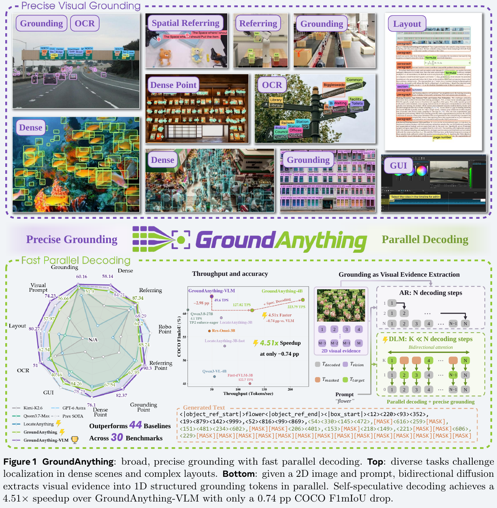
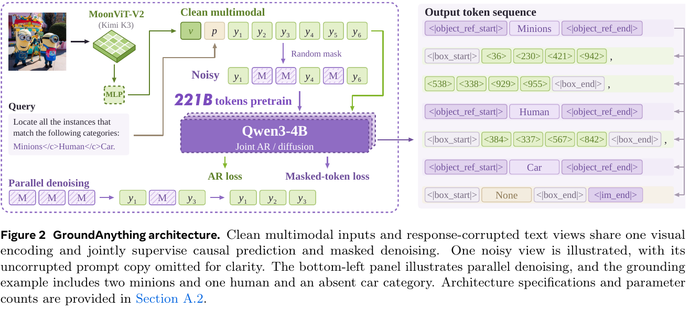
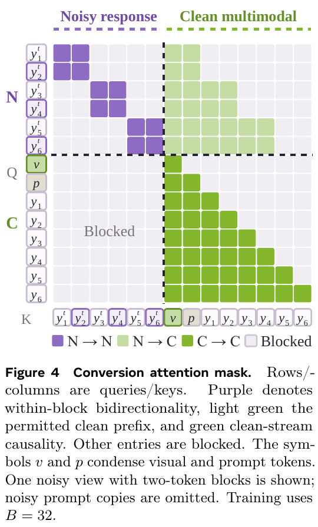
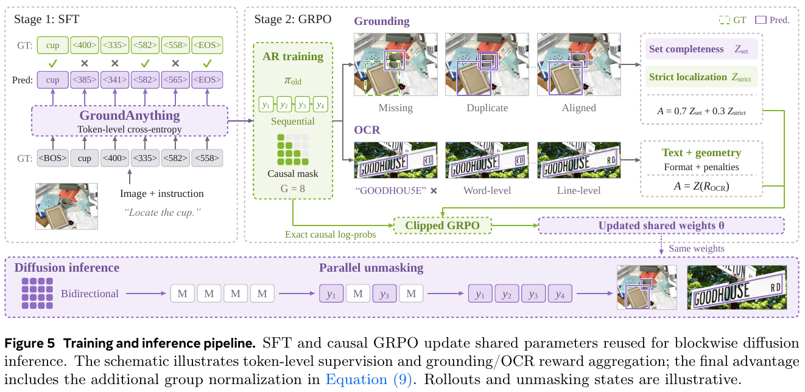
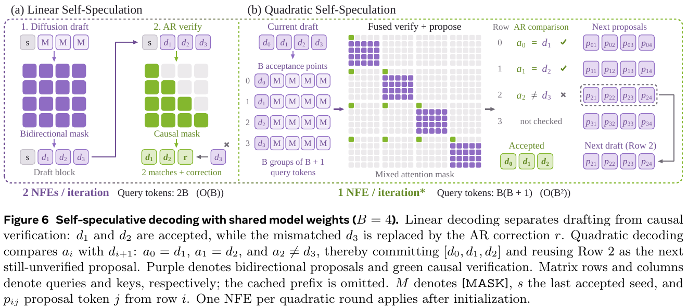
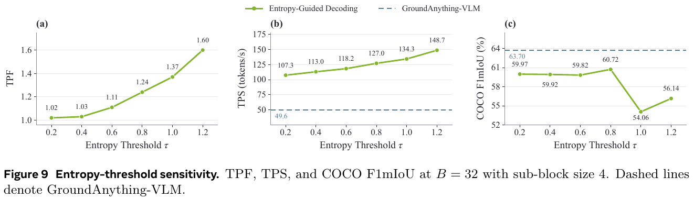

# GroundAnything: Reconciling Parallel Decoding with Precise Visual Grounding at Flash Speed

> **GroundAnything은 4B급 grounding VLM(박스·점 좌표를 출력하는 VLM)을 블록 단위 masked diffusion(마스크 확산) 디코더로 변환해서 좌표 토큰을 병렬로 뽑는 모델이다. 구조·손실·디코딩 규칙은 공개 코드와 정확히 일치하고(파라미터 수 바이트 단위 일치), DLM↔MTP 통제 실험은 정직하다. 그러나 대표 숫자 두 개가 흔들린다. ① 확산 모델이 자기 AR 부모를 이긴 지점(RefCOCOg +7, ScreenSpot-Pro +10.6, OSWorld-G +6.6)은 논문에 없는 DLM 전용 SFT2 단계와 겹치는데, 코드가 노출한 SFT2 소스 이름이 평가 벤치마크 키와 똑같고 행 수도 평가셋의 절반·전량과 맞는다(test contamination 강한 의심). RefCOCOg에서 IoU 0.95 F1이 88.6(COCO에선 22.4)이라는 이상치도 이것으로 설명된다. ② "2.56×/4.51× 빠르다"는 TPF(forward당 토큰) 1.37/2.18로는 설명이 안 되고, 나머지는 AR 기준과 DLM의 실행 스택 차이로 보인다.**

---

## 📋 메타 정보

| 항목 | 내용 |
|---|---|
| 제목 | GroundAnything: Reconciling Parallel Decoding with Precise Visual Grounding at Flash Speed |
| 저자 | Qize Yu*‡, Lianrui Fan*, Bowen Ping*, Xini Ding*, Zetian Song* 외, Ping Luo†, Shiyu Huang† (XPeng · 북경대 · HKU · UC Berkeley · Princeton · NUS · HKUST-GZ) |
| 공개 | arXiv 2609.39600 v2 (2026-10-16), 61쪽 |
| 분야 | visual grounding(시각 그라운딩) / diffusion language model(확산 언어모델) / parallel decoding(병렬 디코딩) |
| 논문 | https://arxiv.org/abs/2609.39600 · PDF https://arxiv.org/pdf/2609.39600 |
| 프로젝트 | https://groundingpi.github.io/groundanything/ |
| 코드 | https://github.com/groundingpi/GroundAnything (Apache-2.0, Python 약 51.8K줄) |
| 가중치 | HF `GroundingPI/GroundAnything`(DLM), `GroundingPI/GroundAnything-VLM`(AR) — 라이선스 "other"(Kimi K3 라이선스 승계) |
| 백본 | MoonViT-V2(Kimi K3) 시각 인코더 + 2×2 묶음 MLP projector + Qwen3-4B-Instruct-2507 디코더 |
| 학습 데이터 | **목록 비공개.** "public datasets + data engine(teacher ensemble pseudo-label)"만 서술. 코드에 노출된 소스 이름은 → Q1 |

---

## 📖 주요 용어 사전 (Glossary)

### 문제 설정 · 평가

| 용어 | 풀이 |
|---|---|
| **visual grounding(시각 그라운딩)** | 말로 지정한 대상("빨간 컵", "person")을 이미지에서 박스나 점으로 찾아내는 일. 검출·지시표현·OCR·GUI 클릭 위치·레이아웃까지 "좌표를 출력"하는 태스크 전반 |
| **F1mIoU** | IoU(겹침 비율) 임계값 0.50, 0.55, …, 0.95 각각에서 F1을 구해 평균낸 값. "평균 IoU"가 아님. Rex-Omni 평가 관례를 따름 |
| **F1@0.95** | 예측 박스가 정답과 95% 이상 겹쳐야 정답으로 치는 F1. 사람이 친 정답 박스의 오차 수준이라 보통 20~40점대 |
| **F1@Point** | 점이 정답 물체의 SAM 마스크 안에 들어가면 정답으로 치는 F1 |
| **test contamination(평가셋 오염)** | 평가용 데이터가 학습에 섞여 들어가 점수가 부풀려지는 현상 |

### 모델 · 출력 형식

| 용어 | 풀이 |
|---|---|
| **quantized coordinate tokens(양자화 좌표 토큰)** | 0~999 좌표를 전용 토큰 `<0>`…`<999>` 1000개로 만들어 좌표 하나 = 토큰 하나. 박스 하나가 평균 7.6토큰 |
| **`None` payload** | 질의한 카테고리가 이미지에 없으면 박스 자리에 `None`을 쓰는 규약 |
| **untied embedding(분리된 임베딩)** | 입력 임베딩 행렬과 출력 head 행렬을 따로 두는 것. 원래 Qwen3-4B는 공유(tied)하지만 여기선 분리 → 0.39B씩 두 벌 |

### 디코딩

| 용어 | 풀이 |
|---|---|
| **AR (autoregressive, 자기회귀)** | 왼쪽부터 한 토큰씩 생성. GroundAnything-VLM의 방식 |
| **masked diffusion(마스크 확산)** | 빈칸(`[MASK]`)을 여러 번에 걸쳐 동시에 채워가는 생성 방식. BERT식 빈칸 채우기를 반복하는 것 |
| **block diffusion(블록 확산)** | 출력을 B=32토큰 블록으로 자르고, 블록 안은 양방향(bidirectional) attention으로 병렬 채움, 블록 사이는 causal로 순서대로. KV cache 재사용 가능 |
| **TPF (tokens per forward)** | forward 한 번당 확정되는 토큰 수. AR은 1. 알고리즘적 가속의 상한 |
| **TPS (tokens per second)** | 초당 출력 토큰 수. 실제 속도(구현 영향 포함) |
| **entropy-guided decoding(엔트로피 기반 확정)** | 각 빈칸의 예측 분포 엔트로피(불확실성)가 τ 이하인 위치만 확정. 하나도 없으면 가장 확실한 한 칸만 확정 |
| **self-speculative decoding(자기 추측 디코딩)** | 같은 가중치로 확산 모드가 초안을 쓰고 causal 모드가 검증. 일치하는 가장 긴 앞부분만 수락 |
| **MTP (multi-token prediction)** | 한 forward로 여러 미래 토큰을 예측하는 헤드. LocateAnything이 사용 |
| **NFE (network function evaluation)** | 모델 forward 호출 횟수 |

### 학습

| 용어 | 풀이 |
|---|---|
| **AR-to-diffusion conversion(AR→확산 변환)** | 이미 학습된 AR 모델에 mask 토큰만 추가하고 확산 손실로 이어 학습해 확산 모델로 바꾸는 것. Fast-dVLM 방식 |
| **complementary masking(상보적 마스킹)** | 같은 응답에서 마스크 두 장을 만들되, 한 장에서 가린 위치는 다른 장에서 보이게 함 → 모든 토큰이 한 번은 학습됨 |
| **GRPO** | 프롬프트당 응답 G개를 뽑아 그룹 안에서 보상을 정규화해 advantage(상대적 이득)로 쓰는 RL. 가치망 불필요 |

---

## 🎯 논문 요약 (TL;DR)

- **한 줄**: grounding 출력(박스·점 좌표)은 왼쪽→오른쪽 순서가 본질이 아니니, AR VLM을 블록 확산으로 변환해 좌표를 병렬로 채우자.
- **문제**: AR grounding은 박스 수가 많을수록(밀집 장면, 문서 레이아웃) 출력이 길어지고, 토큰 하나당 forward 한 번이라 느리다.
- **해결**: Qwen3-4B 기반 grounding VLM을 만든 뒤(→ GroundAnything-VLM), 확산 0.5 + AR 0.5 손실로 변환(→ GroundAnything). 한 가중치가 확산 초안과 AR 검증을 모두 할 수 있음.
- **검증(주장)**: 30개 벤치 평균 VLM 72.42(GPT-6 Astra 71.35), DLM 61.75(LocateAnything Fast 53.32). COCO에서 entropy 디코딩 2.56×(−2.98pp), self-spec 4.51×(−0.74pp).
- **급소**: 평가셋 이름의 학습 소스(→ Q1), 속도 배수에 섞인 구현 차이(→ 3.2), 통제되지 않은 AR↔DLM 비교(→ 3.4).

---

## 🏆 핵심 기여 (Contributions)

1. **범용 확산 grounding 모델**: 검출·지시표현·포인팅·OCR·GUI·레이아웃·visual prompt를 한 출력 문법으로 묶은 첫 4B급 DLM.
2. **AR→확산 변환 레시피**: 상보적 마스크 두 장 + clean stream을 한 시퀀스에 붙여 확산·AR 손실을 동시에 학습.
3. **디코딩 전략 체계 분석**: entropy 임계값·블록 크기·linear/quadratic self-spec의 속도-정확도 곡선.
4. **DLM vs MTP 통제 비교**: 같은 검증기·같은 prefix에서 초안 수락률·토큰당 비용·마감시간 비교 + attention만 바꾼 통제쌍.
5. **인프라 가속**: SGLang → CUDA Graph → FP8로 모드별 3.45~4.06× (논문 주장, 공개 코드는 일부만).

---

## 1️⃣ 주요 알고리즘

*좌표 출력을 병렬로 채우려면 ① 좌표를 짧은 토큰으로 만들고 ② AR 모델을 확산으로 바꾸고 ③ 병렬로 확정할 규칙이 필요하다. 이 장은 그 세 가지를 순서대로 설명한다.*



### 1.1 전체 구조

*AR 모델과 확산 모델이 가중치를 그대로 공유해야 self-spec이 가능하므로, 둘은 같은 뼈대를 쓴다.*



| 부품 | 구성 | 파라미터 (HF 가중치 실측 = 논문 Table 9) |
|---|---|---|
| vision encoder(시각 인코더) | MoonViT-V2, 27층 × 1024폭, patch 14, 최대 1024 visual token | 401,214,464 |
| projector(연결층) | LayerNorm → 2×2 patch 묶음(1024×4=4096) → Linear 4096→4096 → GELU → Linear 4096→2560 → RMSNorm | 27,267,584 |
| LM decoder body | Qwen3-4B: 36층 × 2560, FFN 9728, GQA 32/8, RoPE base 5M, 전부 full attention, 1D RoPE | 3,633,511,936 |
| input embedding / output head | untied, 각 152,671행(DLM) × 2560 | 390,837,760 × 2 |
| **합계** | | **4,843,669,504 (DLM)** / 4,843,664,384 (VLM) |

- "4B"는 디코더 이름일 뿐이고 전체는 **4.84B**. 논문 Table 9가 스스로 밝힘.
- 어휘: Qwen3 기본 151,669 + 좌표 1000 + `</c>` = 152,670(VLM). DLM은 `|<MASK>|`(ID 152670) 한 행 추가. mask 행은 `<|im_start|>`, `<|im_end|>`, `<|vision_start|>`, `<|vision_end|>` 네 행의 평균으로 초기화.
- DeepStack(ViT 중간층을 LLM 여러 층에 주입) 같은 다층 시각 주입은 **없음** (코드·가중치로 확인).

### 1.2 출력 문법

*검출·OCR·GUI처럼 서로 다른 태스크를 하나의 모델이 처리하려면 출력 형식이 하나여야 한다.*

```
<|object_ref_start|>person<|object_ref_end|><|box_start|><10><20><30><40>,<50><60><70><80><|box_end|>
<|object_ref_start|>button<|object_ref_end|><|box_start|><512><384><|box_end|>          ← 점
<|object_ref_start|>OPEN<|object_ref_end|><|box_start|><100><200><300><260><|box_end|>   ← OCR: 글자가 이름 칸
<|object_ref_start|>car<|object_ref_end|><|box_start|>None<|box_end|>                    ← 없는 대상
```

- 박스는 (x1,y1,x2,y2), 점은 (x,y). 같은 이름의 인스턴스는 한 wrapper에 쉼표로.
- 박스는 x1 기준 안정 정렬(stable sort), 궤적처럼 의미 있는 순서는 유지.
- 좌표 변환: 0~1000 격자 값 v를 `floor((999·v + 500) / 1000)`로 0~999 토큰에 매핑.
- 출력 길이: COCO 이미지당 46.4토큰(박스당 7.6), Dense200 446.8토큰(박스당 5.1). SEED1.5-VL은 박스당 148.8 (Table 5).

### 1.3 AR→확산 변환 (Conversion)

*처음부터 확산 VLM을 학습하면 비싸므로, 이미 잘 학습된 AR grounding 모델에 mask 토큰만 추가하고 확산 손실로 이어 학습한다.*



**입력 구성**: 한 시퀀스에 `[noisy view 1 ; noisy view 2 ; clean x]`를 이어 붙인다. clean x = [이미지 V, 프롬프트 P, 응답 Y]. noisy view = [프롬프트 복사본, 마스크 낀 응답]. 이미지는 clean 쪽에만 한 번 인코딩.

**마스킹** (코드 `models/dlm/hybrid.py:585-653`과 일치):
1. 응답을 32토큰 블록으로 자름(박스 경계와 무관).
2. 블록마다 t ~ Uniform(0,1) 뽑기 → 각 토큰을 확률 t로 가림 = view 1.
3. view 2 = view 1의 반대(가린 곳 ↔ 보인 곳). EOS는 두 view 모두 가림.

**attention mask** (그림 4, 코드 `hybrid.py:751-802`와 일치):
- noisy 블록 → 같은 블록 안은 양방향(보라).
- noisy 블록 → clean 이미지·프롬프트와 **자기보다 앞선** clean 응답 블록만 봄(연두).
- clean → causal(초록), noisy는 못 봄.

**손실** (코드 `hybrid.py:2142-2151`):

```
L = 0.5 · L_MDM + 0.5 · L_AR
```
(즉 "가려진 칸 맞히기" 손실과 "다음 토큰 맞히기" 손실을 반반 섞음. 둘 다 hidden i−1이 target i를 예측하는 next-token shift 유지. inverse-noise 가중치 없음)

**변환 학습 설정 (논문 Table 12 ↔ 코드)**:

| 항목 | 논문 | 공개 코드 `configs/training_stages.yaml` |
|---|---|---|
| 단계 | Phase I(vision 동결) → Phase II(전체) | general(2 ep) → specialist(2 ep) → **sft1(1 ep) → sft2(1 ep)** |
| GPU / global batch | 256 / 8192 | 64 / 2048 |
| LR | 2e-5 (vision 2e-6) | 같음. sft1/2는 7e-6 |
| seed | 32 / 42 | 같음 |
| 행 수 | 미기재 | 299만 / 3,000만 / 474만 / 30만 |

→ general/specialist가 Phase I/II에 해당. **sft1·sft2는 논문에 없는 DLM 전용 단계** (→ Q1, 3.4).

### 1.4 RL (Causal GRPO)

*변환 후 확산 모델의 좌표 정확도를 끌어올리기 위한 마지막 단계. 단, rollout은 확산이 아닌 causal(AR) 모드로 뽑는다.*



- 프롬프트당 응답 G=8, 온도 0.7, **causal 모드로 생성하고 causal 확률로 학습**. 확산 디코딩 경로 자체는 RL이 직접 최적화하지 않음 → 학습된 가중치를 확산 추론에 그대로 재사용.
- advantage: 보상 성분별로 그룹 정규화 → 가중합 → 다시 그룹 정규화. 박스는 set completeness 0.7 + strict localization 0.3.
- clip ε=0.2, KL 없음, vision 동결, rollout당 업데이트 1회.
- **VLM과 DLM의 RL 레시피가 다름** (Table 13):

| 설정 | GroundAnything (DLM) | GroundAnything-VLM |
|---|---|---|
| LR | 2e-6 | 5e-7 (4배 작음) |
| reference KL | 없음 | 0.02 |
| 학습 모듈 | projector + LM | LM만 |
| 정규화 | population std + 2차 그룹 정규화 | sample std + 배치 정규화 |

**보상 함수 핵심** (Appendix A.10):
- **Box set completeness**: GT마다 IoU 최대 예측을 골라 라벨 일치 시 IoU를 점수로 → soft P/R의 F1. 한 예측이 여러 GT를 지원할 수 있어 "완전성 대리지표".
- **Box strict**: 0.10 형식 + 0.10 개수 + 0.50 F1(IoU .5/.75/.95 평균) + 0.25 IoU + 0.05 정렬 − 0.07 과대박스 − 0.03 중복.
- **OCR**: Hungarian 일대일 매칭 + 편집거리 + IoU, 형식 등급(1.0/0.6/0.3/0)을 제곱해서 곱함.
- **Pointing**: 거리 75 단위 가우시안 유사도(200 넘으면 0), 0.55·F2 + 0.25 개수 + 0.10 라벨 F1 + 0.10 형식.

### 1.5 추론 — 세 가지 디코딩

*병렬로 채울 때 "어느 칸을 언제 확정할지"가 속도와 정확도를 가른다.*

**① entropy-guided (본문 표 전부 이 방식)**
- prefill 후 블록 = [알려진 anchor 1개 + mask 31개], sub-block 4칸씩 왼쪽부터.
- 각 mask 위치의 엔트로피를 계산(mask 토큰 제외, 온도 적용 전 원본 logit) → τ=0.8 이하 전부 확정, 없으면 최소 하나.
- 블록 완성 후 causal forward 1회로 KV cache를 다시 만들고 다음 anchor 예측. 블록당 NFE = 디노이징 횟수 + 1.
- 코드 `infer/decode/reliability.py:20-188`과 일치.

**② self-speculative (linear / quadratic)**



- **linear**: 확산 초안 1 forward + causal 검증 1 forward = 2 NFE. 가장 긴 일치 prefix 수락 + 첫 불일치에서 AR 교정 토큰. 코드 로직 정확 (`gam_speculative.py:416-438`).
- **quadratic**: B개 행 × (B+1) 토큰을 한 forward에 넣어 검증과 다음 초안을 동시에. NFE는 1이지만 query 토큰이 B(B+1)개라 B=32에서 오히려 느림(49.9 TPS). **공개 코드에 없음.**
- 검증기는 **변환된 모델의 causal 가지**이지 원래 VLM이 아님 → self-spec 결과가 VLM과 같다는 보장 없음 (논문도 인정, −0.74pp의 원인).

**③ dynamic / static**: confidence 임계값 / 고정 할당량 방식. 인프라 실험(Fig.15)에만 등장.

---

## 2️⃣ 실험 요약

*논문은 "넓이(30개 벤치)"와 "속도(디코딩 전략)" 두 축으로 주장한다. 여기서는 숫자만 정리하고, 해석은 3장에 모은다.*

### 2.1 주요 벤치 (F1mIoU / 정확도)

*4B급 경쟁 모델 및 초대형 모델 대비 위치 확인.*

| 벤치 | Rex-Omni | LocateAnything Hybrid | SenseNova-Vision | GPT-6 Astra | **GA-VLM (AR)** | **GA (DLM)** |
|---|---|---|---|---|---|---|
| COCO | 56.28 | 59.12 | 57.49 | 62.75 | **63.70** | 60.72 |
| LVIS | 46.74 | 49.56 | 56.12 | 54.97 | **56.63** | 52.59 |
| Dense200 | 53.29 | 50.07 | 68.13 | 65.04 | **75.55** | 70.04 |
| VisDrone | 27.19 | 28.57 | **42.35** | 37.12 | 40.74 | 33.76 |
| RefCOCOg val | 73.90 | 76.43 | 78.69 | 74.98 | 84.37 | **91.61** ⚠️ |
| ScreenSpot-Pro | 36.75 | 57.05 | N/A | **93.17** | 65.34 | 75.96 ⚠️ |
| OSWorld-G | 46.10 | 60.46 | N/A | **86.70** | 74.65 | 81.21 ⚠️ |
| RefSpatial Unseen | 37.01 | 20.78 | 8.54 | **81.93** | 62.34 | 62.34 |
| HierText (OCR) | 34.46 | 26.65 | 31.20 | **42.95**¹ | 41.33 | 33.31 |
| SROIE (OCR) | 48.35 | 30.05 | 36.26 | 53.57 | **71.15** | 43.64 |
| DocLayNet | 68.06 | 77.34 | 85.53 | 77.54 | **85.78** | 68.38 |
| Dense200 visual prompt | 55.50 | N/A | 62.84 | 68.94 | **75.26** | 63.52 |

¹ HierText 최고는 Qwen3.7-Max 42.95. ⚠️ = DLM이 AR 부모를 이긴 지점 (→ Q1).

- AR 모델은 4B급에서 확실히 강함. DLM은 OCR·레이아웃에서 AR 대비 10~28pp 손실.
- DLM이 AR을 이기는 곳은 RefCOCOg, ScreenSpot-Pro/V2, OSWorld-G뿐.

### 2.2 속도 (COCO, B=32)

*병렬 디코딩이 실제로 얼마나 빨라지는지.*



| 방식 | TPF | TPS | 배수 | COCO F1mIoU |
|---|---|---|---|---|
| GA-VLM (AR) | 1 | 49.6 | 1× | 63.70 |
| entropy τ=0.8 | 1.37 | 127.0 | 2.56× | 60.72 (−2.98) |
| linear self-spec | 2.18 | 223.8 | 4.51× | 62.96 (−0.74) |
| quadratic self-spec | 3.17 | 49.9 | 1.0× | — |

- τ>0.8에서 정확도 급락(τ=1.0에서 54.06). entropy 디코딩은 B=16에서 최고(61.58), linear는 B=32에서 최고.
- 인프라(Fig.15, H800): 모드별 native PyTorch 대비 SGLang+CUDA Graph+FP8 누적 3.45~4.06×, self-spec 최종 3.73 ms/token.

### 2.3 DLM vs MTP (통제 실험)

*"왜 MTP가 아니라 확산으로 초안을 쓰나?"에 답하는, 이 논문에서 가장 정직한 실험.*

같은 frozen causal 검증기, 같은 prefix 묶음에서 초안기만 교체:

| 지표 (K=16) | causal MTP (자체 구현) | DLM 1 step | DLM 2 step |
|---|---|---|---|
| 초안 수락률 | 16.8% | 21.8% | — |
| 수락 토큰/라운드 | 2.69 | 3.48 | — |
| 수락 토큰당 비용 | 7.71 ms | 5.38 ms | **4.70 ms** |

- 4·8 step은 오히려 비용 증가(6.84, 11.83 ms). K=4에서는 MTP가 더 쌈(7.15 vs 9.31 ms). 50ms 마감에선 MTP 승, 400ms 마감에선 DLM 승(97.1 vs 84.6 토큰).
- Dense200 빗나간 박스 비율: causal MTP 24.9% → causal DLM 21.7% → bidirectional DLM 14.8%. **양방향 block-MTP도 개선** → "양방향 attention의 이득이지 확산 고유의 이득은 아님"을 논문이 인정.

### 2.4 Ablation (Fig.16)

*설계 선택이 각각 얼마나 기여하는지.*

| 변경 | AR | DLM |
|---|---|---|
| Full (ablation 프로토콜) | 73.03 | 61.66 |
| 좌표 토큰 → 숫자 글자 | 71.60 (−1.43) | 55.98 (−5.68) |
| MoonViT-V2 → MoonViT (Kimi-VL) | 72.81 | 61.03 |
| → Qwen3-ViT | 71.12 | 60.12 |
| w/o "Stage III" | 71.74 (−1.29) | 45.04 (**−16.62**) |

- "Stage III"가 어느 단계인지 논문이 끝내 안 밝힘("Stage 1–4 번호와 별개"라고만). 정황상 RL 또는 DLM 후처리 단계.
- ablation 점수(73.03/61.66)와 최종 점수(72.42/61.75)가 다름 — 논문 스스로 "집계 방식이 같다고 가정하지 않음".

---

## 3️⃣ 비판적 평가 — 논문의 급소

*숫자를 액면 그대로 받기 전에 확인해야 할 지점들. 가장 중대한 것부터.*

### 3.1 ① RefCOCOg의 IoU 0.95 이상치 — 평가 정답을 본 흔적

*같은 모델이 이미지 출처에 따라 박스 정밀도가 4배 차이 나면, 모델 능력보다 데이터를 의심해야 한다.*

| 모델 | RefCOCOg val F1@0.5 | F1@0.95 | COCO F1@0.95 |
|---|---|---|---|
| **GA (DLM)** | 92.66 | **88.63** | 22.39 |
| GA-VLM | 94.11 | 51.46 | 23.87 |
| SenseNova-Vision | 89.94 | 43.58 | 28.61 |
| Qwen3.7-Max | 91.56 | 48.45 | 24.66 |
| GPT-6 Astra | 92.13 | 35.89 | 26.11 |

- DLM은 0.5에서 맞힌 박스의 **96%가 0.95에서도 맞음**. 다른 모든 모델은 절반 이하로 떨어짐.
- COCO(val2017, 학습 이미지와 분리)에서는 22.39로 평범. 같은 종류 물체·같은 COCO 박스 규격인데 4배 차이.
- 원인 후보: ⓐ RefCOCO 계열 이미지는 전부 COCO train2014 → COCO train 검출 라벨로 정답 박스를 봤을 가능성 ⓑ **더 직접적으로, 코드가 노출한 SFT2 소스에 `gam_refcocog_val`·`gam_refcocog_test`가 있음** (→ Q1).
- 같은 논문 안에 RefCOCOg 점수가 두 개: 표 19 val 91.61 vs 표 20 family 83.06. 코드상 데이터 경로가 다르지만(`refcocog_val.yaml` vs `refcocog_rexstyle_val.yaml`) 차이 설명 없음.
- 자기 모델 COCO/LVIS 행에 Zero-shot "YES" 표기 — 학습 데이터 목록 비공개 상태에서 검증 불가.

### 3.2 ② 속도 배수에 구현 차이가 섞여 있다

*TPF는 알고리즘이 줄인 forward 수다. TPS 배수가 TPF보다 훨씬 크면 나머지는 forward 1회 자체가 빨라진 것, 즉 구현 차이다.*

```
AR      : 1 / 49.6  TPS ≈ 20.2 ms per forward  (1토큰 forward)
entropy : 1.37 / 127.0 ≈ 10.8 ms per forward  (32토큰 블록 forward)
linear  : 2.18 / 223.8 ≈  9.7 ms per forward
```
(즉 1토큰짜리 AR forward가 32토큰 블록 forward보다 두 배 느리게 측정됨 → 서로 다른 실행 스택)

- 알고리즘만으로 기대할 상한은 entropy 약 1.4×, linear 약 2.2×. 논문이 내세운 2.56×/4.51×의 절반가량은 구현 몫.
- AR 기준 49.6 TPS를 어떤 스택(HF eager? SGLang?)으로 쟀는지 본문·부록 어디에도 없음. 논문은 "인프라 배수(Fig.15)와 곱하지 말라"고만 함.
- 공개 코드: CUDA Graph 강제 OFF(`serve_sglang.py:50`), FP8 없음, `--max-running-requests 1`(단일 스트림). → Fig.15 최고 속도 재현 불가.

### 3.3 ③ "기존 SOTA 53.32" 비교 대상 고르기

*30개 벤치 평균은 모델별 계산표가 없어 검증할 수 없다. 본문 표만으로 재계산해 본다.*

본문 Table 1~4의 27개 열 단순 평균(우리 계산):

| 모델 | 27열 평균 |
|---|---|
| GA-VLM | 71.3 |
| GPT-6 Astra | 70.8 |
| GA (DLM) | 65.9 (논문 30벤치 61.75와 불일치) |
| **Rex-Omni** | **58.7** |
| LocateAnything Hybrid | 55.9 (25열) |
| LocateAnything Fast | 49.9 (25열) |

- 초록은 가장 약한 LocateAnything **Fast**(MTP)를 "prior SOTA"로 대비. 본문 표 기준으론 Rex-Omni가 더 높음.
- 초록은 "prior state of the art"라 쓰고 본문은 "prior overall **AR** SOTA"라 씀 — LocateAnything은 AR이 아니라 MTP.

### 3.4 ④ AR ↔ DLM 비교가 통제되지 않았다

*"확산이 AR보다 낫다/못하다"를 말하려면 두 모델이 디코딩 방식 말고는 같아야 한다.*

- DLM에만 있는 것: 변환 4단계(그중 sft1·sft2는 논문에 없음), LR 4배·KL 없음·projector 학습하는 RL.
- 따라서 DLM이 AR을 이긴 RefCOCOg·GUI(+7~10pp)는 확산의 장점인지 추가 학습 데이터(→ Q1) 덕인지 구분 불가.
- "w/o Stage III"가 DLM에서만 −16.62pp → DLM 성능이 특정 후단계에 크게 의존한다는 뜻인데, 그 단계가 무엇인지 미공개.

### 3.5 ⑤ 논문에 없는 평가 시 처리

*같은 모델이라도 디코딩 설정과 후처리가 벤치마크마다 다르면 점수 해석이 달라진다.*

- **single-target truncation(단일 타깃 절단)**: referring·pointing·GUI 14개 태스크에서 확산 블록이 박스를 여러 개 내도 **첫 박스 하나만 남기고 강제 종료** (`infer/engines/sglang_gam/__init__.py:173-248`, 기본 ON). DLM 경로에만 적용. 단일 정답 벤치에서 precision을 올리는 효과.
- **벤치마크별 샘플링 등급** (`task_profiles.json`): strict_single T=0 / COCO·LVIS·레이아웃 T=0.1, top_p 0.95 / OCR T=0.3 등. 논문 미기재.
- "5 seed × 2회 = 10회 평균"이라 했지만 평가 코드는 seed 42 고정, 다회 집계 도구 없음.

### 3.6 ⑥ 사소한 것

- Fig.2에 "221B tokens pretrain", 부록 A.5에 "700B 토큰 이상" — 어느 단계 수치인지 불명.
- RL은 rollout당 업데이트 1회라 old/new 확률 비율이 항상 1 → clip은 실제로 작동 안 함(그룹 정규화 REINFORCE와 동일). 버그는 아니나 식(3)의 clip은 장식.
- "4B" = 디코더 기준, 전체 4.84B (논문 Table 9가 명시하므로 감점 작음).

---

## 4️⃣ 코드 분석 (groundingpi/GroundAnything)

*논문이 재현 가능한지, 숨은 차이가 없는지 확인하기 위해 저장소를 실행 없이 읽었다.*

### 4.1 논문과 일치 (검증됨)

| 항목 | 위치 |
|---|---|
| 파라미터 수 (HF safetensors 실측, 바이트 단위) | DLM 4,843,669,504 / VLM 4,843,664,384 |
| projector 구조 | `models/vlm/modeling_groundinganything.py:962-989` |
| 블록별 t, 상보적 마스크, EOS 양쪽 마스킹 | `models/dlm/hybrid.py:585-653` |
| attention mask (그림 4) | `hybrid.py:751-802` |
| 손실 0.5·MDM + 0.5·AR | `hybrid.py:2142-2151` |
| entropy 규칙 (원본 logit, mask 제외, 최소 1개 확정) | `infer/decode/reliability.py:20-188`, `serve_sglang.py:27` |
| τ=0.8, B=32, sub-block 4 | `infer/decode/configs/task_profiles.json` |
| linear self-spec 수락 로직 | `gam_speculative.py:416-438` (버그 없음) |
| GRPO 0.7/0.3, 이중 정규화, ε 0.2, KL 0, G=8, T=0.7 | `train/rl/reward_adapter.py:53-80`, `configs/rl/default.yaml` |

### 4.2 논문과 다름

| 항목 | 논문 | 코드 |
|---|---|---|
| DLM 학습 단계 | Phase I/II | general → specialist → sft1 → sft2 |
| 변환 규모 | 256 GPU / 8192 | 64 GPU / 2048 |
| RL 규모 | 256 GPU, 프롬프트 32 | 24 GPU, 프롬프트 3 (`train_batch_size: 24`) |
| RL seed | DLM 20260902 | 20260812 (논문의 VLM seed) |
| RL 위상 | 마지막 필수 단계 | "optional", `included_in_default_chain: false` |
| 평가 반복 | 10회 평균 | seed 42 고정 (`eval/eval_runner.py:599`) |
| EOS/pad | 서로 다른 ID | `generation_config.json`이 둘 다 EOS로 취급 |

### 4.3 버그·함정

- **DLM config 불일치**: `config.json`의 `vocab_size: 152670`인데 가중치는 152,671행 + 키에 `base_model.` 접두사 → `AutoModel.from_pretrained` 직접 로드 불가, 저장소 래퍼(resize 후 `strict=False`)로만 로드.
- **죽은 코드**: `models/vlm/streammind_gate.py`(Mamba + 4층 Qwen3 "말할까/말까" 분류기, 영상 프로젝트 잔재)가 모델 파일에 연결돼 있으나 가중치 없음. Qwen3.5 하이브리드(GatedDeltaNet)용 DLM 래퍼(`GAMQwen35DLM`)가 기반 클래스로 남아 있음 — 실제 백본은 Qwen3.
- **third_party**: 패치된 SGLang(v0.5.6.post2 기준 386개 파일 교체/추가), transformers(v5.7.0 기준 9개), lmms-eval(22개)를 tarball로 동봉. 패치는 해시만 기록돼 diff 검토 불가. transformers 버전 표기 3곳이 제각각(5.5.4 / 5.7.0 / 5.2.0).
- **평가 지표**: Rex-Omni 관례 그대로 — 이미지 안에서 **카테고리 무관(label-agnostic) 매칭**, F1은 데이터셋 평균 P·R의 조화평균. 모든 모델에 동일 적용이라 공정성 문제는 아니지만 "카테고리 맞히기"는 약하게 평가됨.
- **테스트**: 58개 전부 도구(배치 재개·데이터 확인·vLLM 계획). 모델·손실·디코딩·지표 테스트 0개.

### 4.4 미공개

- AR 사전학습·좌표 정렬(Stage 1~4), VLM용 RL(KL 0.02 레시피)
- quadratic self-spec, FP8, dynamic/static의 논문판 구현
- 학습 데이터, 원본 JSONL → Arrow 캐시 변환기
- sft1/sft2 데이터셋 목록 (config에서 삭제됨, RL 빌더 코드에만 이름이 남음 → Q1)

### 4.5 라이선스

- 코드 Apache-2.0. 모델은 Kimi K3 라이선스 승계(수정 MIT): 월 MAU 1억 또는 월매출 $20M 초과 제품은 "Kimi K3" 표기 의무, 연매출 $20M 초과 MaaS는 Moonshot과 별도 계약.

### 4.6 쓰기 전에 알 것

- 정확도가 목적이면 **GA-VLM(AR)**. DLM은 OCR·레이아웃에서 크게 손실.
- DLM 서빙은 저장소 래퍼 필수, 공개판은 단일 요청·CUDA Graph OFF.
- 공개 점수(특히 RefCOCOg·GUI·RoboSpatial·RefSpatial·Dense200)는 자체 held-out 데이터로 다시 확인 필요.

---

## 💬 Q&A

### Q1. 학습셋은?

*학습 데이터를 알아야 벤치 점수가 일반화 능력인지 암기인지 판단할 수 있다.*

#### ① 논문이 밝힌 것

- 데이터셋 이름 **0개**. "public datasets + data engine"만 서술.
- data engine: 여러 teacher 모델의 예측을 필드(박스/마스크/속성) 단위로 융합 → 태스크별 검증 → 통과한 라벨로 grounding expert 학습 → expert가 다시 라벨 제안(반복). teacher 모델 이름도 미공개. AI Use Statement에서 "generative AI 모델로 pseudo-label 생성" 인정.
- 사전학습 700B 토큰 이상(Fig.2엔 221B), 좌표 정렬(SFT)은 8개 태스크 그룹.

#### ② 공개 저장소가 밝힌 것

- 학습 데이터 자체 없음. DLM config에서 데이터셋 목록이 지워지고 행 수만 남음.

| DLM 단계 | 행 수 | 에폭 |
|---|---|---|
| general | 2,997,407 | 2 |
| specialist | 29,996,394 | 2 |
| sft1 | 4,739,428 | 1 |
| sft2 | 302,678 | 1 |

- 단서: `train/runtime/tar_uri.py`(OpenImages tar 경로), `header_only_cache.py` 주석("General Data V1 LLaVA inventory"), RL용 `lvis_grpo_gt20`, `ocr_mixed4583`.

#### ③ 결정적 단서 — RL 빌더가 노출한 SFT2 소스 이름

RL V3 데이터 빌더(`train/rl/shared/multiroute_data.py`의 `_quota()`)가 내부 sft2 목록에서 행을 뽑는데, 그 **소스 이름이 평가 벤치마크 키(`configs/datasets.yaml`)와 글자 하나 다르지 않다.**

| 학습 소스 (sft2 tier) | RL 사용 행 | 같은 이름 평가셋 크기 | 비고 |
|---|---|---|---|
| `gam_screenspot_v2` | 636 | 1,272 | **정확히 절반** |
| `gam_osworld_g` | 282 | 564 | **정확히 절반** |
| `gam_screenspot_pro` | 782 | 1,581 | 약 절반. 공개 train split 없는 벤치 |
| `gam_dense200` | 189 | 200 | 주석: "admissible Dense200 행을 전부 소비" |
| `gam_robospatial_context` | 122 | 122 (RoboSpatial-Home) | 전량 |
| `gam_refspatial_unseen` | 76 | 77 | 거의 전량 |
| `gam_refcocog_val` / `_test` | 250 / 300 | 4,889 / 9,577 | |
| `gam_rex_point_refcocog_val/test` | 500 / 700 | 4,887 / 9,572 | |
| `gam_visual_dense200`, `gam_fsc147` | 130 / 300 | 200 / 1,190 | |
| `gam_doclaynet`, `gam_m6doc`, OCR 4종, VisDrone, LVIS, COCO… | | | 30개 평가 묶음 전부 |

- `route_schema.py` 주석: *"RL 샘플링이 benchmark family를 통째로 빠뜨리지 않게"* — 학습 데이터 구성을 30개 평가 묶음 기준으로 설계.
- 논문 수치와의 정합: RoboSpatial context 72.13% = 88/122, RefSpatial Unseen 62.34% = 48/77 → 평가셋이 정확히 이 크기.

#### ④ 왜 심각한가

- sft2는 **DLM에만 있고 논문엔 아예 없는 단계**. DLM이 AR 부모를 이긴 지점(RefCOCOg +7, ScreenSpot-Pro +10.6, OSWorld-G +6.6, ScreenSpot-V2 +0.7)이 정확히 이 소스들과 겹침.
- 3.1의 RefCOCOg IoU 0.95 이상치(88.63)도 "평가 정답 박스를 학습에서 봤다"면 그대로 설명됨.
- 평가 config는 전량(1,272 / 564 등)을 평가 → 학습에 쓴 절반도 점수에 포함.

#### ⑤ 단서 (확정 못 하는 부분)

- 지워진 sft2 목록의 실제 행이 평가 파일 그 자체인지는 데이터가 없어 확정 불가. 같은 이름으로 만든 별도 학습용 분할일 가능성도 이론상 남음.
- 다만 ScreenSpot-Pro, OSWorld-G, Dense200, RoboSpatial-Home, RefSpatial-Bench는 **공개 train split이 없는 평가 전용 벤치**이고, 행 수가 평가셋의 절반·전량과 맞음 → test contamination 가능성 매우 높음.
- 이 RL V3 빌더가 논문 RL에 쓰였는지는 불명(공개 기본 RL은 2-source 레시피). 그러나 sft2 단계 자체는 공개 DLM 기본 학습 체인에 포함.

#### 요약

| 질문 | 답 |
|---|---|
| 논문에 학습셋 목록? | 없음 |
| 코드에 학습 데이터? | 없음 (config 목록도 삭제) |
| 평가셋 오염 증거? | DLM 전용 SFT2 소스 이름 = 평가 키, 행 수 = 평가셋 절반/전량 |
| 영향받는 점수 | RefCOCOg, ScreenSpot-Pro/V2, OSWorld-G, RoboSpatial, RefSpatial, Dense200 등 → 특히 DLM 쪽 |

---

## 📌 한 줄 요약 (전체)

**AR grounding VLM을 블록 확산으로 변환해 좌표를 병렬로 채운 4.84B 모델. 구조·손실·디코딩은 코드와 정확히 맞고 DLM↔MTP 통제 실험은 정직하지만, 확산 모델이 AR 부모를 이긴 점수들은 평가 벤치마크 이름을 단 DLM 전용 SFT2 데이터와 겹쳐 오염이 강하게 의심되고, "2.56×/4.51× 가속"의 절반가량은 알고리즘이 아닌 실행 스택 차이다. 정확도는 VLM 쪽, 속도 주장은 직접 재측정 후 신뢰할 것.**

---

## 🔗 관련 문서

- [PAPER_LocateAnything.md](PAPER_LocateAnything.md) — MTP 기반 박스 병렬 디코딩. 본 논문의 주 비교 대상
- [PAPER_MinerU2.5-Pro.md](PAPER_MinerU2.5-Pro.md) — 레이아웃·OCR 문서 파싱 (MinerU-Diffusion이 본 논문 변환 방식의 출처 중 하나)
- [PAPER_Qwen3-VL.md](PAPER_Qwen3-VL.md) — DeepStack 다층 주입 (본 논문은 미사용, D.3.1에서 논의)
- [PAPER_Florence-2.md](PAPER_Florence-2.md) — 좌표 토큰화 seq2seq grounding의 원조 계보
- [PAPER_LLaDA-Image.md](PAPER_LLaDA-Image.md) — 확산 언어모델(dLLM) 계열
